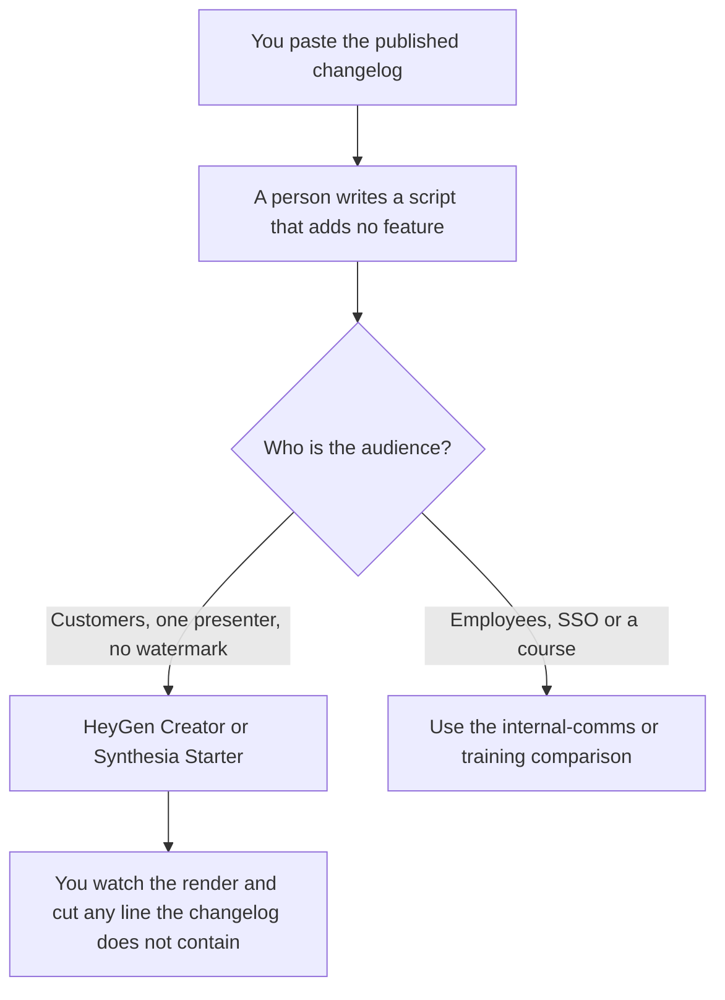

**Use HeyGen Creator or Synthesia Starter, both $29 a month on the monthly cards, when one person needs a short product-update clip with the watermark gone. Pick HeyGen when the clip is one presenter's update and 1080p is on the Creator card. Pick Synthesia when the yearly Starter price on the card, shown at $19 a month, is the bill you want and the script is already a template.** The all-hands decision is [Synthesia vs HeyGen for internal comms](/blog/synthesia-vs-heygen-for-internal-comms-2026/). The course decision is [Synthesia vs HeyGen for training](/blog/synthesia-vs-heygen-for-training-2026/). This page is the customer-facing or in-product clip that says what shipped.

The words in the clip come from a list you already published. That list is [how to write a changelog with AI](/blog/how-to-write-a-changelog-with-ai-2026/). The email that points at the same change is [how to create a feature announce email with AI](/blog/how-to-create-a-feature-announce-email-with-ai-2026/).

Prices are US list prices excluding tax from directory pages checked October 16, 2026. Published October 24, 2026. We did not score avatars, lip sync, or languages.

## Which plan matches the update

| The clip you actually need | Start here | What you still do |
|---|---|---|
| A test, watermark acceptable | [HeyGen](/tools/heygen/) Free, 3 videos a month up to 1 minute, or [Synthesia](/tools/synthesia/) Basic, 10 minutes and 500 credits, watermarked | You do not send a watermarked clip to customers |
| One owner, no watermark, monthly | HeyGen Creator at $29, or Synthesia Starter at $29 billed monthly | The script is the changelog. You read it aloud in the draft before you render |
| Starter, paid yearly | Synthesia's card shows $19 a month with yearly billing | Confirm the toggle. $19 is the yearly reading, not a second monthly price |
| 4K or a faster render | HeyGen Pro at $49 a month, 1,000 credits | A product update rarely needs 4K. Read the credit receipt |
| A team, SSO, or an LMS | HeyGen Business at $149, extra seats $20, or Synthesia Enterprise, custom | That is the internal-comms or training page if the audience is employees |

Synthesia Pro is $89 a month billed monthly, with 6,000 credits, and higher credit tiers exist up to $676 a month on the card. A two-minute update does not need that tier until the credit receipt says Starter is short. HeyGen's free plan is a test, not a customer channel. Synthesia Basic is watermarked. The customer clip starts on the first paid plan that removes the mark.

## What the script may say

The features in the changelog, the date you shipped them, and the place the viewer should look. It may not add a roadmap item, a metric, or a promise the changelog does not make. If the avatar says "most customers," the script is wrong unless you supplied that figure. Product updates go stale. Put the version or the date in the first line so a person can pull the clip later.

**HeyGen Creator** at $29 includes 600 credits, 30-minute videos, 1080p, watermark removal, and voice cloning, on the monthly card. Yearly billing exists. The invoice is [HeyGen pricing explained](/blog/heygen-pricing-explained-2026/).

**Synthesia Starter** at $29 billed monthly includes 1,250 credits, downloads, and logo removal, with 125+ avatars on the card. The $19 figure is the yearly reading the directory shows. The invoice is [Synthesia pricing explained](/blog/synthesia-pricing-explained-2026/).

**A cut of a recording you already have** is [Descript](/tools/descript/) Hobbyist at $16 a person a month billed annually, when the update is a human on camera and you are removing a retake. An avatar is the wrong tool for that file.

**The script's home** can be a page in [Notion AI](/tools/notion-ai/) on Business at $20 a seat a month, next to the changelog, so the next update starts from the last script instead of from memory.

A prompt that holds the line:

"Write a 60-second product-update script from the changelog I pasted. Use only items in that changelog. Open with the version or the date. Do not add a metric, a roadmap item, or a greeting that names a customer. If the changelog is empty, write Missing."

## What not to delegate

Do not let the avatar announce a feature that is behind a flag you have not turned on. Do not translate the clip into a language you will not have a person review. Synthesia's one-click translation into 140+ languages is an Enterprise line on the card. A translation nobody checked is a second product update you did not mean to ship. Do not send the clip instead of the changelog. The clip points at the changelog. The changelog remains the record.

## FAQ

### Which avatar looks more like a product manager?

We did not score that. Pick the plan that removes the watermark at the length you need, then read the script against the changelog. A realistic avatar reading an unshipped feature is a worse update than a plain email.

### Is $29 the same product at both companies?

No. Both entry paid plans are $29 on the monthly cards we used, and the included minutes, credits, and resolution differ. HeyGen Creator states 1080p and 600 credits. Synthesia Starter states 1,250 credits and logo removal. Compare the receipt on one real update, not the headline price.

### Do we need Business or Enterprise for a customer clip?

Not for one presenter and a published changelog. Business and Enterprise are the rows for SSO, a brand kit on Synthesia's Enterprise card, SCORM, or a team seat. If the update is an all-hands, use the internal-comms comparison. If it is a course, use the training comparison.

### Can the model write the changelog and the script together?

Write the changelog first, with a person checking every line. Then write the script from that text. Combining them is how a feature that is not shipped yet ends up in the video. The release gates are a different list: [how to write a release checklist with AI](/blog/how-to-write-a-release-checklist-with-ai-2026/).

## Last verified

October 16, 2026 for HeyGen, Synthesia, Descript, and Notion AI. Published October 24, 2026.

**Sources:** [HeyGen pricing](https://www.heygen.com/pricing), [Synthesia pricing](https://www.synthesia.io/pricing), [Descript pricing](https://www.descript.com/pricing), [Notion pricing](https://www.notion.com/pricing).

*Published by Andrew for [AI Tools Optimizer](https://aitoolsoptimizer.com).*

[HeyGen](/tools/heygen/) is in the [video directory](/tools/category/video/). Directory pages may use affiliate links. A purchase through them may earn us a commission at no extra cost to you.
