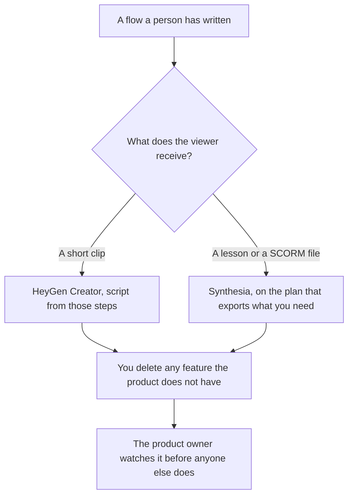

**Use HeyGen when the walkthrough is a short presenter clip and the script is a flow a person already wrote. Use Synthesia when that same flow has to be a lesson, with chapters or a quiz, on the plan that includes the export you need.** The avatar may speak the steps. It may not add a feature, a price, or a button the product does not have. A policy lesson is [HeyGen vs Synthesia for policy training](/blog/heygen-vs-synthesia-for-policy-training-2026/). A help-center clip is [HeyGen vs Synthesia for support videos](/blog/heygen-vs-synthesia-for-support-videos-2026/).

HeyGen and Synthesia prices below are the October 24, 2026 pricing-page figures already recorded in the policy-training article, which fetched those pages that day. Notion and Descript prices are from directory pages checked October 16, 2026. Published October 24, 2026. We did not score lip sync or completion. This page does not re-fetch a price the earlier article could not confirm.

## Which walkthrough you are shipping

| The piece | Start here | First paid step | The script |
|---|---|---|---|
| A short clip beside the product page | [HeyGen](/tools/heygen/) Free, 3 watermarked videos a month, up to 1 minute | Creator is $29 a month | The steps a person wrote, cut to the length you can check |
| The same short clip on Synthesia's monthly card | [Synthesia](/tools/synthesia/) Basic, watermarked | Starter is $29 a month billed monthly | The same steps |
| A lesson with chapters, a quiz, or SCORM | Synthesia | Enterprise is where the October 24 page put SCORM export | The approved lesson, not a feature tour the model invented |
| The written steps people can still read | [Notion AI](/tools/notion-ai/) | Business is $20 a seat a month | The page is the source. The video does not replace it |

HeyGen's October 24 page, as recorded that day, lists Pro at $49 a month and Business at $149 a month, and says yearly billing includes 2 months free. Business lists SCORM export. If you need SCORM, Creator is the wrong stop. The invoice is [HeyGen pricing explained](/blog/heygen-pricing-explained-2026/).

Synthesia's October 24 page lists Pro at $89 a month billed monthly. The October 16 directory record showed Starter at $19 a month with yearly billing. The October 24 fetch did not reproduce that yearly sticker cleanly. Use checkout for the yearly price. The invoice is [Synthesia pricing explained](/blog/synthesia-pricing-explained-2026/).

## What the clip may say

Only steps the product owner has accepted, in the order the product actually uses. A walkthrough that adds "you can also export to the warehouse" will become the documentation. If the page is silent, the script stays silent. Update the page first, then regenerate.

**HeyGen Creator** fits a two-minute path through a screen a person could also click. Keep the script short enough that you can watch every sentence against the product.

**Synthesia Starter** fits that same clip on the monthly card. Move up when the learning system requires the lesson tools. Do not buy a translation tier so the model can invent a localized feature.

**Notion Business** holds the written steps. **[Descript](/tools/descript/)** Hobbyist is $16 a person a month billed annually, on the October 16 card, if you need to cut a recording you already have. The invoice is [Descript pricing explained](/blog/descript-pricing-explained-2026/). A cut still cannot add a step.

A prompt that holds the line:

"Turn these product steps into a spoken script. Use only the steps I pasted. Do not add a feature, a price, or a button. If a step has no text, write Step missing."

## What not to delegate

Do not ask the model what the product should do next. Do not publish a clip the owner has not watched against the current build. Do not put a customer's data on the screen you record.

## FAQ

### Which avatar explains a product more clearly?

We did not score that. Pick HeyGen when the output is a short clip on Creator. Pick Synthesia when the output is a lesson or a SCORM package. Watch one sample against the written steps before you buy a larger credit tier.

### Do I need SCORM for a walkthrough?

Only if the learning system requires a SCORM package. A link on the product page is not SCORM. The October 24 pages put SCORM on HeyGen Business and Synthesia Enterprise. Read the row before you assume Creator or Starter exports it.

### What if the product changes next week?

The owner updates the written steps, then you regenerate. A model does not "refresh the tour" from memory of an older build. The page and the clip have to match the build you are willing to show.

### Who may approve the script?

The person who owns the product surface in the clip. A finished video is not approval. A missing step is better than a step the product does not have.

## Last verified

October 24, 2026 for the HeyGen and Synthesia figures recorded from their pricing pages that day. October 16, 2026 for Notion and Descript, and for the older Synthesia yearly Starter figure the later fetch did not confirm. Published October 24, 2026.

**Sources:** [HeyGen pricing](https://www.heygen.com/pricing), [Synthesia pricing](https://www.synthesia.io/pricing), [Notion pricing](https://www.notion.com/pricing), [Descript](https://www.descript.com).

*Published by Andrew for [AI Tools Optimizer](https://aitoolsoptimizer.com).*

[HeyGen](/tools/heygen/) is in the [video directory](/tools/category/video/). Directory pages may use affiliate links. A purchase through them may earn us a commission at no extra cost to you.
