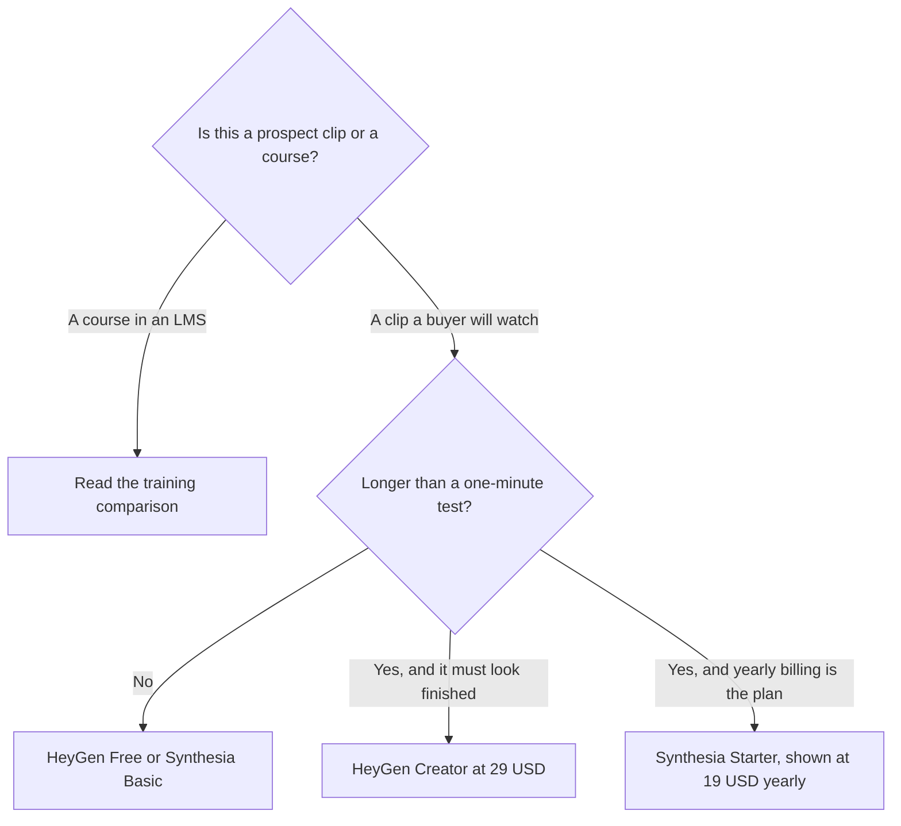

**For a short sales video a prospect will see, start with HeyGen Creator at $29 a month when you need 1080p, no watermark, and voice cloning on a self-serve plan. Use Synthesia Starter when you want its yearly rate and you have already accepted the credit math for short clips.** Do not buy either tool's training package to send a 60-second follow-up. SCORM, learner seats, and an LMS are a different purchase.

The general comparison, which mixes marketing and training, is [HeyGen vs Synthesia](/blog/heygen-vs-synthesia-2026/). The course angle is [Synthesia vs HeyGen for training](/blog/synthesia-vs-heygen-for-training-2026/). This page is only the sales motion: a personalized clip after a call, a one-to-many sequence, or a demo follow-up. We did not score which avatar looks more human.

Prices are US list prices from directory pages checked October 16, 2026. Published October 24, 2026.

## The sales job, side by side

| Sales job | Lean toward | Why, on the pricing page |
|---|---|---|
| A 60 to 90 second follow-up, one rep, no watermark | [HeyGen](/tools/heygen/) Creator at $29 a month | 1080p, watermark removal, voice cloning, videos up to 30 minutes, 600 credits |
| You want to see if an avatar belongs, this week | HeyGen Free, or [Synthesia](/tools/synthesia/) Basic | HeyGen Free is 3 videos a month, up to 1 minute. Synthesia Basic is 10 watermarked minutes and 500 credits |
| A named yearly sticker under $29 | Synthesia Starter, shown as $19 a month on yearly billing | Monthly Starter is $29. Yearly is the discount. Confirm credits before you promise a sequence |
| 4K for a booth loop | HeyGen Pro at $49 a month | 4K and 1,000 credits are listed on Pro |
| SCORM, SSO, brand kits, learner seats | Neither, for this job | Those are HeyGen Business at $149, or Synthesia Enterprise. The training post covers them |
| You can film yourself | [Descript](/tools/descript/) | An avatar is the wrong tool when the rep will be on the next call anyway |

## What a sales team actually spends

HeyGen Creator is the self-serve plan that removes the watermark and adds cloning and 175+ languages. Free is a one-minute test, three times a month. That can prove the format. It cannot run a weekly outbound sequence. Pro at $49 is the 4K step, not the default for a webcam-sized follow-up. Business at $149 is where SSO, SCORM, and extra seats at $20 a month show up. A sales pod does not need SCORM to email a prospect.

Synthesia Starter is $29 month-to-month and was shown at $19 a month on yearly billing. Pro at $89 a month with 6,000 credits is a volume plan. Enterprise is where 1-click translation into 140+ languages, Brand Kits, SAML/SSO, unlimited minutes, and SCORM sit together. Learner seats at $29 per learner per month are a training line. A prospect is not a learner seat.

Credits matter more than the $29 sticker. Synthesia's card describes video at about 100 credits a minute and dubbing at about 76 a minute, after the first 10 minutes included on every plan. A two-minute prospect clip is on the order of 200 credits if you are past those included minutes. Starter's 1,250 credits can hold a handful of those clips, not a personalized video for every account in a territory. Estimate the month before you pick the pack. The full ladders are [HeyGen pricing explained](/blog/heygen-pricing-explained-2026/) and [Synthesia pricing explained](/blog/synthesia-pricing-explained-2026/).

## What the clip still needs from a person

The script has to be true. An avatar will say the wrong price as confidently as the right one. Pull the offer from the one-pager you already approved. That page is [how to write a sales one-pager with AI](/blog/how-to-write-a-sales-one-pager-with-ai-2026/). Do not let the video invent a discount the one-pager does not contain.

Consent matters for a likeness. A custom avatar of a rep is that person's face. Have permission, and a plan for when they leave. Disclose the synthetic presenter when your platform or your buyer requires it.

If the "video" is really a leave-behind deck, use a slide tool. [Gamma](/tools/gamma/) Plus is $9 a seat a month. The format choice against an add-in is [Plus AI vs Gamma](/blog/plus-ai-vs-gamma-2026/). Voice-only, with no face, is [ElevenLabs](/tools/elevenlabs/) Starter at $6 a month, which includes a commercial license on the directory card. The card is [ElevenLabs pricing explained](/blog/elevenlabs-pricing-explained-2026/).

The sales stack around the clip, which is the CRM and the sequence rather than the avatar, is [best AI tools for sales teams](/blog/best-ai-tools-for-sales-teams-2026/). A partner video is a different audience: [best AI tools for partnerships teams](/blog/best-ai-tools-for-partnerships-teams-2026/).

## FAQ

### Which is cheaper for a sales pod?

At monthly billing, both first paid plans list $29. Synthesia shows Starter at $19 on yearly billing. HeyGen's next step is Pro at $49. Cheaper fails if the watermark is still on, or if the credit pack cannot cover the number of clips you will actually send. Count clips, then compare.

### Should sales buy HeyGen Business or Synthesia Enterprise?

Buy those when IT requires SSO or the video is a course. A prospect follow-up does not become a course because the file is an MP4. Read the training comparison before you book that call with sales at the vendor.

### Can we generate a unique avatar video per lead?

You can until the credits run out. A territory of hundreds of accounts is a credit plan, not a $29 afterthought. Write the monthly count down before the rep promises it in a forecast meeting.

### Is a screen recording a better sales video?

Often, yes. Descript Hobbyist is $16 a person a month billed annually when you are editing a real recording. Use an avatar when you will not film, the script is approved, and the likeness is allowed. The product page is [Descript review](/blog/descript-review-2026/).

## Last verified

October 16, 2026 for HeyGen, Synthesia, Gamma, ElevenLabs, and Descript prices named above. Published October 24, 2026.

**Sources:** [HeyGen pricing](https://www.heygen.com/pricing), [Synthesia pricing](https://www.synthesia.io/pricing), [Descript pricing](https://www.descript.com/pricing).

*Published by Andrew for [AI Tools Optimizer](https://aitoolsoptimizer.com).*

[HeyGen](/tools/heygen/) is in the [video directory](/tools/category/video/). Directory pages may use affiliate links. A purchase through them may earn us a commission at no extra cost to you.
