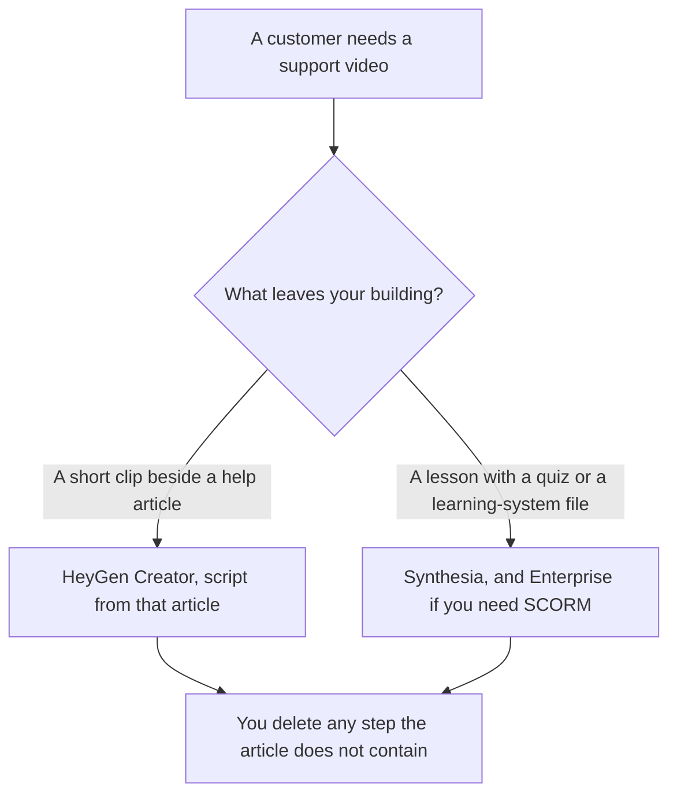

**Use HeyGen when the support video is one short how-to a customer watches, and the script is a help article you already published. Use Synthesia when the same topic has to be a lesson with a quiz, a survey, or a SCORM file for a team that trains in a learning system.** The product-update clip, which announces a change, is [HeyGen vs Synthesia for product updates](/blog/heygen-vs-synthesia-for-product-updates-2026/). The course decision is [Synthesia vs HeyGen for training](/blog/synthesia-vs-heygen-for-training-2026/).

Prices are US list prices excluding tax from directory pages checked October 16, 2026. Published October 24, 2026. We did not score avatars, lip sync, or completion rates.

## Which support video you are making

| The video | Start here | First paid step | The script |
|---|---|---|---|
| A one-to-three minute how-to on a help article | [HeyGen](/tools/heygen/) Free, 3 videos a month up to 1 minute, watermarked path on the card | Creator is $29 a month for 1080p and watermark removal | The published article, cut down |
| The same how-to, and you want Synthesia's yearly card | [Synthesia](/tools/synthesia/) Basic, watermarked, 10 minutes and 500 credits a month | Starter is $29 a month, shown as $19 a month with yearly billing | The same article |
| A lesson with a quiz or SCORM | Synthesia | Pro is $89 a month. SCORM export is on Enterprise, on the directory card | The approved lesson, not a ticket |
| A filmed troubleshooting clip you already shot | [Descript](/tools/descript/) | The Descript article for that job | The footage |

HeyGen Free is a test, not a help center. One minute and a small monthly count will not cover a real article, and you still have to read the watermark rules on the card. Creator at $29 is the first seat that lists 1080p and watermark removal. Pro at $49 lists 4K. Business at $149 lists SSO, SCORM, and LMS integrations, with extra seats at $20 a month, on the directory card. If the requirement is SCORM, do not stop at Creator. The invoice is [HeyGen pricing explained](/blog/heygen-pricing-explained-2026/).

Synthesia Basic carries a watermark. Starter at $29 monthly, or the $19 yearly figure on the card, removes the logo and allows downloads. Pro at $89 is the larger credit pool. Enterprise is where the directory puts 1-click translation into 140+ languages and SCORM export. The invoice is [Synthesia pricing explained](/blog/synthesia-pricing-explained-2026/). The training workflow is [how to make training videos with Synthesia](/blog/how-to-make-training-videos-with-synthesia-2026/).

## What the clip may say

Only steps that are in the published help article, or in a lesson a person has approved. A video that adds a workaround the article does not contain will create tickets. The article workflow is [how to build a help center with AI](/blog/how-to-build-a-help-center-with-ai-2026/). Update the article first. Then regenerate the clip.

**HeyGen Creator** fits a presenter-style answer: where to click, what you should see, when to stop and contact support. Keep it short enough that the credit math on the pricing article still matches a month of articles, not one hero video.

**Synthesia Starter** fits the same clip when you want that card's yearly price. Move up when you need the lesson tools. Do not buy Enterprise for a three-step password reset.

**Descript** fits when you already have a screen recording and you need to cut it. An avatar is the wrong tool for footage you shot.

A prompt that holds the line:

"Turn the help article I pasted into a spoken script. Use only steps that are in the article. Do not add a workaround. End with the support contact line I pasted, or write Contact missing."

## What not to delegate

Do not let the avatar invent a menu name. Do not publish a clip that outruns the article. Do not put a customer's real account on screen. A sample account you created for training is the fixture. Likeness and consent rules for a custom avatar are the vendor's, and they are yours to follow before you upload a face.

## FAQ

### Which avatar looks more helpful?

We did not score that. Pick HeyGen for a short public how-to on Creator. Pick Synthesia when the output is a lesson or a SCORM package. Watch one sample on the free or watermarked plan and read it against the article.

### Are both $29 plans the same?

Both monthly entry paid cards are $29 on the directory record checked October 16, 2026. Synthesia's card also shows Starter at $19 a month with yearly billing. The feature lists differ. Read the pricing articles before you treat them as substitutes.

### Where does SCORM live?

Synthesia's directory card puts SCORM export on Enterprise. HeyGen's card puts SCORM and LMS integrations on Business at $149 a month. If a learning system is the requirement, price that tier, not the $29 card.

### Can I write the script in a chat first?

Yes, from the article, with the prompt above. [Notion AI](/tools/notion-ai/) Business at $20 a seat a month is enough if the article already lives there. The video tool does not get a second copy of the facts.

## Last verified

October 16, 2026 for HeyGen, Synthesia, and Notion. Published October 24, 2026. Credit math changes with video length. Price a real article before you pick a tier.

**Sources:** [HeyGen](https://www.heygen.com), [Synthesia](https://www.synthesia.io), [Notion pricing](https://www.notion.com/pricing).

*Published by Andrew for [AI Tools Optimizer](https://aitoolsoptimizer.com).*

[HeyGen](/tools/heygen/) is in the [video directory](/tools/category/video/). Directory pages may use affiliate links. A purchase through them may earn us a commission at no extra cost to you.
