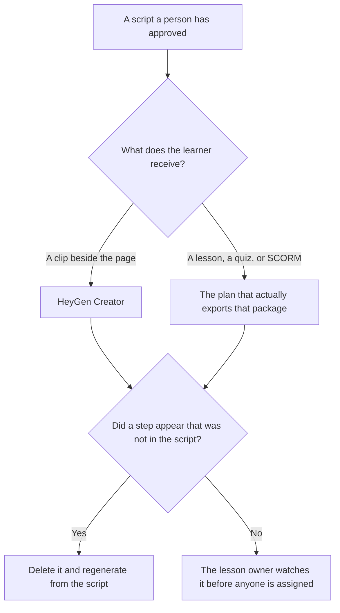

**Use HeyGen when the training module is a short clip a person watches beside a page you already wrote. Use Synthesia when the module has to be a lesson with a quiz, a survey, or a package your learning system accepts.** The avatar may speak the script. It may not add a step, an exception, or a passing score the script does not contain. A policy announcement, which is one page read aloud, is [HeyGen vs Synthesia for policy training](/blog/heygen-vs-synthesia-for-policy-training-2026/). The people who design the lesson are [best AI tools for learning designers](/blog/best-ai-tools-for-learning-designers-2026/).

HeyGen and Synthesia list prices below are the ones recorded from their pricing pages on October 24, 2026 in the policy-training article, and they match the October 16 directory cards on the monthly stickers this page quotes. Notion and Claude prices are stated with their own dates below. Published October 24, 2026. We did not score completion or lip sync.

## Which module you are building

| The module | Start here | First paid step | The script |
|---|---|---|---|
| A short clip beside the lesson page | [HeyGen](/tools/heygen/) | Creator is $29 a month | The approved script, cut to the length you can spare |
| The same clip on Synthesia's monthly card | [Synthesia](/tools/synthesia/) | Starter is $29 a month billed monthly | The same script |
| A quiz, a survey, or a SCORM package | Synthesia, or HeyGen's Business row | Synthesia's October 24 page puts SCORM on Enterprise. HeyGen's puts SCORM on Business at $149 a month | The approved lesson, including the questions you wrote |
| The page learners can still read | [Notion AI](/tools/notion-ai/) | Business is $20 a seat a month | The page is the source. The video does not replace it |

HeyGen Pro is $49 a month and Business is $149 a month on that October 24 record. Business is where SCORM and LMS integrations were listed, with extra seats at $20 a month. Creator removes the watermark and is the seat for a clip. Do not buy Business because the word "training" appeared. Buy it because the learning system requires the export.

Synthesia Pro is $89 a month billed monthly on that record, with 6,000 credits. The October 16 card showed Starter at $19 a month with yearly billing. The October 24 fetch did not reproduce that yearly sticker cleanly, so this page does not quote it. Learner seats were $29 per learner a month. Enterprise is where that fetch put SCORM, Brand Kits, and 1-click translation into 140+ languages. The invoice is [Synthesia pricing explained](/blog/synthesia-pricing-explained-2026/).

## What the module may teach

Only steps and checks the lesson owner has accepted. A module that adds "skip this if you are busy" will become the training. If the script is silent, the narration does not fill the silence with advice. Update the script first.

**HeyGen Creator** fits a presenter walking through a procedure you already wrote, when a link to the video is enough. Keep the length inside the plan you bought.

**Synthesia Starter** fits that same clip. Move up when you need the quiz, the survey, or SCORM. A two-minute reminder that also fits in the wiki does not need Enterprise.

**Notion Business** holds the script and the page. The invoice is [Notion AI pricing explained](/blog/notion-ai-pricing-explained-2026/).

**Claude Pro**, at $17 a month billed annually or $20 monthly on claude.com/pricing fetched October 24, 2026, can turn an approved outline into a spoken script. It may not add a step. The review is [Claude review](/blog/claude-review-2026/).

A prompt that holds the line:

"Turn the lesson I pasted into a spoken script. Use only steps from that lesson. Do not add a tip. End with the owner and the URL I pasted, or write Owner missing."

## What not to delegate

Do not ask the model what the course should teach. Do not assign a module the owner has not watched. Do not put a customer's name or a real incident in a training video. The quiz, if you need one, starts from questions a person wrote. The workflow is [how to create training quizzes with AI](/blog/how-to-create-training-quizzes-with-ai-2026/).

## FAQ

### Which avatar teaches more clearly?

We did not measure that. Pick HeyGen when the output is a clip. Pick Synthesia when the output is a lesson package your system can assign. Watch one sample against the script before you buy a larger credit tier.

### Do I need SCORM?

Only if the learning system requires it. A link is not SCORM. HeyGen's Business row and Synthesia's Enterprise row are where the October 24 pages put that export. Read the row before you assume Creator or Starter includes it.

### How is this different from a policy video?

A policy video reads a policy. A training module teaches a task, and it may include a check the learner must pass. The script is still human-approved. The policy article is the one to use when there is no task, only a rule.

### Who may assign the module?

The lesson owner, after they have watched it. Generating the video does not enroll anyone.

## Last verified

October 24, 2026 for the HeyGen and Synthesia stickers quoted from that day's pricing-page record, and for Claude. October 16, 2026 for Notion, and for the Synthesia yearly Starter figure this page refuses to repeat. Published October 24, 2026.

**Sources:** [HeyGen pricing](https://www.heygen.com/pricing), [Synthesia pricing](https://www.synthesia.io/pricing), [Notion pricing](https://www.notion.com/pricing), [Claude pricing](https://claude.com/pricing).

*Published by Andrew for [AI Tools Optimizer](https://aitoolsoptimizer.com).*

[HeyGen](/tools/heygen/) is in the [video directory](/tools/category/video/). Directory pages may use affiliate links. A purchase through them may earn us a commission at no extra cost to you.
