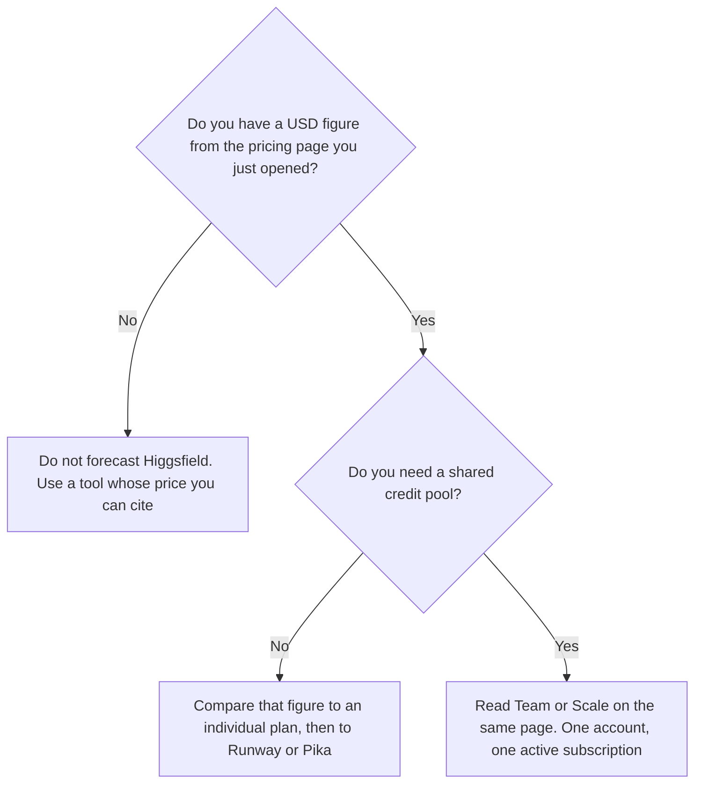

**Budget Higgsfield only after you read a dollar figure on higgsfield.ai/pricing.** The directory card checked October 16, 2026 describes a limited free tier, individual plans, and business plans named Team, Scale, and Enterprise. It says dollar prices are shown on the pricing page, and that review could not verify them. A later read of that page on October 24, 2026 did not return a price table. This article prints no USD amount, no credit count, and no discount percent.

The generators with prices we could record are [Runway pricing explained](/blog/runway-pricing-explained-2026/) and [Pika pricing explained](/blog/pika-pricing-explained-2026/). A paid-media license question against those two is [Runway vs Pika for UGC ads](/blog/runway-vs-pika-for-ugc-ads-2026/). Kling's recorded ladder is [Kling pricing explained](/blog/kling-ai-pricing-explained-2026/).

Published October 24, 2026. We did not score video quality. We did not subscribe.

## What the card does say

| Plan type | Who the card says it is for | What it says you get | What it does not say |
|---|---|---|---|
| Free tier | Exploring | A small set of models, and no credits | A dollar price, because it is the unpaid row |
| Individual plans | Solo creators | More models, monthly credits, parallel generation. Mid and top tiers add unlimited access to selected models | The USD price and the credit count |
| Team | Small teams | A shared workspace and pooled credits | A per-seat price |
| Scale | Growing teams | More credits per seat, a priority queue, SSO, and admin spend controls | A per-seat price |
| Enterprise | Large organizations | Custom credits and volume rollover | A list price |

The help-center note on the card says each account supports one active subscription. Upgrades and Credit Packs are how you add usage. Annual billing costs less per month than monthly, in the card's words. It does not say how much less. Do not invent a percent.

There is no free trial, on that card. The free tier can generate with a small set of models and includes no credits. A social test on the free tier is not a forecast of a paid month.

## How to read the unlimited line

Mid and top individual plans include unlimited access to selected models, meaning generations on those models do not deduct credits, in the card's words. "Selected" is the whole sentence. A model that is not on that list still spends credits. Before you treat unlimited as the plan, list the models your ads actually use and check them against the page you are buying from.

Credit Packs and auto top-ups are mentioned. Their prices are not on the card. Leave the overage line blank until the page you open prints it.

Tools named on the card include Genjutsu, Katana, and Ads Studio. Naming a tool is not a price. If the job is a licensed UGC-style ad and you need a number today, start with Pika's Creator row or Runway's published plans, then come back when Higgsfield's page shows a dollar.

## What not to assume

Do not convert a screenshot from another currency. Do not copy a credit price from Kling, Runway, or Pika and call it Higgsfield's. [Kling](/tools/kling-ai/) Standard on the directory card is $6.99 the first month, then $8.80 a month. That is Kling. [Runway](/tools/runway/) Standard is $12 a month billed annually. That is Runway. [Pika](/tools/pika/) Creator is $35 a month and is the row whose card states a commercial license. Those figures are here so a forecast has somewhere real to land while Higgsfield's sticker is unread.

ChatGPT and Claude integrations are listed on the card. They do not include a Higgsfield subscription. The assistant seat is a separate bill.

## FAQ

### How much does Higgsfield cost?

This page does not know, in USD, as of October 24, 2026. The October 16 directory card could not verify the pricing page, and a later fetch did not return one. Open higgsfield.ai/pricing and write down the plan name and the dollar figure you see.

### Is Higgsfield free?

You can generate without a paid plan, on a small set of models, with no credits, according to the card. There is no free trial. A production month is a paid plan whose price you still need to read.

### Can a team share one subscription?

Team, Scale, and Enterprise are the shared-workspace rows, with pooled credits. The card also says one active subscription per account. Read how seats work on the current page before you assume five people can share a solo plan.

### What is unlimited model access?

The card says mid and top plans include unlimited generations on selected models, and those generations do not deduct credits. It does not list the models here. Check the list on the plan you are about to buy, against the models you actually run.

## Last verified

October 16, 2026 for the plan types, from the directory card and Higgsfield's help center. October 24, 2026 for a pricing-page read that did not return dollar figures. Runway, Pika, and Kling comparisons use the October 16 directory check. Published October 24, 2026.

**Sources:** [How Higgsfield plans work](https://higgsfield.ai/creator-hub/help-center/plans/how-do-higgsfield-plans-work), [Higgsfield](https://higgsfield.ai).

*Published by Andrew for [AI Tools Optimizer](https://aitoolsoptimizer.com).*

[Higgsfield](/tools/higgsfield/) is in the [video directory](/tools/category/video/). Directory pages may use affiliate links. A purchase through them may earn us a commission at no extra cost to you.
