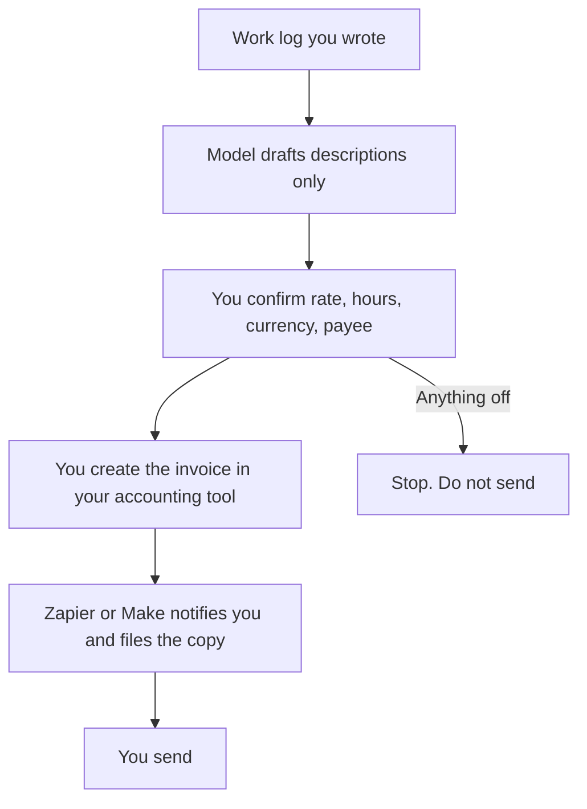

**Automate the copy-paste around an invoice, and leave the amount, the tax, and the send in a person's hands.** A workable loop is: your time log or delivery note goes in, a model drafts the line descriptions from that log, a checklist confirms rate and quantity, and Zapier or Make files the approved record and pings you. The model does not decide what the work was worth. It does not calculate tax. It does not change a bank detail.

This is a workflow article. It is not tax, accounting, or legal advice. Your accountant owns the tax treatment. Your accounting system owns the invoice of record. AI Tools Optimizer does not prepare invoices for you.

Prices are US list prices excluding tax, recorded October 16, 2026, except n8n's cloud price, which was shown in euros. The automation map is [Zapier vs Make vs n8n](/blog/zapier-vs-make-vs-n8n/). A broader build is [how to automate work with Zapier and Make](/blog/how-to-automate-work-with-zapier-and-make/).

## The jobs, separated

| Job | Who does it | Tool |
|---|---|---|
| Decide the rate, the discount, and whether the work is billable | You, from the contract | None |
| Turn a completed work log into line descriptions | A model, from the log you paste | [Claude](/tools/claude/) or [ChatGPT](/tools/chatgpt/) |
| Check quantity, rate, currency, and payee against the contract | You | A checklist in the invoice draft |
| Tax, invoice numbering, and the books | Your accounting tool and your accountant | The system you already file in |
| Move an approved draft into that system and notify you | A workflow | [Zapier](/tools/zapier/) or [Make](/tools/make/) |
| Send or charge the customer | You, inside the accounting tool | Not an unattended agent |

## Step 1: Write the log the model is allowed to see

A few lines per billable block: date, what shipped, quantity, the rate from the contract. Leave tax out of the log. Leave bank details out of the prompt. If the client is under an NDA, do not paste their confidential material into a consumer chat plan. A description can say "implementation, March" without pasting their data.

Claude Pro is $20 a month, or $17 billed annually. ChatGPT Plus is $20 a month. Either can draft. The habit of pasting sources and refusing invented facts is [how to write a blog post with Claude](/blog/how-to-write-a-blog-post-with-claude-2026/). An invoice description is a small version of that habit.

A prompt that stays in bounds:

> Draft invoice line descriptions from the log. Use only the dates, quantities, and rates in the log. Do not add tax, fees, or discounts. If a quantity is missing, write "missing" instead of estimating.

## Step 2: Approve a checklist, not a vibe

Before anything is filed, confirm:

- The payee matches the contract.
- The currency is the contract currency. This site talks about tools in USD. Your invoice uses whatever the contract says.
- Hours or quantities match the log, not a rounded suggestion.
- The rate matches the contract.
- No new bank account, payment link, or wallet address appeared. If a payment detail changed, verify it with the client out of band. An email that "updates ACH" is a common fraud pattern. An agent must not apply that change.
- Tax is whatever your accountant already set up in the accounting tool. Do not ask the model for a rate.

If any line fails, the automation stops. That is the design.

## Step 3: Connect the workflow to the approval, not to the send

[Zapier](/tools/zapier/) Free is 100 tasks a month, which covers a handful of invoices if each run is short. Professional is $19.99 a month billed annually, with 750 tasks, multi-step Zaps, and premium apps. Filters and paths do not count as tasks. [Make](/tools/make/) Free is 1,000 credits a month. Core starts at $9 a month billed annually for 10,000 credits.

A reasonable Zap:

1. Trigger when you move a draft to an "Approved" status in a table or a form you control.
2. Create or update the record in the accounting app Zapier already supports for your account.
3. Send yourself a link to review.
4. Stop. The send button stays manual until you have watched a month of correct drafts.

Do not trigger on "email arrived." Invoice and payment-detail fraud often starts in the inbox. [Lindy](/tools/lindy/) can draft from an inbox, and the review is [Lindy review](/blog/lindy-review-2026/). For money, keep it on drafts. Lindy's trial is $50 in credits for 7 days. Team starts at $49.99 a month for 5,000 credits. The general rule for agents is [how to create an AI agent without coding](/blog/how-to-create-an-ai-agent-without-coding/): a person approves anything that sends, pays, or deletes.

[n8n](/tools/n8n/) is the technical version. Cloud Starter was shown at €20 a month billed annually. The self-hosted Community Edition is free. Use it when someone on the team will maintain the workflow. The price is in euros because that is how the page was shown. We are not inventing a USD conversion.

## Step 4: Keep the archive the accountant can read

Store the approved log, the draft, and the invoice number in one place. [Notion AI](/tools/notion-ai/) is a reasonable archive if you already pay for Notion. Business is $20 a seat a month for full Notion AI. The archive is the point. An agent that answers questions about old invoices is optional, and it should be read-only.

Reconcile from the accounting tool, not from the chat. If the books and the chat disagree, the books win until your accountant says otherwise.

## What not to automate

- Tax classification, nexus, and what is deductible.
- A model-invented rate when the log is blank.
- Unattended sending, charging, or refunds.
- Any change to where money is deposited.
- Chasing a customer in a tone you have not approved. A reminder draft is fine. A threat is not, and it is not this article.

Freelancers who want the rest of the stack, proposals through delivery, can use [best AI tools for freelancers](/blog/best-ai-tools-for-freelancers-2026/). The invoice step is still the checklist above.

## FAQ

### Can AI create and send invoices by itself?

It can draft descriptions and a workflow can file an approved record. Sending and charging stay manual until you have a month of drafts that matched the contracts. Unattended send is how a wrong payee or a wrong amount goes out.

### Will this calculate sales tax?

No. Tax stays in the accounting tool your accountant configured. Asking a chatbot for a rate is how a confident wrong number lands on a customer. This article is not tax advice.

### Is Zapier or Make better for invoices?

Zapier is the broader app list, at $19.99 a month on the Professional annual price for 750 tasks. Make is usually the cheaper credit meter, from $9 a month on Core annual. Pick the one that already connects to your accounting app. The comparison linked above is the longer version.

### Can I paste client data into ChatGPT to write the lines?

Only what you have the right to paste, and nothing you would not put in an email to the model vendor. Prefer a log you wrote: dates, quantities, rates, and a short public description of the work.

## Last verified

October 16, 2026 for Zapier, Make, Claude, ChatGPT, Lindy, and Notion prices. n8n's €20 Starter figure is from the same check. Published October 24, 2026.

**Sources:** [Zapier pricing](https://zapier.com/pricing), [Make pricing](https://www.make.com/en/pricing), [n8n pricing](https://n8n.io/pricing/).

[Zapier](/tools/zapier/) and [Make](/tools/make/) are in the [automation directory](/tools/category/automation-agents/). Directory pages may use affiliate links. A purchase through them may earn us a commission at no extra cost to you.
