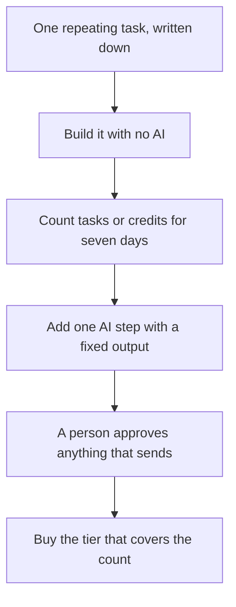

**Build the automation without a model first, count the meter for a real week, then add one AI step.** [Zapier](/tools/zapier/) charges tasks. [Make](/tools/make/) charges credits. The same form-to-sheet flow can fit Make's free plan and miss Zapier's, or the reverse, depending on how many actions you used. This guide builds that flow and does the arithmetic. The "which product" page is [Zapier vs Make vs n8n](/blog/zapier-vs-make-vs-n8n/).

Prices are US list prices checked October 16, 2026. Make's entry figures come from Make's comparison and help material, because the pricing page did not fully render in our check. Monthly billing costs more than the annual rates below. We did not invent a euro-to-dollar rate for n8n.

## The meters you will feel on day one

| | Zapier | Make |
|---|---|---|
| Free | 100 tasks/month, unlimited Zaps | 1,000 credits/month, no card, no time limit |
| What spends the meter | A successful action. Filters, Paths, and Formatter do not | Most module actions spend 1 credit. Some AI modules spend more. Routers and error handlers do not |
| Entry paid | Professional $19.99/month billed annually, 750 tasks, after a 14-day trial | Core from $9/month billed annually, from 10,000 credits |
| Next admin step | Team $69/month annual | Teams from $29/month annual, at the 10,000-credit tier |
| When you run out | Professional keeps running and bills overage per task | Scenarios pause until you add credits. Make warns you at 75% and 90% |

Product reviews: [Zapier](/blog/zapier-review-2026/) and [Make](/blog/make-com-review-2026/). Agents that are a role rather than a flowchart are in [how to create an AI agent without coding](/blog/how-to-create-an-ai-agent-without-coding/).

## Build 1: a lead lands in a sheet and a private Slack note

The job: a form submission adds a row, then posts a short note to a channel only your team sees. No email to the lead yet.

**On Zapier.** The trigger is the new form submission. Zapier describes a task as an action the Zap completes, and the examples are things like creating a contact. Treat the form trigger as not a task unless your task history says otherwise, and believe the history. Two actions, "create spreadsheet row" and "send Slack message," are two tasks per lead if both succeed. Filters, Paths, and Formatter stay free. Eighty leads in a month are 160 tasks. Free includes 100 tasks, so this Zap does not fit on Free. Professional's 750 tasks covers it. At three actions instead of two, 80 leads are 240 tasks, which still fits in 750 and still misses 100.

**On Make.** A module that reads, searches, or creates usually spends 1 credit. A four-module scenario (trigger, transform, sheet, Slack) is about 4 credits per lead if none of the modules is a router or an AI step. Eighty leads are 320 credits. Free includes 1,000 credits, so this scenario fits, with room for a second simple scenario. A router that splits "existing customer" and "new lead" does not, by Make's description, add a credit by itself. The modules on each branch do.

That is the whole comparison for this job. Make's free plan holds it. Zapier's free plan does not, once you are past about 50 two-action leads (100 tasks). Professional at $19.99/month annual is the Zapier fix. Core at $9/month annual is optional on Make until you outgrow 1,000 credits.

Write the field names down before you connect anything. If the sheet column is "email" and the form field is "Email address," the row will be wrong in a way no model will notice later.

## Build 2: add one classification, still with a human at the end

Add a single AI step that writes one of three labels, "sales," "support," or "other," plus a two-sentence summary a person will read. Do not let it reply to the customer.

**Zapier.** The AI action is another task if it completes successfully. Three billable actions on 80 leads are 240 tasks. Still inside Professional's 750. Two hundred leads are 600 tasks. Three hundred leads are 900 tasks, which passes 750. Professional charges per task after the limit, so a busy month does not stop. It invoices. Forecast the lead count before you call $19.99 the price. The model is a separate bill if the action uses your own API key. ChatGPT Plus is a poor place to run this unattended. An API key or ChatGPT Business, at $20/user/month annual, is the account to read the data terms on. See [which AI subscription is worth paying for](/blog/which-ai-subscription-is-worth-paying-for/).

**Make.** If the AI module spends 1 credit, five modules are 5 credits per lead, and 80 leads are 400 credits. Still inside the free 1,000. Make says some AI features spend more than one credit. Run ten real leads and read the credit drop before you multiply. If the drop is 8 credits per lead, 80 leads are 640, and 150 leads are 1,200, which pauses the free scenario until you buy credits. Core's 10,000-credit tier is the usual next step, from $9/month annual. Extra credits are sold in bundles. Scenarios do not keep running for free the way Zapier Professional's overage does.

Keep the output shape boring. A label from a list you wrote, and a summary no longer than two sentences. An open-ended "write a helpful email" is how the automation starts inventing policy.

## Build 3: the approval you leave in place

The Slack message should ask a person to send the reply, or it should save a draft. It should not email the lead because the label was "sales."

A Path or a Filter on Zapier can skip junk without spending a task. Use that for "email is empty" and "label is other." A router on Make can do the same split without a credit for the router itself.

Team features are not required for this build. Zapier Team at $69/month annual is shared folders, roles, and SAML SSO. Make Teams starts at $29/month annual at the 10,000-credit tier. Buy them when a second person must edit the connection, not when the first Zap feels important.

## Where n8n, Lindy, and Manus fit

[n8n](/tools/n8n/) charges cloud plans per workflow execution, and the self-hosted Community Edition is free. Cloud Starter was €20/month billed annually in the currency displayed to us. Use n8n when a developer will own the scenario or the data has to stay on your server. The review is [n8n Cloud](/blog/n8n-cloud-review-2026/). This guide does not convert that euro price into dollars.

[Lindy](/tools/lindy/) and [Manus](/tools/manus/) are agents. Use them when you cannot draw the modules in advance. Lindy's trial is $50 in credits for 7 days, no card, then Team from $49.99/month. Manus Free includes 300 refresh credits a day, and Pro starts at $20/month. They are a worse fit than Zapier for a flow a client will ask you to diagram.

## A week-long test

1. Pick one task you did by hand at least ten times last month.
2. Build Build 1 in the tool whose free meter can hold it. Use the arithmetic above with your volume, not ours.
3. Run it on live items for seven days. Fix wrong columns before you add a model.
4. Add the label-and-summary step. Record the new task or credit cost from the history, not from this article.
5. Subscribe to the smallest paid tier that covers that history with room. On Zapier, include overage in the forecast. On Make, assume the scenario will pause at zero.

## FAQ

### Is Zapier or Make better for beginners?

Zapier is the shorter path to a first Zap on common apps. Make is the cheaper free path for the lead-to-sheet example in this guide, because 1,000 credits hold a few hundred simple runs and Zapier's 100 tasks do not. The better beginner tool is the one that matches the apps you already have.

### Do AI steps cost extra?

They count as tasks on Zapier and as credits on Make, and some Make AI modules spend more than one credit. The language model can also be a separate API bill. Measure ten runs.

### Can I automate email replies safely?

Draft them. Send them yourself until a week of drafts is something you would have sent unchanged. An approval step is part of the build, not a later improvement.

## Last verified

October 16, 2026. Recheck [Zapier's pricing](https://zapier.com/pricing), [Make's pricing](https://www.make.com/en/pricing), and your task or credit history before you raise the tier.

Directory pages for [Zapier](/tools/zapier/) and [Make](/tools/make/) may include affiliate links. A purchase through them may earn us a commission at no extra cost to you.
