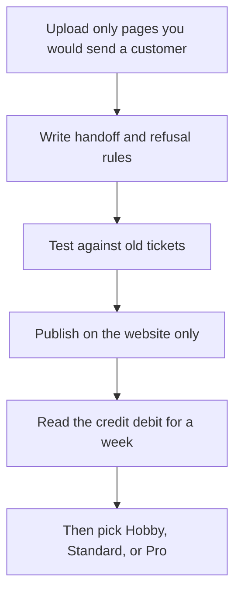

**A Chatbase agent is only as safe as the pages you upload and the questions you refuse.** The build is short: connect sources, write the handoff rules, test on real tickets, then publish to one channel. The bill is a message-credit pool, and branding removal is a separate annual add-on that costs more than the starter plan.

Prices are US list prices excluding tax, from Chatbase's pricing page as checked October 16, 2026, published here on October 24, 2026. A live refetch that day did not return the page. The product review is [Chatbase review](/blog/chatbase-review-2026/). Where this sits among help-desk agents is [best AI chatbots for business](/blog/best-ai-chatbots-for-business-2026/).

## The plan is a credit decision

| Plan | Yearly monthly rate | Month to month | Message credits | Training size |
|---|---|---|---|---|
| Hobby | $32 | $40 | 700 | 10 MB |
| Standard | $120 | $150 | 4,000 | 20 MB |
| Pro | $400 | $500 | 15,000 | 40 MB |
| Enterprise | Custom | Custom | Custom | Custom |

There is a 7-day trial, not a permanent free plan, on the page we checked. Extra credits are $40 per 1,000. An extra agent is $300 per agent per year. Removing "Powered by Chatbase" is $1,188 per year. One agent is included on the listed tiers.

Credits are spent when the agent responds. The pricing summary does not give a universal "one customer question equals one credit" rate for every action, so measure a week of test traffic before you lock a tier. Voice and extra channels show up as you leave the cheapest plan. Confirm the channel list in the current comparison before you promise WhatsApp on Hobby.

## Step 1: Upload the answers you already stand behind

Use the help center, the shipping page, the refund page, and the product constraints. Do not upload a brainstorming doc, a draft policy, or a salesperson's slide. The agent will say the draft in the same tone as the policy.

Keep the corpus small enough that a person can name what is in it. Hobby's 10 MB cap is a feature at this stage. If you need 40 MB to answer "where is my order," you do not need a larger plan. You need an action that looks the order up, or a human.

[Chatbase](/tools/chatbase/) can train on files and site pages, set guardrails, and run actions. An action is how a bot checks a real order status. A paragraph in the prompt that says "look up the order" does not look up the order.

## Step 2: Write the refusals before the greeting

In the instructions, state:

- The topics it may answer from the sources.
- The topics that always go to a person: billing disputes, legal threats, medical or safety claims, anything about a specific account if no action is connected.
- The sentence it should use when the sources do not contain the answer. "I don't have that" is the sentence. A plausible guess is the incident.
- The tone, in a few lines, not a brand manifesto.

Test those rules. Chatbase includes a way to test before you publish. Use ten real tickets from last month, including two the bot must refuse. If it answers the refusal tickets, you are not ready for the site embed. Fix the instructions or the sources. Do not raise the temperature and hope.

## Step 3: Publish one channel

Put it on the website chat first. WhatsApp, email, and Slack are real deployment options, and they multiply the ways a bad answer reaches someone. Add a channel after the website week looks like the test set.

Tell the visitor they are talking to an automated agent, and put a person in the handoff path during business hours. An agent with no handoff is a locked door with a friendly voice.

The annual branding-removal fee is $1,188. On Hobby, billed yearly, the software is $384 a year before that add-on. Removing the badge can cost more than the plan. Decide that on purpose. A small shop can leave the badge and spend the money on credits.

## Step 4: Read the meter, then change plans

Hobby's 700 credits is the right production plan only if a measured week, times four, fits inside it. If you are guessing, stay on the trial and the test credits until you have the number. Standard's 4,000 is the next pool, at $120 on yearly billing. Pro's 15,000 at $400 is a volume plan. Buying Pro because the demo felt impressive is how the tool gets a reputation for being expensive.

Auto-recharge exists. Turn it on only with a cap you can see. An uncapped recharge on a public widget is a traffic spike with an invoice attached.

## When Chatbase is the wrong build

| Situation | Use instead |
|---|---|
| You already run Zendesk or Intercom and want resolutions priced per outcome | [Intercom Fin](/tools/intercom-fin/). $49/month includes 50 outcomes, then $0.99 an outcome |
| You want live chat, tickets, and a small AI allowance in one inbox | [Tidio](/tools/tidio/). Starter is $24.17/month billed annually, with 100 billable conversations and 50 one-off Lyro conversations |
| The "bot" is an internal assistant over your wiki | [Notion AI](/tools/notion-ai/) on the Business plan, at $20/seat/month. That is not a customer widget |
| You want a general agent you design without a support corpus | The no-code agent overview is [how to create an AI agent without coding](/blog/how-to-create-an-ai-agent-without-coding/) |

[Zendesk AI](/tools/zendesk-ai/) belongs in this decision when the help desk is already Zendesk. The seat price starts at $19 per agent per month on yearly billing for Support Team, and the AI agent products sit on higher suites. Do not add Chatbase and a suite agent on the same queue until one of them has failed a test you can describe.

## FAQ

### How much does a Chatbase chatbot cost?

Hobby is $32/month billed yearly or $40 monthly, with 700 message credits. Standard is $120 or $150, with 4,000 credits. Pro is $400 or $500, with 15,000. Extra credits are $40 per 1,000. Removing the badge is $1,188 a year.

### Is there a free Chatbase plan?

The page we checked lists a 7-day trial, not a free forever plan. Use the trial to measure credits. Do not launch a store on the last day of a trial without a plan selected.

### Can it answer order-status questions?

Only if you connect an action that returns the order, and you have tested it. A prompt cannot see your database. If the action is wrong, turn it off and hand those chats to a person.

### How do I stop it from inventing policy?

Upload the policy you will honor, tell it to refuse when the answer is absent, and test with tickets it must not answer. Review the transcripts in the first week as if they were a new hire.

## Last verified

October 16, 2026 for Chatbase prices. Published October 24, 2026. The pricing page did not return a fresh fetch that day. Channel availability by plan should be rechecked in the live comparison before you promise a channel to a customer.

**Sources:** [Chatbase pricing](https://www.chatbase.co/pricing), [Chatbase](https://www.chatbase.co), [Intercom Fin pricing](https://fin.ai).

[Chatbase](/tools/chatbase/) is in the [customer support directory](/tools/category/customer-support/). Directory pages may use affiliate links. A purchase through them may earn us a commission at no extra cost to you.
