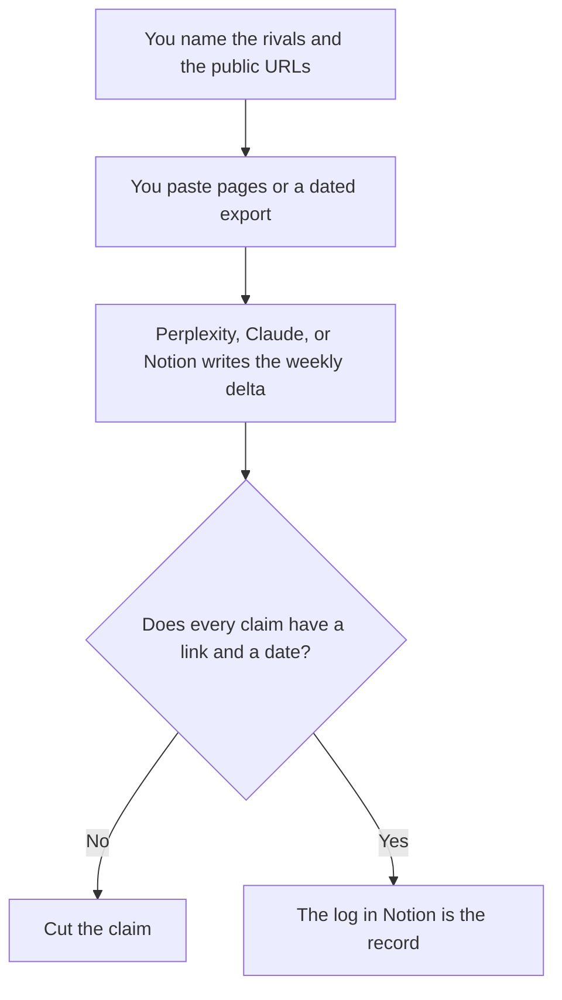

**A competitor tracker built with AI is a log of public changes you decided to watch, summarized only from sources you opened.** The model can turn three pricing pages and a changelog into a weekly note. It cannot know a competitor's private roadmap, and it should not be pointed at a login, a paywall, or someone's inbox. If you cannot link the source, the row does not go in the log.

The one-off version is [how to use AI for competitive analysis](/blog/how-to-use-ai-for-competitive-analysis-2026/). A research habit that is broader than rivals is [how to build an AI research digest](/blog/how-to-build-an-ai-research-digest-2026/). The claim check is [how to fact-check AI writing](/blog/how-to-fact-check-ai-writing-2026/).

Prices are US list prices excluding tax. Perplexity's annual prices are from pages read October 24, 2026. Other figures are from directory pages checked October 16, 2026, unless a pricing explainer gives a later date. Published October 24, 2026. We did not score competitive intelligence.

## What the tracker is allowed to hold

| Column | Source | The model may |
|---|---|---|
| Pricing | The public pricing page, with the date you read it | Quote the cell. It may not "recall" last quarter |
| Packaging | That same page | Note what moved. It may not guess why |
| Changelog or docs | The public log | Summarize the lines you pasted |
| AI-answer presence | A tracker you pay for, or a query you ran and saved | Report the saved result |
| A rumor | Nowhere, until you have a link | Leave it out |
| A private deck or a scraped login | Not this system | Refuse the row |

Open the page. Save the date. A model that "knows" a competitor's price from training data is reciting a memory, not reading this morning's card. Prices change. The log without a date is how sales quotes a plan that was retired.

## Which tool watches which column

**Cited answers from the public web.** [Perplexity](/tools/perplexity/) Pro is $17 a month billed annually. Free is the test, with a tight Pro Search allowance recorded in [Perplexity pricing explained](/blog/perplexity-pricing-explained-2026/). Use it to find the page. Then open the page. The research split against a paper tool is [Perplexity vs Elicit for research](/blog/perplexity-vs-elicit-for-research-2026/). Elicit will not watch a pricing page. Do not ask it to.

**Whether AI answers mention you.** [Writesonic](/tools/writesonic/) Starter is $79 a month billed annually for 50 prompts, with daily answer tracking, on the October 24 pricing read. That is a monitoring quota. It is not a writing seat. The card is [Writesonic pricing explained](/blog/writesonic-pricing-explained-2026/). Track buyer prompts, not vanity prompts.

**Search data, when you need a dataset.** [Semrush](/tools/semrush/) SEO is $139 a month, or $117.33 billed annually. Semrush One Starter is $199, or $165.17 annually, on the review. Buy it when the tracker needs keywords, ranks, and a real export. The review is [Semrush review](/blog/semrush-review-2026/). The aisle is [best AI SEO tools](/blog/best-ai-seo-tools-2026/).

**Account lists, when the "competitor" work is actually sales research.** [Clay](/tools/clay/) is a different invoice. The October 24 explainer shows Launch at $167 a month and Growth at $446 on the annual toggle, with sliders under those headlines. Do not add Clay because a wiki page felt thin. Add it when the row is an account list you are allowed to build. The card is [Clay pricing explained](/blog/clay-pricing-explained-2026/).

**The log itself.** [Notion AI](/tools/notion-ai/) Business is $20 a seat. One database: rival, URL, date, what changed, who checked it. [Claude](/tools/claude/) Pro at $20, or $17 billed annually, is the long paste of a changelog. [ChatGPT](/tools/chatgpt/) Plus at $20 is fine for a short delta. The page they write into is the wiki, not the chat. That home is [how to build an internal wiki with AI](/blog/how-to-build-an-internal-wiki-with-ai-2026/).

A prompt that holds the line:

"Compare these two pasted pricing pages. Quote every number. Date them with the dates I gave you. If a plan exists on only one page, say so. Do not explain strategy. Do not add a plan that is not in the paste."

## What you do with the week

Send a short note: what changed, the link, and whether it affects a live deal or a page you publish. A rival's new tier is not automatically your new tier. Strategy stays with a person. The writing, if you change your own page, still needs [how to fact-check AI writing](/blog/how-to-fact-check-ai-writing-2026/). The marketing stack around the tracker is [best AI tools for marketers](/blog/best-ai-tools-for-marketers-2026/). A content response, if you decide you need one, starts with [how to use AI for SEO briefs](/blog/how-to-use-ai-for-seo-briefs-2026/), not with a panicked rewrite.

Keep the set small. Five rivals and four URLs each will be maintained. Fifty rivals will become a dashboard nobody opens, full of undated claims.

## FAQ

### Can the tracker run itself every morning?

A scheduled pull of public pages can, if the tool you use is allowed to fetch them and a person still reads the delta before it is treated as fact. An agent that emails the company a strategy every morning will eventually assert a price it did not open. Keep the schedule on collection. Keep the judgment on a person.

### Is this scraping?

Reading a public pricing page, a docs changelog, and a blog, and storing the link, is ordinary research. Bypassing a login, a paywall, or a technical barrier is not this workflow. If a page is not public, it is not a row.

### Which single tool should I pay for first?

The log is free until you want Notion AI. Pay for Perplexity Pro when you are doing this most days and Free is the limit. Pay for Writesonic when AI-answer coverage is a report you must send. Pay for Semrush when you need the dataset. One of those, after the log exists. Not all three in the first week.

### How do I handle a price I cannot verify?

Leave the cell blank and write "not on the page I opened." A blank beats a remembered number. Update it when you can link it.

## Last verified

October 24, 2026 for Perplexity Pro at $17 annually and for Clay's Launch and Growth headlines as recorded in those explainers. October 16, 2026 for Writesonic, Semrush, Notion, Claude, and ChatGPT prices named above. Published October 24, 2026.

**Sources:** [Perplexity pricing](https://www.perplexity.ai/pro), [Writesonic pricing](https://writesonic.com/pricing), [Semrush pricing](https://www.semrush.com/pricing/).

*Published by Andrew for [AI Tools Optimizer](https://aitoolsoptimizer.com).*

[Perplexity](/tools/perplexity/) is in the [research and search directory](/tools/category/research-search/). Directory pages may use affiliate links. A purchase through them may earn us a commission at no extra cost to you.
