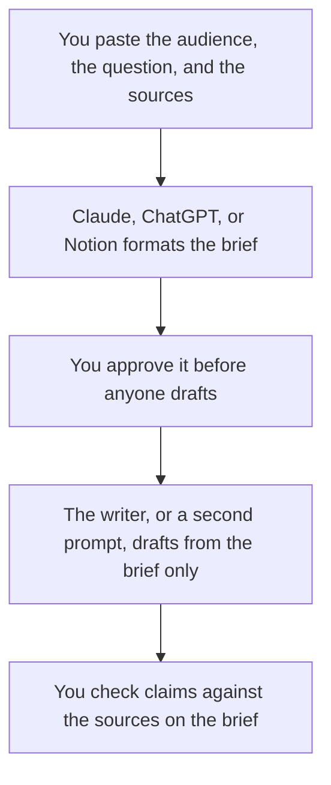

**A content brief written with AI is the assignment a writer can follow: who it is for, what it must answer, which sources are allowed, and what it must not claim.** The model can format that page. It cannot decide the angle, the offer, or the fact you are willing to publish. The article comes after the brief is approved.

If the brief is specifically a search outline built from keyword data you already pulled, use [how to use AI for SEO briefs](/blog/how-to-use-ai-for-seo-briefs-2026/). This page is the assignment even when search is only part of the job. The draft that follows, in one assistant, is [how to write a blog post with Claude](/blog/how-to-write-a-blog-post-with-claude-2026/). The fact pass is [how to fact-check AI writing](/blog/how-to-fact-check-ai-writing-2026/).

Prices are US list prices excluding tax from directory pages checked October 16, 2026. Published October 24, 2026. We did not score briefs.

## What the brief contains

| Field | Who fills it | The model may |
|---|---|---|
| Audience | You | Restate it. It may not widen it to "everyone" |
| Question | You, in one sentence | Keep it. It may not swap in a trendier question |
| Angle | You | Phrase it. It may not add a take you did not choose |
| Sources | Links or notes you trust | List them. It may not add a citation |
| Outline | The sections you want | Reorder for clarity. It may not add a section that needs a new fact |
| Out of scope | You | Repeat it at the top |
| Call to action | The offer you actually have | Place it. It may not invent a lead magnet |

A brief that says "make it SEO-friendly and comprehensive" will produce a long, vague draft. A brief that says "answer whether a five-person team should buy Notion Business or ChatGPT Plus, using only these price pages" can be reviewed. The price pages are the sources. The model does not get to remember a price. That discipline is [what a system of record for AI is](/blog/what-is-a-system-of-record-for-ai-2026/).

## Where it gets written

**The brief itself.** [Claude](/tools/claude/) Pro is $20 a month, or $17 billed annually. Keep the brief in a Project with the style rules. [ChatGPT](/tools/chatgpt/) Plus is $20. The container is [Claude Projects vs ChatGPT Projects](/blog/claude-projects-vs-chatgpt-projects-2026/). The ladder is [ChatGPT Go vs Plus vs Pro](/blog/chatgpt-go-vs-plus-vs-pro-2026/).

**A source you still need to find.** [Perplexity](/tools/perplexity/) Pro is $17 a month billed annually when the citation is the product. Open the link before it goes on the brief. A link you did not open is not a source. The market-research habit is [how to use Perplexity for market research](/blog/how-to-use-perplexity-for-market-research-2026/). The research-seat choice is [Gemini vs Claude for research](/blog/gemini-vs-claude-for-research-2026/).

**The library of briefs.** [Notion AI](/tools/notion-ai/) Business is $20 a seat if the calendar already lives in Notion. The page is the record. A chat is not. The card is [Notion AI pricing explained](/blog/notion-ai-pricing-explained-2026/).

**The prose of the brief, not the facts.** [Grammarly](/tools/grammarly/) Free covers grammar. Pro is $12 a member a month billed annually. Do not ask it which sources to allow. The card is [Grammarly pricing explained](/blog/grammarly-pricing-explained-2026/).

The words the draft must use are [how to create a style guide with AI](/blog/how-to-create-a-style-guide-with-ai-2026/). The reusable prompt that turns a brief into a draft belongs in [what a prompt library is](/blog/what-is-a-prompt-library-2026/).

A prompt that holds the line:

"Create a content brief with audience, question, angle, allowed sources, outline, out of scope, and call to action. Use only my notes. If a section needs a fact I did not give you, write MISSING. Do not add statistics, quotes, or competitors."

## Then stop

Approve the brief before you generate the article. A draft that invents a section is a brief that was skipped. Teams that publish every week can keep this to one page. The marketers' shelf is [best AI tools for marketers](/blog/best-ai-tools-for-marketers-2026/). The growth team's version of the same calendar is [best AI tools for growth teams](/blog/best-ai-tools-for-growth-teams-2026/).

The person who approves the angle is [what human-in-the-loop AI is](/blog/what-is-human-in-the-loop-ai-2026/).

## FAQ

### Is a content brief the same as an outline?

An outline is one field. The brief also names the audience, the sources, the forbidden claims, and the ask. An outline alone lets the draft wander into facts you did not approve.

### Can the same chat write the brief and the article?

Yes, after you approve the brief. Do it in that order. If you ask for both in one prompt, you will not get a chance to fix the angle before the prose hardens.

### How is this different from an SEO brief?

An SEO brief starts from queries and the pages that already rank, which is the other how-to. A content brief can include those notes. It can also be a story, a help article, or a launch post with no keyword in it. Use the page that matches the assignment.

### What if we do not have sources yet?

The brief should say MISSING, and someone should go get the source. Publishing from a brief with empty sources is how a statistic appears. The check is the fact-check how-to linked above.

## Last verified

October 16, 2026 for Claude, ChatGPT, Perplexity, Notion, and Grammarly prices named above. Published October 24, 2026.

**Sources:** [Claude pricing](https://claude.com/pricing), [Perplexity](https://www.perplexity.ai), [Notion pricing](https://www.notion.com/pricing).

*Published by Andrew for [AI Tools Optimizer](https://aitoolsoptimizer.com).*

[Perplexity](/tools/perplexity/) is in the [research and search directory](/tools/category/research-search/). Directory pages may use affiliate links. A purchase through them may earn us a commission at no extra cost to you.
