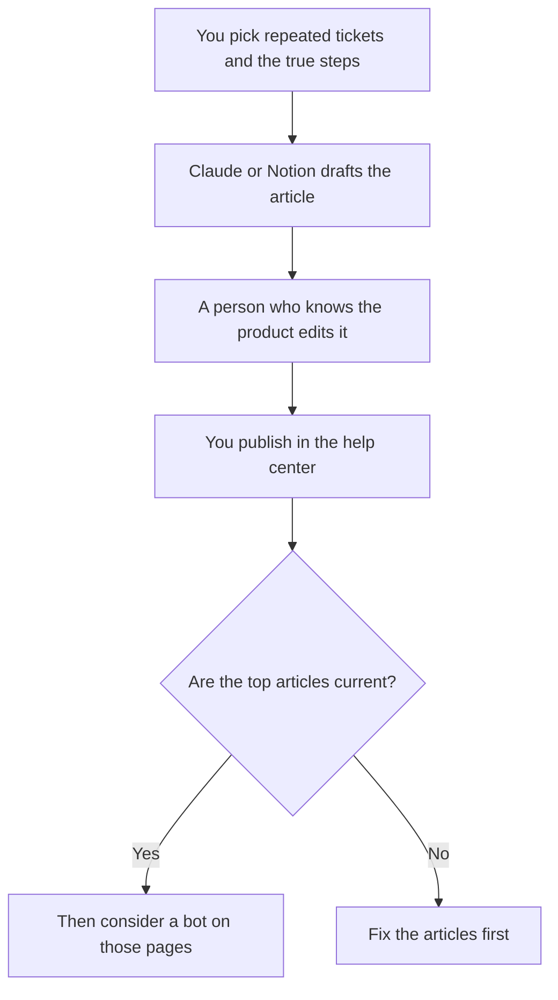

**A help center built with AI is a set of articles a person owns, drafted from tickets and product facts you paste, published where customers already look.** The model can turn a resolved ticket into a draft answer. It cannot decide the policy, and it should not be the only place the answer lives. A bot comes after the articles are current. The bot build is [how to build a knowledge-base chatbot](/blog/how-to-build-a-knowledge-base-chatbot-2026/). The article pattern is [how to create FAQ pages with AI](/blog/how-to-create-faq-pages-with-ai-2026/).

The support stack around the queue is [best AI tools for support teams](/blog/best-ai-tools-for-support-teams-2026/). The method a bot uses to quote a page is [what RAG is](/blog/what-is-rag-explained-2026/).

Prices are US list prices excluding tax from directory pages checked October 16, 2026. Published October 24, 2026. We did not score deflection rates.

## What the model may touch

| Piece | Who owns it | The model may |
|---|---|---|
| The question title | You, from real tickets | Phrase the question a customer would type |
| The steps | The product as it works today | Order steps you pasted. It may not add a menu that does not exist |
| The policy line | The policy owner | Quote it. It may not soften a limit |
| What this article will not do | You | Keep the boundary. It may not promise a workaround |
| The owner and the review date | You | Print them. It may not pick a teammate |

An article that describes last year's UI is worse than a gap, because a bot will quote it. The path from that sentence back to a page is [what AI data lineage is](/blog/what-is-ai-data-lineage-2026/).

## Where the article is written

**The draft from a long ticket.** [Claude](/tools/claude/) Pro is $20 a month, or $17 billed annually. Put the style guide for help articles in a Project: short steps, no marketing adjectives, a visible owner. The container is [Claude Projects vs ChatGPT Projects](/blog/claude-projects-vs-chatgpt-projects-2026/).

**The workspace, if the help center is a wiki you control.** [Notion AI](/tools/notion-ai/) Business is $20 a seat. Plus at $10 is not the full AI tier. Page history helps. An owner on the page helps more. The internal version of this habit is [how to build an internal wiki with AI](/blog/how-to-build-an-internal-wiki-with-ai-2026/). The card is [Notion AI pricing explained](/blog/notion-ai-pricing-explained-2026/).

**The desk you already run.** [Zendesk AI](/tools/zendesk-ai/) Suite Team is $55 per agent per month paid yearly, with AI agents and a knowledge base on the directory card. Support Team at $19 does not include those agents. Automated resolutions can bill on top. If Zendesk is already the help center, draft into it. Do not stand up a second wiki so a model has somewhere to write.

**A bot, after the pages exist.** [Chatbase](/tools/chatbase/) Hobby is $32 a month billed yearly, or $40 monthly, with 700 message credits. It answers from what you upload. [Intercom Fin](/tools/intercom-fin/) is $0.99 per outcome with a $49 a month base that includes 50 outcomes. The meter comparison is [Chatbase vs Intercom Fin pricing](/blog/chatbase-vs-intercom-fin-pricing-2026/). Neither bot fixes a wrong article.

A prompt that holds the line:

"Here is a resolved ticket and the steps that are true today. Draft a help article with a customer-phrased title, numbered steps, and a section called Limits. Use only these notes. If a step is missing, write Missing. Do not invent buttons, timeframes, or refunds. Add Owner: and Reviewed: as blank fields for me."

The person who publishes is [what human-in-the-loop AI is](/blog/what-is-human-in-the-loop-ai-2026/). A style sheet for the words is [how to create a style guide with AI](/blog/how-to-create-a-style-guide-with-ai-2026/).

## What to publish first

Publish the ten questions that already dominate the queue. Give each an owner. Put a review date on the page. Then consider a bot. A help center of two hundred generated pages with no owners will fail the first product change.

The release note that should update those pages is [how to write release notes with AI](/blog/how-to-write-release-notes-with-ai-2026/). When the product changes, the article changes in the same week. The flag that limits a new behavior, if the article would otherwise lie, is [what AI feature flags are](/blog/what-is-ai-feature-flags-2026/).

## FAQ

### Should we generate the whole help center in one pass?

Generate the articles customers already ask for. A complete-looking center full of guessed tasks trains customers and bots on fiction. Ten true articles beat a hundred drafts.

### Can the bot replace the help center?

The bot should quote the help center. If you skip the articles, you have a chat log and no page to correct. Fix the page, then re-upload or re-index.

### Who is the owner if the whole team writes?

A named person per article, even if others edit. "Support" is not an owner. The review date is how you notice the UI changed.

### Is this the same as an internal wiki?

The habit is the same. The audience is not. Internal pages can name systems customers should not see. Do not publish the internal wiki as the help center. Split them.

## Last verified

October 16, 2026 for Claude, Notion, Zendesk, Chatbase, and Intercom Fin prices named above. Published October 24, 2026.

**Sources:** [Zendesk pricing](https://www.zendesk.com/pricing/), [Chatbase pricing](https://www.chatbase.co/pricing), [Intercom Fin](https://fin.ai).

*Published by Andrew for [AI Tools Optimizer](https://aitoolsoptimizer.com).*

[Zendesk AI](/tools/zendesk-ai/) is in the [customer support directory](/tools/category/customer-support/). Directory pages may use affiliate links. A purchase through them may earn us a commission at no extra cost to you.
