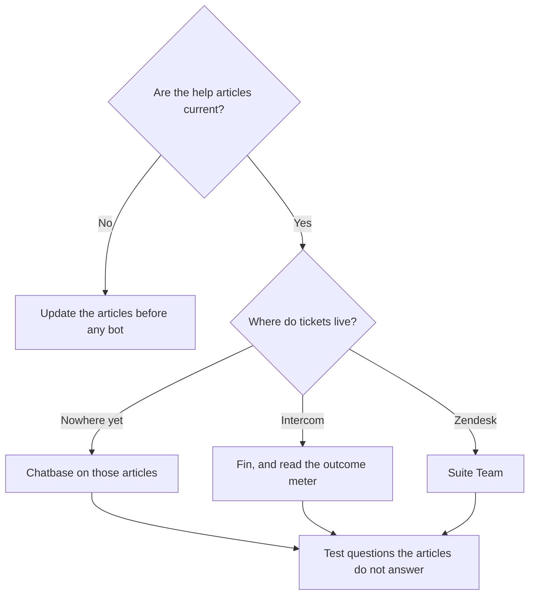

**A knowledge-base chatbot answers from the articles you uploaded, and it says when the articles are silent.** The build is a corpus decision, a host decision, and a test on real questions. The model is the last piece. A bot on a stale or fictional help center is a fluent way to be wrong.

The method underneath is [what RAG is](/blog/what-is-rag-explained-2026/). The chat habit is [what retrieval-augmented chat is](/blog/what-is-retrieval-augmented-chat-2026/). A step-by-step on one host is [how to build a support chatbot with Chatbase](/blog/how-to-build-a-chatbot-with-chatbase-2026/). Prices are US list prices excluding tax from directory pages checked October 16, 2026. Published October 24, 2026. We did not score resolution rates.

## Pick the host from the desk you already have

| You already have | Start the bot here | Price to know | Choose a different host when |
|---|---|---|---|
| A pile of help articles and no desk | [Chatbase](/tools/chatbase/) | Hobby is $32/month billed yearly ($40 monthly), 700 message credits, 10 MB of training data | You need a full ticket queue, not a site widget |
| Intercom, or you want outcome pricing | [Intercom Fin](/tools/intercom-fin/) | $49/month including 50 outcomes, then $0.99 per outcome | You do not want a per-resolution meter |
| Zendesk | [Zendesk](/tools/zendesk-ai/) Suite Team | $55 per agent per month paid yearly, which is the tier that adds AI agents and a knowledge base | You only needed email tickets. Support Team at $19/agent yearly does not include those AI agents |
| A small site chat | [Tidio](/tools/tidio/) Lyro | Standalone Lyro starts at $32.50/month for 50 Lyro conversations. Starter chat is $24.17/month annually | You need a deep help center more than a widget |
| The articles already live in Notion | [Notion AI](/tools/notion-ai/) | Business is $20/seat/month for the agent on the workspace | Customers should not be inside your wiki. Use Notion for internal answers |

The field of business bots is [best AI chatbots for business](/blog/best-ai-chatbots-for-business-2026/). Chatbase's credit math is [Chatbase pricing explained](/blog/chatbase-pricing-explained-2026/). Customer-success teams that need this bot plus the QBR notes are [best AI tools for customer success](/blog/best-ai-tools-for-customer-success-2026/).

## The build, in order

**1. Delete or update anything you would not say to a customer today.** The bot will prefer a confident old article over a silent gap. One owner, one review date on the article. Synthetic FAQs written to "fill the bot" teach the bot fiction. That boundary is [what synthetic data is](/blog/what-is-synthetic-data-2026/).

**2. Write the refusal.** "If the articles do not state the answer, say you do not have it, and offer a person." Put that line in the bot's instructions. A system-level rule of this kind is [what a system prompt is](/blog/what-is-a-system-prompt-2026/). Test it with three questions you know are absent: a discount you do not offer, a feature on the roadmap, a legal promise.

**3. Connect the real corpus, and note the size cap.** Chatbase Hobby trains on 10 MB. If the help center is larger, you are on a higher Chatbase tier or on the desk you already pay for. Zendesk's knowledge base on Suite Team is the corpus living next to the tickets. Fin can run on Intercom or, on the directory card, on other desks. Read which desk the $49 base assumes before you migrate.

**4. Test on 20 real questions.** Ten that the articles answer, ten that they do not. A pass is: the first ten cite the article, the second ten refuse. A wrong citation is a fail even if the sentence sounds helpful. The name for that fail is [what an AI hallucination is](/blog/what-is-ai-hallucination-2026/).

**5. Hand off to a person with the transcript.** The bot's job ends at the article or the refusal. Refunds, account-specific promises, and angry threads go to a human queue. Fin's $0.99 outcome price, as Intercom described it, counts a resolution or a successful procedure handoff. A handoff you intended is still an outcome on that meter. Price a month of real volume before you call $49 the bill. Intercom's example on the card: 5 resolutions stay inside the $49; 100 resolutions cost more.

**6. Re-test when an article changes.** A bot does not notice a policy edit unless the corpus update is part of the publish step. Put "reindex" on the same checklist as "publish the article."

## What the meters actually count

Chatbase counts message credits: 700 on Hobby, 4,000 on Standard at $120 a month billed yearly, 15,000 on Pro at $400 yearly. Extra credits were $40 per 1,000 on that card. Branding removal was a separate annual add-on at $1,188, which is larger than a year of Hobby. Read that line before you treat Hobby as the all-in price.

Zendesk also bills AI agent usage per automated resolution, on top of the seat, according to the directory card. The $55 Suite Team price is the seat. The resolution line is a second look at the invoice.

Tidio's Starter includes 50 one-off Lyro conversations and 100 billable conversations at $24.17 a month annually. Lyro as its own product starts at $32.50 for 50 conversations. Pick one of those entries and track conversations for a month. A quiet brochure site and a support-heavy app do not share a plan.

## FAQ

### Can I paste the help center into ChatGPT instead?

For a private dry run, yes. [ChatGPT](/tools/chatgpt/) Plus is $20 a month. Paste one article and ask the question. That is a test of the article's clarity. It is not a customer-facing bot, and it will not stay current when the article changes. The context limit on a giant paste is [what a context window is](/blog/what-is-a-context-window-2026/).

### How many articles do I need?

Enough to answer the questions you will allow the bot to take. Twenty accurate articles beat two hundred stale ones. Start with the ten questions support already answers from a macro.

### Should the bot use the internet?

No, if the promise is "answers from our help center." Web search adds pages you do not control. Keep the corpus closed. If a question needs a public status page, link the status page as an article you chose.

### Who is responsible for a wrong answer?

The person who published the bot, and the owner of the article it cited. A vendor's resolution fee does not move that responsibility. Log the transcript and fix the article when the article was wrong, or the instruction when the article was fine and the bot wandered.

## Last verified

October 16, 2026 for Chatbase, Intercom Fin, Zendesk, Tidio, Notion, and ChatGPT prices. Published October 24, 2026.

**Sources:** [Chatbase pricing](https://www.chatbase.co/pricing), [Fin pricing](https://fin.ai/help/en/articles/13975800-fin-pricing-outcomes), [Zendesk pricing](https://www.zendesk.com/pricing/).

*Published by Andrew for [AI Tools Optimizer](https://aitoolsoptimizer.com).*

[Chatbase](/tools/chatbase/) and [Zendesk](/tools/zendesk-ai/) are in the [customer support directory](/tools/category/customer-support/). Directory pages may use affiliate links. A purchase through them may earn us a commission at no extra cost to you.
