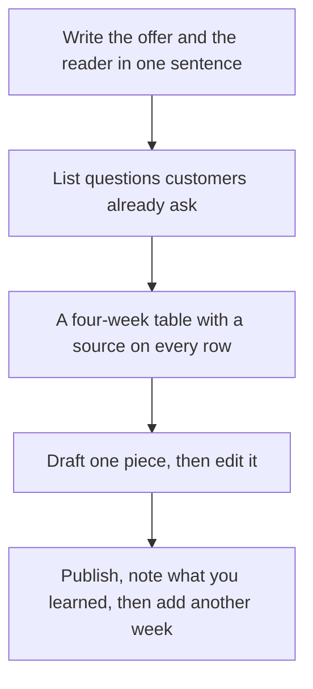

**A content calendar is a list of dates, a channel, a working title, and the source for each piece.** An AI tool can draft that table from your offer and your customer questions. It should not invent a quarter of posts you have no facts to support. Build four weeks. Publish one. Then extend the table.

The writing standard for a single post is [how to write a blog post with Claude](/blog/how-to-write-a-blog-post-with-claude-2026/). The tool-by-job map is [best AI tools for marketers](/blog/best-ai-tools-for-marketers-2026/). Prices are US list prices excluding tax from directory pages checked October 16, 2026, unless a later review on this site is named. Published October 24, 2026.

## The columns, before the model

| Column | Who fills it | Leave it blank when |
|---|---|---|
| Date | You, from the cadence you can actually ship | You do not know who edits that week |
| Channel | You. One primary channel for the month | You are tempted to say "everywhere" |
| Working title | You, or the model from a question you wrote down | The title is a keyword with no reader |
| Source | A customer question, a page you can cite, or a product fact | The model would have to guess the claim |
| Status | You | The status says "drafted" and nobody has opened the file |
| Asset | A doc, a deck, or a visual, named | The asset is "AI will design it" with no brief |

Four weeks on one channel is a calendar. Ninety generated titles is a backlog. The second one feels productive and does not ship.

## Which tool touches which column

| Column | Tool | Price to know |
|---|---|---|
| The questions and the first table | [Claude](/tools/claude/) or [ChatGPT](/tools/chatgpt/) | Claude Pro is $20/month or $17 annual. ChatGPT Plus is $20. Free tiers can draft the table |
| Where the table lives, if the team is already in Notion | [Notion](/tools/notion-ai/) | The full agent is Business at $20/seat/month. A database does not require the agent |
| A keyword you will actually target | [Semrush](/tools/semrush/) | SEO plan $117.33/month billed annually, or $139 monthly. Free is one project and 10 reports a day |
| A page quota, if the row is an article | [Frase](/tools/frase/) | Starter $39/month billed yearly, 10 articles. No permanent free plan. A 7-day trial |
| A deck or a one-page leave-behind on that date | [Gamma](/tools/gamma/) | Plus $9/seat/month |
| The image or the resize | [Canva](/tools/canva/) | Free is a real editor. Pro is $18/month or $180/year |
| A saved voice, once two people are drafting | [Jasper](/tools/jasper/) | Pro $59/seat/month yearly, or $69 monthly |

Semrush is optional until someone is paid to choose keywords. A calendar built only from search volume will miss the questions already in your inbox. Start with the inbox and the sales calls. Add Semrush when a row needs a query, not a vibe. The SEO aisle is [best AI SEO tools](/blog/best-ai-seo-tools-2026/). Frase versus a content score is [Surfer SEO vs Frase](/blog/surfer-seo-vs-frase-2026/). Surfer Standard is $99 a month yearly for 360 documents, which is a lot of calendar for a four-week test.

## The session that produces the month

**Write the constraint at the top of the prompt.** Audience, offer, channel, and the rule: every row needs a source you will paste, or the row should say "source missing." That pattern is [what prompt engineering is](/blog/what-is-prompt-engineering-2026/). A calendar with no source column is how a model fills the month with topics you cannot defend.

**Paste real questions.** Ten support tickets, five sales objections, or the headings already on your site. Ask for a four-week table: date, title, the question it answers, and the asset type. Reject any row whose question you do not recognize.

**Put the table where you will look at it on Monday.** A Notion database, a sheet, or a doc. Notion AI is worth Business when the team asks questions of that database. It is a $20 seat, and the pricing explainer is [Notion AI pricing explained](/blog/notion-ai-pricing-explained-2026/). A solo operator can keep the table in a document and spend the $20 on Claude instead.

**Draft the first row only.** One post, edited, with the claims checked. The brand voice, if it must be stored for a second writer, is Jasper. Two Brand Voices are on Pro. A solo calendar rarely needs that. The comparison with other writers is [Jasper vs Copy.ai vs Writesonic](/blog/jasper-vs-copy-ai-vs-writesonic-2026/).

**Design the asset the day you need it.** Gamma Plus at $9 covers a deck. Canva Free covers a social image. Generating thirty images on day one produces a folder, not a cadence.

**Review on a weekday.** Move a row, kill a row with no source, add one row from something a customer said that week. The calendar is a working list. A model can propose the next row. You assign the date.

## FAQ

### Can ChatGPT build my entire content calendar?

It can draft a four-week table from questions you provide. A year of titles from a one-line prompt is a list of guesses. Keep the source column, and publish on a cadence you have staff to edit.

### Do I need Surfer or Frase to have a calendar?

No. Add Frase or Surfer when the row is a page that must be written against a query. A newsletter or a founder LinkedIn post does not require a content score to be scheduled.

### Where should the calendar live?

Wherever the Monday editor already works. Notion if that is the wiki. A sheet if it is one person. The tool is the list plus the date. The model is the drafter.

### How many posts a week should the AI suggest?

Start with the number you published last month, or with one a week if you are starting. A model will happily suggest five. Your editor is the constraint. The stack for a one-person company is [best AI tools for solopreneurs](/blog/best-ai-tools-for-solopreneurs-2026/).

## Last verified

October 16, 2026 for the plan prices. Published October 24, 2026.

**Sources:** [Claude pricing](https://claude.com/pricing), [Semrush pricing](https://www.semrush.com/pricing/), [Frase pricing](https://www.frase.io/pricing), [Canva pricing](https://www.canva.com/pricing/).

*Published by Andrew for [AI Tools Optimizer](https://aitoolsoptimizer.com).*

[Claude](/tools/claude/) is in the [chatbots directory](/tools/category/chatbots-assistants/). [Frase](/tools/frase/) and [Semrush](/tools/semrush/) are in the [marketing directory](/tools/category/marketing-seo/). Directory pages may use affiliate links. A purchase through them may earn us a commission at no extra cost to you.
