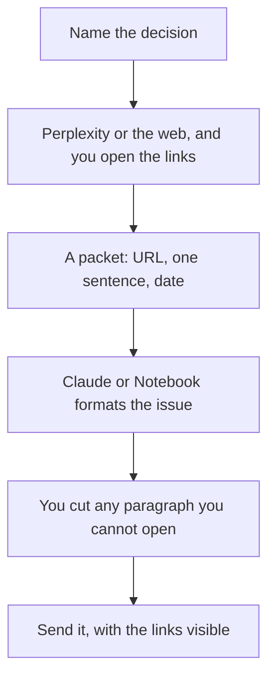

**An AI research digest is a short brief of sources you opened, with one paragraph per source and a sentence on why it matters to a decision you already named.** The model formats the brief. It does not go find the truth and mail it to you. A digest of unsourced paragraphs is a rumor with headings.

The search comparison is [Perplexity vs ChatGPT vs Gemini for search](/blog/perplexity-vs-chatgpt-vs-gemini-for-search-2026/). A single research question is [ChatGPT vs Perplexity for research](/blog/chatgpt-vs-perplexity-for-research-2026/). The habit of opening the page is [how to fact-check AI writing](/blog/how-to-fact-check-ai-writing-2026/).

Prices are US list prices excluding tax from directory pages checked October 16, 2026, except where noted. Published October 24, 2026. We did not score source quality.

## What one issue contains

| Block | Who fills it | Done when |
|---|---|---|
| The decision the digest serves | You | One sentence, such as "whether to change the onboarding email" |
| Sources | You | Three to seven URLs you opened, or papers you can name |
| One paragraph each | The model, from the page | It says what the page says, and links it |
| Why it matters | You | Tied to the decision. The model may draft it. You keep it |
| What you are not claiming | You | A ban list: no market sizes, no "studies show" without the study |

A digest that will be reread next quarter needs the date on every source. Models summarize the web as if it were current. Your packet is what makes it a record.

## Which tool supplies which block

**Find candidate links.** [Perplexity](/tools/perplexity/) Pro is $17 a month billed annually when this is a daily habit. Free covers a lighter week. Open every link you will include. A citation in the digest that you did not open is decoration. The invoice detail lives in [Perplexity pricing explained](/blog/perplexity-pricing-explained-2026/).

**Papers, if the decision needs them.** [Consensus](/tools/consensus/) Pro is $20 a month, or $12 a month billed annually ($144 a year), on the review. Search the claim, open the paper, and put the paper in the packet. A title the model invented is [what an AI hallucination is](/blog/what-is-ai-hallucination-2026/). [Elicit](/tools/elicit/) is the other paper tool in the directory if that is where your team already searches.

**Format the issue.** [Claude](/tools/claude/) Pro is $20 a month, or $17 billed annually. Paste the packet. Ask for one paragraph per URL and a final "so what" that quotes your decision sentence. [Gemini Notebook](/tools/gemini-notebook/) is the better formatter when the sources are files you uploaded for one study session. The directory lists it as free, with higher limits on Google AI Plus at $4.99 a month, in the retrieval-augmented chat article's October 16 note. That notebook is [retrieval-augmented chat](/blog/what-is-retrieval-augmented-chat-2026/) over files you brought.

**ChatGPT, if the team will not leave it.** Plus is $20. Put the digest in a Project so last month's sources stay attached. The container is [ChatGPT Projects vs custom GPTs](/blog/chatgpt-projects-vs-custom-gpts-2026/). A custom GPT can hold the headings. It should not hold the facts. The facts change every issue.

Competitive pages are gathered the same way as [how to use AI for competitive analysis](/blog/how-to-use-ai-for-competitive-analysis-2026/). A content team that turns the digest into a calendar is [how to build an AI content calendar](/blog/how-to-build-an-ai-content-calendar-2026/).

## A prompt for the issue

"Decision: [one sentence]. Sources, each with a URL and a sentence I wrote after opening it: [paste]. Write one short paragraph per source, then three bullets on what this means for the decision. If a bullet needs a number we did not paste, omit the bullet. Date the issue today."

Schedule it weekly only after two issues were worth reading. A robot that emails an empty roundup trains the team to ignore it. [Lindy](/tools/lindy/) can run a routine, and the October 24 pricing page starts paid use at $49.99 per user per month. That is a large tool for a digest. Use it when the gathering is the pain. Use a calendar reminder when the pain is discipline.

## FAQ

### How many sources belong in one issue?

Three to seven you opened. More than that is a reading list, which is fine if you label it as a list and stop pretending each item was read.

### Can the digest include social posts?

Yes, as primary sources, with the author and the date, when the post is the evidence. No, as proof of a market fact, unless you also opened a better source. The model will treat a viral post as a study if you let it.

### Who is the audience?

One team, one decision. A digest for "everyone" becomes headlines. Name the reader in the decision sentence.

### How do I keep it from drifting into news?

Leave out anything you would not still cite in a month, or put a date on it and a reason it expires. This article is the evergreen version of that rule. A daily news roundup is a different product.

## Last verified

October 16, 2026 for Perplexity, Claude, ChatGPT, Consensus, and the Gemini Notebook price note. October 24, 2026 for Lindy's $49.99 starting line. Published October 24, 2026.

**Sources:** [Perplexity Pro](https://www.perplexity.ai/pro), [Claude pricing](https://claude.com/pricing), [Consensus](https://consensus.app).

*Published by Andrew for [AI Tools Optimizer](https://aitoolsoptimizer.com).*

[Perplexity](/tools/perplexity/) is in the [research directory](/tools/category/research-search/). Directory pages may use affiliate links. A purchase through them may earn us a commission at no extra cost to you.
