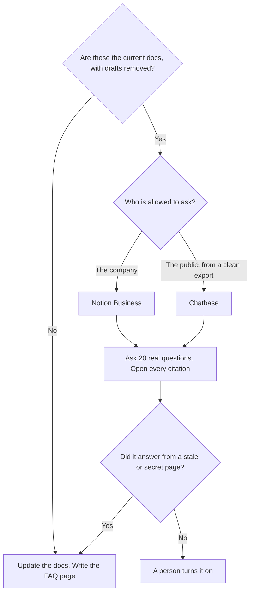

**An FAQ chatbot built from docs answers only from the documents you pointed it at, and it says when those documents are silent.** The work is choosing which docs are current, cutting the drafts, and testing questions a real reader asks. The model is last. A bot on a folder of stale specs will quote the stale spec with confidence.

This page is the docs folder: a product guide, an internal handbook, a markdown tree. The customer help center, which is a different corpus, is [how to build a knowledge-base chatbot](/blog/how-to-build-a-knowledge-base-chatbot-2026/). The pages a human reads, before any bot, are [how to create FAQ pages with AI](/blog/how-to-create-faq-pages-with-ai-2026/). The method is [what RAG is](/blog/what-is-rag-explained-2026/).

Prices are US list prices excluding tax from directory pages checked October 16, 2026. Published October 24, 2026. We did not score answer rates.

## Pick the host from who is allowed to see the docs

| Who asks | Start here | Price to know | Do not |
|---|---|---|---|
| Employees, and the docs are already in Notion | [Notion AI](/tools/notion-ai/) | Business is $20 a seat for the agent on the workspace | Invite customers into the wiki |
| Readers of a site, and you have a clean doc export | [Chatbase](/tools/chatbase/) | Hobby is $32 a month billed yearly, or $40 monthly, for 700 message credits | Upload drafts, roadmaps, or incident notes |
| You already pay Intercom and want outcome pricing | [Intercom Fin](/tools/intercom-fin/) | $49 a month including 50 outcomes, then $0.99 an outcome | Point Fin at a folder you have not cleaned |
| A small site widget | [Tidio](/tools/tidio/) Lyro | Standalone Lyro starts at $32.50 a month for 50 Lyro conversations | Treat a widget as a docs site |
| You are still writing the answers | [Claude](/tools/claude/), then publish the page | Pro is $20, or $17 billed annually | Ship a bot that replaces the missing page |

The search under this bot is often an embedding index. You do not have to pick that model if the host hides it. The definition, so you know what a re-index is, is [what an embedding model is](/blog/what-is-an-embedding-model-2026/). The requirement that you can open the passage is [what AI grounding is](/blog/what-is-ai-grounding-2026/).

## Clean the folder before you connect it

Include the pages you would send a colleague today. Exclude drafts, old versions, meeting notes, and anything with a customer name that does not belong in an answer. A bot cannot tell a draft from a policy if both are in the upload. Date the export. When the docs change, update the bot. A nightly copy of a folder nobody owns will drift.

Write the questions you will use as a test, from real tickets or real reader mail, before you admire a demo question. Include questions the docs do not answer. The correct behavior on those is a refusal or a handoff, not a guess. The failure mode is [what an AI hallucination is](/blog/what-is-ai-hallucination-2026/). The person who accepts the bot is [what human-in-the-loop AI is](/blog/what-is-human-in-the-loop-ai-2026/).

[Chatbase](/tools/chatbase/) Hobby is the small public bot: 700 message credits a month on the yearly price, and the directory records training on your sources. Standard is $120 a month billed yearly. The step-by-step on that host, aimed at a help center, is [how to build a support chatbot with Chatbase](/blog/how-to-build-a-chatbot-with-chatbase-2026/). Use the same clicks. Use a docs export, not a scratch FAQ you generated to fill the box.

[Notion AI](/tools/notion-ai/) Business is the internal version when the docs already live there. Plus at $10 is not the full AI tier. Do not put customer-facing traffic on a workspace that also holds HR notes. The card is [Notion AI pricing explained](/blog/notion-ai-pricing-explained-2026/).

[Intercom Fin](/tools/intercom-fin/) fits when the docs are already the help center and you want a resolution meter. Fifty outcomes are included in the $49. Extra outcomes are $0.99. A docs experiment does not need that meter. The comparison is [Chatbase vs Intercom Fin pricing](/blog/chatbase-vs-intercom-fin-pricing-2026/).

[Tidio](/tools/tidio/) Lyro is the widget. Starter chat is $24.17 a month annually. Buy it when you need a person to catch the handoff on a small site. The directory's standalone Lyro price starts at $32.50 a month for 50 conversations.

[Claude](/tools/claude/) is how you draft a missing page from source you paste. It is not the bot. Publish the page, then point the bot at the page. The writing method is [how to write a blog post with Claude](/blog/how-to-write-a-blog-post-with-claude-2026/).

## FAQ

### Can I point a chatbot at the whole drive?

You can, and you will answer from the wrong file. Pick the folder that is the source of truth. A roadmap and a spec from last year are how the bot contradicts the product.

### How is this different from a knowledge-base chatbot?

The knowledge-base guide assumes help articles for customers. This one starts from docs: product guides, internal handbooks, markdown. The host can be the same. The corpus rule is stricter, because docs folders collect drafts.

### Do I need an embedding API key?

Not if Chatbase, Notion, or Fin is doing the retrieval. You need one if you are building the index yourself. This directory does not record a standalone embedding price. The explainer is linked above.

### When should it refuse?

When the docs do not contain the answer. Write that sentence into the bot's instructions, and test it. A refusal that offers a human is a success. A paragraph that sounds helpful and is not in the docs is a bug.

## Last verified

October 16, 2026 for Notion, Chatbase, Intercom Fin, Tidio, and Claude prices named above. Published October 24, 2026.

**Sources:** [Chatbase pricing](https://www.chatbase.co/pricing), [Notion pricing](https://www.notion.com/pricing), [Fin pricing](https://fin.ai/help/en/articles/13975800-fin-pricing-outcomes).

*Published by Andrew for [AI Tools Optimizer](https://aitoolsoptimizer.com).*

[Chatbase](/tools/chatbase/) is in the [customer support directory](/tools/category/customer-support/). Directory pages may use affiliate links. A purchase through them may earn us a commission at no extra cost to you.
