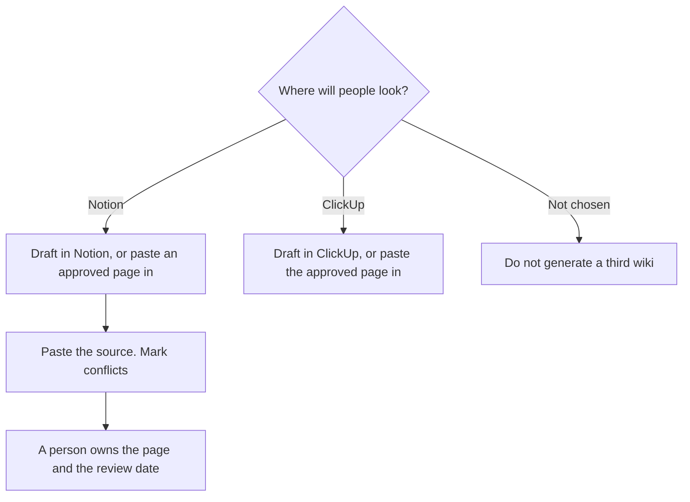

**An internal wiki built with AI is a set of pages a person owns, drafted from material you already have, in the tool the team will actually open.** The model can turn a messy doc into a page with headings. It cannot decide which page wins when two docs disagree. Pick the home first. Then draft into it. A chatbot full of forgotten answers is not a wiki.

The page a new hire should meet on day one is [how to create onboarding docs with AI](/blog/how-to-create-onboarding-docs-with-ai-2026/). The notes comparison is [Notion AI vs ChatGPT for notes](/blog/notion-ai-vs-chatgpt-for-notes-2026/). The tracker comparison is [Notion AI vs ClickUp Brain](/blog/notion-ai-vs-clickup-brain-2026/).

Prices are US list prices excluding tax from directory pages checked October 16, 2026. Published October 24, 2026. We did not score wiki quality.

## What has to exist before a model writes

| Piece | Who decides | The model may |
|---|---|---|
| The home | You. One system of record | Not a second copy in a chat |
| The owner of a page | You | Name the person you named |
| The source | You paste the policy, the spec, or the thread | Format it. It may not merge two conflicting policies |
| The audience | You. The whole company, or one team | Keep a private page out of the all-hands index |
| A stale page | You | Flag a date you pasted. It may not declare a page current |

Two wikis is how the model becomes a third opinion. If sales has a Notion and engineering has a repo, write down which question lives where. Do not "just let AI search everything" until a person has said which source wins.

## Where the pages live

**Notion, if that is already the company memory.** [Notion AI](/tools/notion-ai/) Business is $20 a seat a month, and it is the full AI tier: Agent, AI Meeting Notes, and search across connected apps, on the pricing explainer. Plus at $10 is the workspace plan, not that tier. Custom Agents are a second bill, $10 per 1,000 credits, only after you want work done on a schedule. A wiki you edit by hand does not need the credit pack. The card is [Notion AI pricing explained](/blog/notion-ai-pricing-explained-2026/).

**ClickUp, if the work and the doc should not diverge.** [ClickUp Brain](/tools/clickup-brain/) is an add-on from $9 per user a month. Unlimited is $7 per user billed yearly, or $10 monthly. Business is $12 yearly, or $19 monthly. Put the process next to the task. A wiki page that restates a task status will rot. The review is [ClickUp Brain review](/blog/clickup-brain-review-2026/).

**A long rewrite of a policy.** [Claude](/tools/claude/) Pro is $20, or $17 billed annually, with Projects on Free up to five. Paste the old page and the decision that changed it. Ask for a revised page and a list of sentences that were not in either source. Then the owner pastes the keeper into the wiki. The writing seat, if the team prefers it, is [ChatGPT](/tools/chatgpt/) Plus at $20. The comparison is [ChatGPT vs Notion AI for writing](/blog/chatgpt-vs-notion-ai-for-writing-2026/).

A prompt that holds the line:

"Rewrite this source as a wiki page with: purpose, who it is for, the steps, and the owner. If two sentences conflict, quote both and write 'conflict' instead of picking one. Do not add policy that is not in the source."

## When a bot is allowed to read the wiki

A customer-facing bot is a different project. Build it after the pages are owned and current, not before. The how-to is [how to build a knowledge base chatbot](/blog/how-to-build-a-knowledge-base-chatbot-2026/). [Chatbase](/tools/chatbase/) Hobby is $32 a month billed yearly for 700 message credits. That bot answers from what you upload. A stale wiki becomes a confident wrong answer. The meter, if you are choosing a support bot, is [Chatbase vs Intercom Fin pricing](/blog/chatbase-vs-intercom-fin-pricing-2026/).

Search over pages that do not fit in a prompt is [what RAG is](/blog/what-is-rag-explained-2026/). It retrieves. It does not settle a conflict between two pages. A person still does that. The label for that person is [what human-in-the-loop AI is](/blog/what-is-human-in-the-loop-ai-2026/).

FAQ pages are the public cousin of the same habit. The workflow is [how to create FAQ pages with AI](/blog/how-to-create-faq-pages-with-ai-2026/). Technical writers who keep this honest are [best AI tools for technical writers](/blog/best-ai-tools-for-technical-writers-2026/).

## FAQ

### Should every team have its own wiki?

Every team can have a section. They should not have a rival source of truth for the same policy. One home, sections inside it. Generate pages into that structure. Do not generate a new structure every quarter.

### How often should a page be reviewed?

Put a date on the page when you publish it. The model can remind you only if the date is in the page and someone asks. A page with no owner will not be saved by a better model.

### Can AI keep the wiki up to date by itself?

It can draft an update from a source you paste. A scheduled agent that rewrites policy while you are away will eventually publish a guess. Keep schedules for summaries and reminders. Keep policy edits on a person.

### What should we migrate first?

The pages people already ask for: how to get access, how to ship, how to talk to a customer, how to spend money. Leave the archive of old brainstorms unmigrated until someone needs it. Migrating everything is how the new wiki starts stale.

## Last verified

October 16, 2026 for Notion, ClickUp, Claude, ChatGPT, and Chatbase prices named above. Published October 24, 2026.

**Sources:** [Notion pricing](https://www.notion.com/pricing), [ClickUp pricing](https://clickup.com/pricing), [Claude pricing](https://claude.com/pricing).

*Published by Andrew for [AI Tools Optimizer](https://aitoolsoptimizer.com).*

[Notion AI](/tools/notion-ai/) is in the [productivity and notes directory](/tools/category/productivity-notes/). Directory pages may use affiliate links. A purchase through them may earn us a commission at no extra cost to you.
