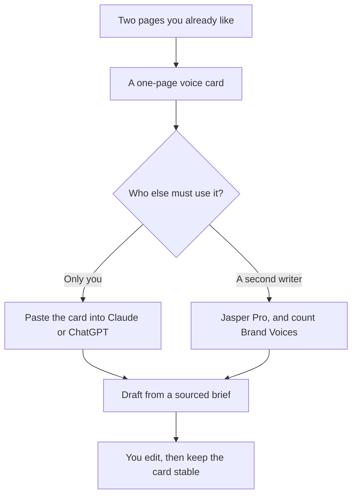

**A brand voice is a one-page card with samples you wrote, words you use, and words you refuse, applied to a source that contains the facts.** The AI does not discover the voice. It copies the card. Put the card in the prompt when one person writes. Put it in a brand product when a second person has to find the same rules without asking you.

The tool decision is [Jasper alternatives](/blog/jasper-alternatives-2026/). Showing the card as an example inside the prompt is [what few-shot prompting is](/blog/what-is-few-shot-prompting-2026/). Prices are US list prices excluding tax from directory pages checked October 16, 2026. Published October 24, 2026. We did not score how "on brand" a paragraph sounds.

## Write the card before you pick the software

| Block on the card | What "done" looks like | What to leave off |
|---|---|---|
| Who it is for | One audience, named | "Everyone" |
| The offer | The product and the action, in your words | A claim you have not sourced |
| Words you use | Five to ten, from a page you already published | A thesaurus dump |
| Words you do not use | Five, including the hype you are tired of | A ban list so long the model ignores it |
| A good paragraph | One you would sign, pasted in full | A paragraph the model wrote and you have not edited |
| A bad paragraph | One that shows the failure, with a note on what failed | A straw man |
| Facts that cannot move | Prices, policies, names | "The model can fill these in" |

The drafting sequence after the card exists is [how to write a blog post with Claude](/blog/how-to-write-a-blog-post-with-claude-2026/). A brief that also carries search terms is [how to use AI for SEO briefs](/blog/how-to-use-ai-for-seo-briefs-2026/).

## Where the card lives

**One writer.** Paste the card at the top of the thread in [Claude](/tools/claude/) or [ChatGPT](/tools/chatgpt/). Claude Pro is $20 a month, or $17 billed annually. ChatGPT Plus is $20. Go is $8. Save the card in a project if the product has projects, which Plus lists. The card is still yours to update. A free tier is enough to learn the habit until the cap stops a workday.

**Two writers and one or two brands.** [Jasper](/tools/jasper/) Pro is $59 per seat per month billed yearly, or $69 monthly. Pro includes two Brand Voices, five Knowledge assets, and three Audiences. A third brand voice is a Business quote. Do not stack three clients into one voice "for now." The comparison with the other platforms is [Jasper vs Copy.ai vs Writesonic](/blog/jasper-vs-copy-ai-vs-writesonic-2026/).

**A shared chat, five seats, no voice admin.** [Copy.ai](/tools/copy-ai/) Chat is $24 a month billed annually, or $29 monthly. The voice card still has to live somewhere the five people can open. The chat plan does not replace the card.

**The last pass in the inbox.** [Grammarly](/tools/grammarly/) can nudge tone after the draft exists. Pro is $12 per member per month billed annually. Tone suggestions pull toward a standard. Use them to catch a banned word, and reject a suggestion that sands off the paragraph you marked as good. The editing split is [Grammarly vs ChatGPT for editing](/blog/grammarly-vs-chatgpt-for-editing-2026/).

## Apply it without letting it invent

**1. Start from a sourced brief.** The voice card is style. The brief is truth. A beautiful voice with an empty brief produces on-brand fiction. The check is [how to fact-check AI writing](/blog/how-to-fact-check-ai-writing-2026/).

**2. Ask for a draft that follows the card, then quote one rule it might break.** "Use the voice card. Do not add a statistic. If a fact is missing, write 'not in the brief.'" That instruction is short enough to reread.

**3. Edit the draft yourself, and update the card only when a rule failed twice.** A card that changes every afternoon is a mood. A card that gains one banned phrase after a repeated miss is a system.

**4. Keep one bad example current.** Models drift toward generic marketing. The bad paragraph is the antidote. Replace it when your failure mode changes, from hype words to fake customer quotes, for example.

**5. Give agencies one card per client.** The seat math and the two-voice cap are [best AI tools for agencies](/blog/best-ai-tools-for-agencies-2026/).

## FAQ

### Can I ask the AI to invent my brand voice?

You can ask it to describe the voice in a page you paste. You should edit that description until it matches lines you have published. A voice generated from "we are innovative and friendly" will sound like every other brief that used those words.

### How long should the card be?

One page. If it runs longer, the model and your teammates will skim it. Put proof points and policies in the brief for that piece, not in the permanent card.

### Do I need Jasper to have a brand voice?

No. You need Jasper, or another stored system, when a second person must apply the voice without a side channel to you. One writer with a doc and a chat seat already has a voice system.

### How do I know the voice is working?

A teammate can edit a draft toward the card without asking you what you meant. If they cannot, the card is vague. Add a concrete line from the good paragraph, or a concrete ban, and try one more draft.

## Last verified

October 16, 2026 for Jasper, Claude, ChatGPT, Copy.ai, and Grammarly prices. Published October 24, 2026.

**Sources:** [Jasper pricing](https://www.jasper.ai/pricing), [Claude pricing](https://claude.com/pricing), [OpenAI ChatGPT pricing](https://openai.com/chatgpt/pricing/).

*Published by Andrew for [AI Tools Optimizer](https://aitoolsoptimizer.com).*

[Jasper](/tools/jasper/) is in the [writing directory](/tools/category/writing/). [Claude](/tools/claude/) is in the [chatbots directory](/tools/category/chatbots-assistants/). Directory pages may use affiliate links. A purchase through them may earn us a commission at no extra cost to you.
