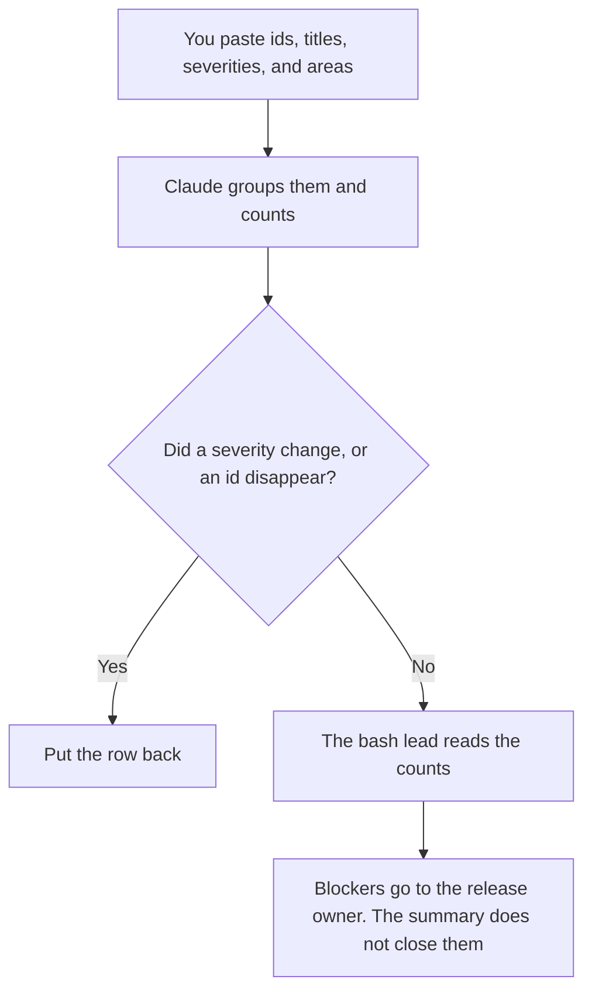

**A bug bash summary written with AI groups bugs people already filed, under the severities they already set, and names an owner only when you pasted one.** The model may cluster titles you provide. It may not raise a severity, close a bug, or declare the release safe. The cases you will re-run after a fix are [what an AI eval regression suite is](/blog/what-is-ai-eval-regression-suite-2026/). The note that says what actually shipped is [how to write a release train note with AI](/blog/how-to-write-a-release-train-note-with-ai-2026/).

Claude's prices are from claude.com/pricing on October 24, 2026. Notion, Cursor, and ChatGPT prices are from directory pages checked October 16, 2026. chatgpt.com/pricing returned HTTP 403 on October 24. Published October 24, 2026. We did not score bug quality.

## What belongs in the summary

| Row | Who owns it | The model may |
|---|---|---|
| The bug id and the title | The filer | Group similar titles. It may not merge two ids into one bug |
| The severity | The person who set it | Count the rows. It may not change P1 to P2 |
| The area | The component you pasted | Use that label. It may not invent a subsystem |
| The owner | The name on the bug, if you pasted it | Copy it. A blank owner stays blank |
| The decision | The bash lead | Not "ship anyway" |

A bash summary is a snapshot of one session. It is not the backlog. If a bug was filed outside the bash, it stays out unless you paste it and mark it as outside. A theme such as "login" is allowed when several titles say login. A theme such as "users are confused" is not a bug. It is a sentence you did not file.

The count has to add up. If you pasted 40 bugs, the groups have to contain 40 ids. A group called "other" is fine. A missing id is not.

## Where it is written

**The grouping.** [Claude](/tools/claude/) Pro is $17 a month billed annually, $200 up front, or $20 monthly, when the paste is long and the summary should sit beside the last bash. The review is [Claude review](/blog/claude-review-2026/).

**The page the lead will link.** [Notion AI](/tools/notion-ai/) Business is $20 a seat a month if that is where bash notes live. Plus at $10 is not the full AI tier. The invoice is [Notion AI pricing explained](/blog/notion-ai-pricing-explained-2026/).

**A fix, after the summary.** [Cursor](/tools/cursor/) Plus is $8 a month, or $80 a year. The summary does not authorize an edit. The diff still gets a review. The ladder is [Cursor pricing explained](/blog/cursor-pricing-explained-2026/).

**A short bash.** [ChatGPT](/tools/chatgpt/) Plus is $20 a month. Free can group a small paste. Discard a version that ranks bugs by "user impact" you did not define. The review is [ChatGPT review](/blog/chatgpt-review-2026/).

A prompt that holds the line:

"Group these bugs by the area I pasted. Count ids per severity. Do not change a severity. Do not drop an id. If an owner is blank, write Owner missing. Do not say the release is safe."

## What not to delegate

Do not ask which bugs "really" matter. Do not paste a customer record into the title so the summary "has context." Do not close issues from the chat. The human review of a generated fix is [what an AI human review queue is](/blog/what-is-ai-human-review-queue-2026/). The bash summary only decides what the lead will read next.

## FAQ

### How is this different from a triage meeting?

Triage assigns owners and severities. The summary reports what was filed in the bash, with the severities already on the rows. If triage has not happened, the summary says so. It does not perform triage in prose.

### Can the model suggest duplicates?

It may list ids whose titles look similar, and you confirm. It may not close one as a duplicate. Two similar titles can be two bugs.

### What if severities were left blank?

Count them as Unset. Do not fill P3 because most rows are P3. An unset severity is a finding. The lead sets it.

### Who may send the summary?

The bash lead. A model does not post it to the release channel. A summary that promises a fix date has left the paste. Delete the date unless you wrote it.

## Last verified

October 24, 2026 for Claude. October 16, 2026 for Notion, Cursor, and ChatGPT. Published October 24, 2026.

**Sources:** [Claude pricing](https://claude.com/pricing), [Notion pricing](https://www.notion.com/pricing), [Cursor pricing](https://cursor.com/help/account-and-billing/pricing), [ChatGPT pricing](https://chatgpt.com/pricing/).

*Published by Andrew for [AI Tools Optimizer](https://aitoolsoptimizer.com).*

[Cursor](/tools/cursor/) is in the [coding directory](/tools/category/coding/). Directory pages may use affiliate links. A purchase through them may earn us a commission at no extra cost to you.
