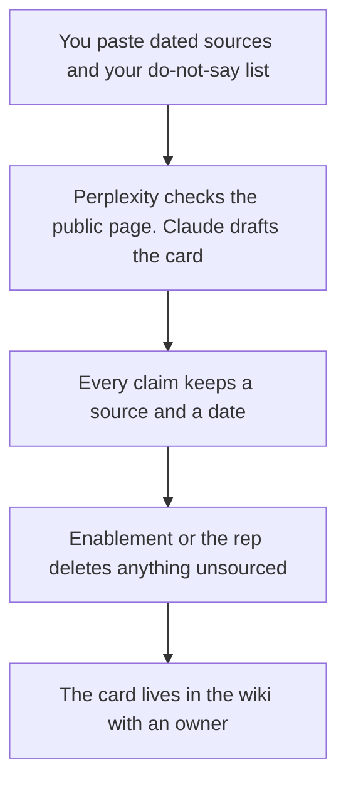

**A competitive battlecard written with AI is a one-page crib sheet a rep can use: who the competitor is, the claims you can source, the questions to ask, and what you will not say.** The model can arrange notes. It cannot invent a competitor's price, a win rate, or a weakness you hope is true. An unsourced jab is how a call becomes a credibility problem.

The script of the demo you will actually give is [how to create a demo script with AI](/blog/how-to-create-a-demo-script-with-ai-2026/). The public research habit is [how to use Perplexity for market research](/blog/how-to-use-perplexity-for-market-research-2026/). The team that should own the card, if enablement exists, is [best AI tools for enablement teams](/blog/best-ai-tools-for-enablement-teams-2026/).

Prices are US list prices excluding tax from directory pages checked October 16, 2026. Published October 24, 2026. We did not score win rates, because a win rate does not belong on a card unless you computed it from your own CRM.

## The blocks that earn a place

| Block | Allowed source | The model may |
|---|---|---|
| Who they sell to | Their public page, dated, that you paste | Quote it. It may not generalize to "everyone" |
| What they say | A page, a PDF, or a call note you captured | Shorten it, with the date |
| What you say | Your current product, the part you can show | Stay inside the demo script |
| Landmines | Questions that reveal a real difference | Phrase them as questions, not insults |
| Price | A public price you copied, or "not published" | Not a guessed range |
| Do not say | Legal, brand, or stale claims | Repeat the ban. It may not soften it |

A battlecard without a date is a rumor with headings. The person who publishes it is [what human-in-the-loop AI is](/blog/what-is-human-in-the-loop-ai-2026/). The check is [how to fact-check AI writing](/blog/how-to-fact-check-ai-writing-2026/).

## Where the card is built

**The public page.** [Perplexity](/tools/perplexity/) Pro is $17 a month billed annually when you need citations beyond the free weekly cap. Open the link and paste the sentence you are willing to stand behind. Do not paste Perplexity's summary onto the card as if it were the competitor's words. The research pair is [Claude vs Perplexity for research](/blog/claude-vs-perplexity-for-research-2026/).

**The draft.** [Claude](/tools/claude/) Pro is $20 a month, or $17 billed annually. One Project per competitor, with the sources attached. [ChatGPT](/tools/chatgpt/) Plus at $20 works if that is where the team already writes. Business is $20 a user a month billed annually for two or more users when the notes include private deal context. The container is [Claude Projects vs ChatGPT Projects](/blog/claude-projects-vs-chatgpt-projects-2026/).

**The page reps open.** [Notion AI](/tools/notion-ai/) Business is $20 a seat a month. Name an owner and a review date. A card from last year that still lists a retired feature is worse than no card. Plus at $10 is not the full AI tier.

**The line edit.** [Grammarly](/tools/grammarly/) Pro is $12 a member a month billed annually. Tone is not a source. A polite sentence can still be false.

A prompt that holds the line:

"Draft a one-page battlecard. Sections: who they sell to, what they say, what we show, questions to ask, price, do not say. Use only the sources I pasted. Put a date on every claim. If a price or a weakness is not in the sources, write Not sourced. Do not insult the competitor. Do not invent a win rate."

The sales shelf around this file is [best AI tools for sales teams](/blog/best-ai-tools-for-sales-teams-2026/). A partner motion is a different document: [how to write a partner brief with AI](/blog/how-to-write-a-partner-brief-with-ai-2026/).

## What this page is not

It is not a place to collect gossip from lost deals unless the note says who heard it and when. Mark those lines as field notes, separate from public claims. It is not legal advice about comparative advertising. If counsel has a do-not-say list, that list wins over a fluent draft.

## FAQ

### How often should the card change?

When the competitor's public page changes, or when your demo script changes. A quarterly date at the top is the minimum. An undated card should come down.

### Can AI monitor the competitor's site?

A tool can fetch a page you are allowed to read. A person decides whether the sentence changed in a way the card should reflect. Do not auto-publish a diff into the wiki.

### Should we include their price?

Only if you copied it from a page you can link, with the date. If the price is "contact sales," the card says that. A guessed discount is a false claim with a dollar sign.

### What if we rarely win against them?

The card can say where you walk away. That is more useful than a list of invented weaknesses. Walking away is a strategy. Fiction is not.

## Last verified

October 16, 2026 for Perplexity, Claude, ChatGPT, Notion, and Grammarly prices named above. Perplexity's month-to-month Pro dollar was not on the card. Published October 24, 2026.

**Sources:** [Perplexity pricing](https://www.perplexity.ai/hub/pricing), [Claude pricing](https://claude.com/pricing), [Notion AI](https://www.notion.com/product/ai).

*Published by Andrew for [AI Tools Optimizer](https://aitoolsoptimizer.com).*

[Claude](/tools/claude/) is in the [chatbots and assistants directory](/tools/category/chatbots-assistants/). Directory pages may use affiliate links. A purchase through them may earn us a commission at no extra cost to you.
