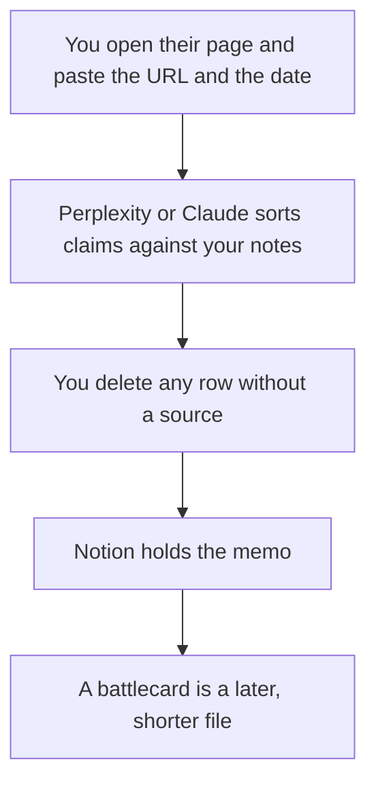

**A competitor teardown written with AI is a sourced memo: what the competitor's own page says, the date you opened it, what you will not claim, and the gap you can prove in your product.** The model can organize links you paste. It cannot know their win rate, their discount, or a feature that is not on the page. If the source is missing, the row says Missing.

The sales compression of that memo is [how to create a competitive battlecard with AI](/blog/how-to-create-a-competitive-battlecard-with-ai-2026/). The team that publishes messaging from it is [best AI tools for product marketing](/blog/best-ai-tools-for-product-marketing-2026/). The launch narrative that should stay consistent with the memo is [how to write a go-to-market brief with AI](/blog/how-to-write-a-go-to-market-brief-with-ai-2026/).

Prices are US list prices excluding tax from directory pages checked October 16, 2026. Published October 24, 2026. We did not score competitive intelligence products.

## The rows worth keeping

| Row | Source | The model may |
|---|---|---|
| What they say they do | Their pricing or product page, with a URL and the date | Quote it shortly. It may not paraphrase a limit into a strength |
| Price | The figure on that page, in the currency printed there | Copy it. It may not convert or "estimate street price" |
| Who it is for | A sentence on their site, or a lost-deal note you label as internal | Keep the label. It may not present an internal note as their claim |
| Where you differ | A feature you can demo | State the difference. It may not invent a missing feature on their side |
| What you will not say | Legal or brand limits you paste | Repeat them. It may not soften them |
| Next review | A date and an owner | Not mark the page as current forever |

An unsourced "they are weak at enterprise" line is [a hallucination](/blog/what-is-ai-hallucination-2026/) that reps will repeat. The check is [how to fact-check AI writing](/blog/how-to-fact-check-ai-writing-2026/).

## Where the reading and the file happen

**Pages, with links.** [Perplexity](/tools/perplexity/) Pro is $17 a month billed annually. Use it to find the official page, then open the page. A citation is a lead. The shopping version of that habit is [Perplexity vs ChatGPT for shopping research](/blog/perplexity-vs-chatgpt-for-shopping-research-2026/). The review is [Perplexity review](/blog/perplexity-review-2026/).

**The memo.** [Claude](/tools/claude/) Pro is $20 a month, or $17 billed annually. Paste excerpts. Ask for a table with a source column. Delete rows that cite "industry knowledge." The review is [Claude review](/blog/claude-review-2026/).

**The record.** [Notion AI](/tools/notion-ai/) Business is $20 a seat a month if the teardown lives in Notion. Put the date in the title. A chat thread will not be the version sales uses next quarter. The invoice is [Notion AI pricing explained](/blog/notion-ai-pricing-explained-2026/).

**A readout, after the memo is true.** [Gamma](/tools/gamma/) Plus is $9 a seat a month. Do not design the teardown before the sources are in the doc.

**The line edit.** [Grammarly](/tools/grammarly/) Pro is $12 a member a month billed annually.

A prompt that holds the line:

"Build a teardown table from the excerpts I paste. Columns: claim, source URL, date I gave you, what we can say, what we must not say. If a cell has no excerpt, write Missing. Do not estimate their revenue, discounts, or win rate. Do not add features from memory."

The person who publishes is [what human-in-the-loop AI is](/blog/what-is-human-in-the-loop-ai-2026/). The place the dated memo lives is [what a system of record for AI is](/blog/what-is-a-system-of-record-for-ai-2026/).

## What this memo is not

It is not a battlecard. The card is shorter and has an owner in enablement. It is not a teardown of their security for its own sake, and it is not a set of steps for probing their product. Stay on public pages and your own lost-deal notes. It is not the PRD. Your roadmap stays in [how to write a PRD with AI](/blog/how-to-write-a-prd-with-ai-2026/).

## FAQ

### How often should a teardown be redone?

When their pricing page changes, and on the review date you wrote down. A model will not notice a new plan by itself unless you open the page again.

### Can I include a screenshot?

Yes, with the date, if your counsel is comfortable storing it. The URL still belongs in the row. A screenshot without a date becomes a false memory.

### Should sales edit the memo?

Sales can comment. One owner edits. A rep's addition without a source goes in a separate column marked internal, or it stays out.

### Is a teardown the same as a win-loss report?

No. Win-loss is what your buyers said. The teardown is what the competitor publishes. Mixing them without labels is how an internal hunch becomes a public claim.

## Last verified

October 16, 2026 for Perplexity, Claude, Notion, Gamma, and Grammarly. Published October 24, 2026.

**Sources:** [Perplexity pricing](https://www.perplexity.ai/hub/pricing), [Claude pricing](https://claude.com/pricing), [Notion pricing](https://www.notion.com/pricing).

*Published by Andrew for [AI Tools Optimizer](https://aitoolsoptimizer.com).*

[Perplexity](/tools/perplexity/) is in the [research and search directory](/tools/category/research-search/). Directory pages may use affiliate links. A purchase through them may earn us a commission at no extra cost to you.
