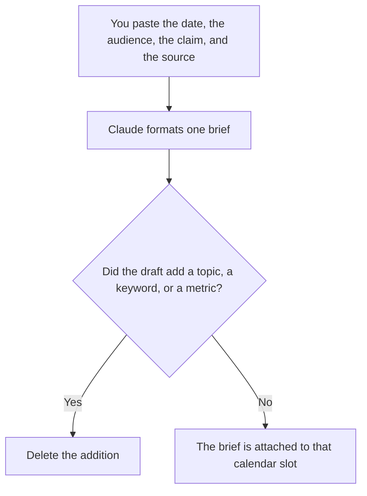

**A content calendar brief written with AI is the assignment for one dated slot: who it is for, the single claim you can source, the format, and the owner.** The model may format notes you paste. It may not invent a topic, a keyword, or a promise. The board those briefs have to match is [how to build an AI content calendar](/blog/how-to-build-an-ai-content-calendar-2026/). The longer research brief is [how to build a content brief with AI](/blog/how-to-build-a-content-brief-with-ai-2026/). This page is one cell, not the month.

The voice the slot has to sound like is [how to create a brand voice with AI](/blog/how-to-create-a-brand-voice-with-ai-2026/). Turning one finished piece into other slots is [how to create a content repurposing plan with AI](/blog/how-to-create-a-content-repurposing-plan-with-ai-2026/).

Prices are US list prices excluding tax from directory pages checked October 16, 2026. A live fetch of vendor pricing pages returned HTTP 401 on October 24, 2026, so this page stays on the directory record. Published October 24, 2026. We did not score rankings or engagement.

## What fits in the brief

| Block | Who owns it | The model may |
|---|---|---|
| Date and channel | The slot already on the calendar | Copy it. It may not move the date to a "better" day |
| Audience | The person you named for this slot | Copy it. It may not widen it to everyone |
| Claim | One sentence you can source | Phrase it. It may not add a second claim |
| Source | The page, the data pull, or the quote you have | Place the link or the id. It may not fetch a new stat |
| Format | A post, a newsletter, a clip, as you specified | Name it. It may not add three derivative posts |
| Owner | A person who can kill the slot | Copy the name |

A brief that says "thought leadership on AI" is not a brief. The claim is a sentence a reader could disagree with, and the source is something you can open. If the source is missing, the block says Source missing and the slot does not get a writer.

## Where the brief is written

**The draft.** [Claude](/tools/claude/) Pro is $20 a month, or $17 billed annually, when the voice card and the last briefs live in a Project. The review is [Claude review](/blog/claude-review-2026/).

**The calendar page.** [Notion AI](/tools/notion-ai/) Business is $20 a seat a month if the slot and the brief are the same database the team already opens. The model may fill a property from the brief. It may not create a row you did not ask for.

**A second pass on the sentence.** [ChatGPT](/tools/chatgpt/) Plus at $20 a month can tighten the claim. Discard a keyword it added because the slot "needed SEO." The SEO outline, when you are ready for one, is [how to use AI for SEO briefs](/blog/how-to-use-ai-for-seo-briefs-2026/).

**The line.** [Grammarly](/tools/grammarly/) Pro is $12 a member a month billed annually, or $30 monthly. It will not notice a fabricated statistic. You will. The invoice is [Grammarly pricing explained](/blog/grammarly-pricing-explained-2026/).

A prompt that holds the line:

"Format a brief for this one calendar slot from the date, channel, audience, claim, source, and owner I pasted. One claim. Do not add a topic, a keyword, or a metric. If the source is missing, write Source missing. Do not draft the asset."

## What not to delegate

Do not ask the model to fill an empty month. That is how you publish claims you cannot source. Do not turn the brief into the asset in the same step. The draft comes after a person accepts the claim. Do not let a repurposing plan create slots the calendar owner did not date. Empty space on a calendar is allowed.

## FAQ

### How is this different from the content calendar article?

That article is the board: what exists, on which dates, from material you have. This article is the assignment on one of those dates. A calendar without briefs is a list of titles. A brief without a date is a pitch. You want both, and they should point at each other.

### Can the model suggest the claim?

It can show you two phrasings of a claim you already wrote. It cannot discover a claim by looking at the category. A sharper sentence that cites a number you did not provide is a worse brief. Mark it Source missing.

### What if the slot is a podcast clip or a social post?

The format block names it. The claim still needs a source, which may be the episode and the timestamp, or the post you are cutting from. The clip workflow is [Descript vs CapCut for podcast clips](/blog/descript-vs-capcut-for-podcast-clips-2026/). The brief does not pick the editor.

### Who kills the slot?

The owner on the brief. A model that offers to "keep the cadence" by inventing a claim has left the job. Cadence is optional. A sourced claim is not.

## Last verified

October 16, 2026 for Claude, Notion AI, ChatGPT, and Grammarly. Published October 24, 2026. Live pricing fetches returned HTTP 401 that day.

**Sources:** [Claude pricing](https://claude.com/pricing), [Notion pricing](https://www.notion.com/pricing), [ChatGPT pricing](https://chatgpt.com/pricing/), [Grammarly pricing](https://www.grammarly.com/plans).

*Published by Andrew for [AI Tools Optimizer](https://aitoolsoptimizer.com).*

[Claude](/tools/claude/) is in the [writing directory](/tools/category/writing/). Directory pages may use affiliate links. A purchase through them may earn us a commission at no extra cost to you.
