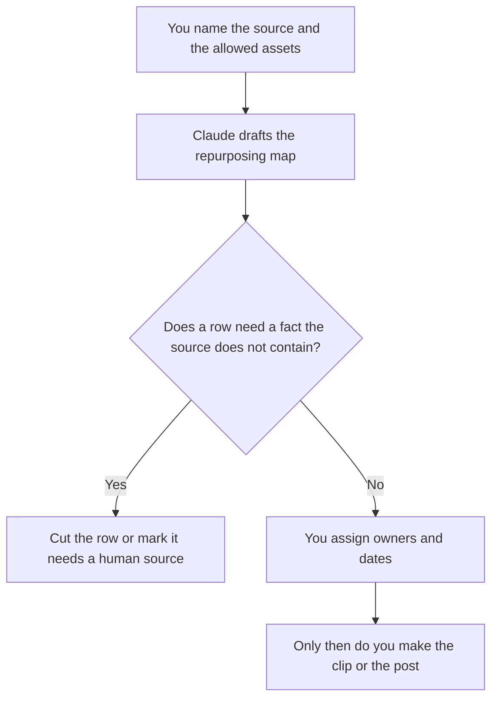

**A content repurposing plan created with AI is a map: one source you already published or recorded, the assets you will make from it, the owner, and the date.** The model may turn that map into a table. It may not invent a source, a statistic, or a channel. Making the clip or the post is a later step, after the map is real.

Turning one webinar into pieces is [how to repurpose a webinar with AI](/blog/how-to-repurpose-a-webinar-with-ai-2026/). Turning one post into social lines is [how to create social posts from a blog with AI](/blog/how-to-create-social-posts-from-a-blog-with-ai-2026/). The calendar those dates land on is [how to build an AI content calendar](/blog/how-to-build-an-ai-content-calendar-2026/). The team that runs the system is [best AI tools for content ops](/blog/best-ai-tools-for-content-ops-2026/).

Prices are US list prices excluding tax from directory pages checked October 16, 2026. Published October 24, 2026. We did not score distribution. A plan is not a published asset.

## The columns that have to be real

| Column | Who owns it | The model may |
|---|---|---|
| Source | A URL or a file you name, with a date | Copy it. It may not pick a "top post" |
| Asset | The format you asked for: clip, newsletter, slide, post | List only formats you allowed |
| Channel | Where that asset will go | Copy your list. It may not add a network |
| Owner | The person who edits and ships | Leave Missing if unnamed |
| Date | When it ships | Copy it. It may not fill the quarter |
| Claim check | Whether numbers must match the source | Mark any line that would need a new fact |

One source can feed several assets. Each asset still gets an owner. A map that says "clip, thread, newsletter, deck" with no names is a wish. The model will happily produce that wish. Your job is the names and the dates.

## Where the map is kept

**The page of record.** [Notion AI](/tools/notion-ai/) Business is $20 a seat a month. The map lives next to the calendar. Free includes a trial of Notion AI. The record rule is [what a system of record for AI is](/blog/what-is-a-system-of-record-for-ai-2026/).

**The draft of the map.** [Claude](/tools/claude/) Pro is $20 a month, or $17 billed annually, when the source is long and should stay in a Project. Free can map one short source. The review is [Claude review](/blog/claude-review-2026/).

**The clip, after the map says clip.** [Opus Clip](/tools/opusclip/) Free includes 60 credits a month, and free clips cannot be exported after 3 days. Starter is $15 a month for 150 credits. Pro is $29 a month, or $14.50 billed annually. Use it when a row on the map says "short video," not to decide that every webinar needs twelve clips. The invoice is [Opus Clip pricing explained](/blog/opusclip-pricing-explained-2026/).

**The slides, after the map says slides.** [Gamma](/tools/gamma/) Plus is $9 a seat a month with 1,000 credits. The deck still uses only claims from the source. The sales-deck comparison is a different job: [Gamma vs Beautiful.ai for sales decks](/blog/gamma-vs-beautiful-ai-for-sales-decks-2026/).

A prompt that holds the line:

"Make a repurposing map from the source I named and the asset types I allowed. Do not add a channel. Do not add a statistic. If an owner or a date is missing, write Missing. Do not write the assets yet."

## What not to delegate

Do not ask which post "performed" unless you pasted the numbers. Do not let the model write the derivative before the map exists. Do not repurpose a customer's story, a lyric, or a quote you do not have rights to. The check on claims is [how to fact-check AI writing](/blog/how-to-fact-check-ai-writing-2026/).

The field version of this map, when the source is an event, belongs with [best AI tools for field marketing](/blog/best-ai-tools-for-field-marketing-2026/). The always-on acquisition program is [best AI tools for demand gen](/blog/best-ai-tools-for-demand-gen-2026/).

## FAQ

### Can AI choose the source?

It can list sources you pasted. Picking the source is an editorial decision. A model that selects your "best" post from memory is guessing. Paste the URL.

### Is the plan the same as making the posts?

The plan is the table. The posts and the clips are the how-to articles linked above. Teams skip the table and then republish the same paragraph five times. The table is what makes the five pieces different on purpose.

### How many assets should one source become?

As many as you named owners for. An unowned row will not ship. Start with the ones you will actually edit this month. Add rows when a person takes them.

### What if the source is a video we have not published?

You can still map it. Mark the source as unpublished and do not schedule public dates until the source itself is cleared. A clip can ship before the long cut only if you meant that, and you wrote it down.

## Last verified

October 16, 2026 for Notion AI, Claude, Opus Clip, and Gamma. Published October 24, 2026.

**Sources:** [Notion pricing](https://www.notion.com/pricing), [Claude pricing](https://claude.com/pricing), [Opus Clip pricing](https://www.opus.pro/pricing), [Gamma pricing](https://gamma.app/pricing).

*Published by Andrew for [AI Tools Optimizer](https://aitoolsoptimizer.com).*

[Opus Clip](/tools/opusclip/) is in the [video directory](/tools/category/video/). Directory pages may use affiliate links. A purchase through them may earn us a commission at no extra cost to you.
