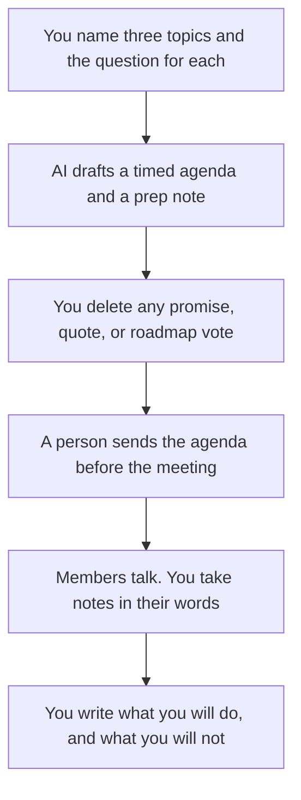

**A customer advisory board agenda written with AI is a timed list of topics you want customers to react to, the prep you will send, and the decisions you are not asking them to make.** The model can fit the topics into the hour and plain the language. It cannot invent what customers think, attribute a quote to a member, or turn the meeting into a roadmap approval. A CAB advises. It does not vote your plan into existence.

A generic internal meeting is [how to create meeting agendas with AI](/blog/how-to-create-meeting-agendas-with-ai-2026/). A quarterly review for one customer, with their numbers, is [how to write a QBR deck with AI](/blog/how-to-write-a-qbr-deck-with-ai-2026/). The discovery questions you use one-on-one are [how to create a sales discovery script with AI](/blog/how-to-create-a-sales-discovery-script-with-ai-2026/).

Prices are US list prices excluding tax from directory pages checked October 16, 2026. Published October 24, 2026. We did not score meeting quality. Send the agenda only if a person who owns the relationship has read it.

## What belongs on the agenda

| Block | Who owns it | The model may |
|---|---|---|
| Purpose | You, in one sentence | Shorten it. It may not promise a feature |
| Topics | You, each with a question customers can answer | Order them and add times you approve |
| Prep | The page or the numbers you will send ahead | List the attachments you named. It may not add a slide |
| Who speaks | The facilitator and the member you asked | Not a script that puts words in a customer's mouth |
| Out of scope | Roadmap votes, other customers' confidential data, a surprise price change | Keep the box. It may not delete it for tone |
| Follow-up | The date you will write back | Not a commitment you did not make |

A fake customer quote in the pre-read is [a hallucination](/blog/what-is-ai-hallucination-2026/) with a name on it. If you want to share a theme from prior calls, label it as your summary and do not attribute it to a member who has not agreed.

## Where the agenda is drafted

**The hour.** [Claude](/tools/claude/) Pro is $20 a month, or $17 billed annually. Keep the out-of-scope box in a Project so every CAB starts from the same rules. The review is [Claude review](/blog/claude-review-2026/).

**The page members can open.** [Notion AI](/tools/notion-ai/) Business is $20 a seat a month if the board's materials live there. The agenda is a page with a date, not a chat. Plus at $10 is not the full AI tier. The invoice is [Notion AI pricing explained](/blog/notion-ai-pricing-explained-2026/).

**A short deck, if you must show one.** [Gamma](/tools/gamma/) Plus is $9 a seat a month, or $108 a year, when a link is acceptable. Keep it to the topics. A 20-slide briefing is an announcement. The invoice is [Gamma pricing explained](/blog/gamma-pricing-explained-2026/).

**Notes, if members know how notes are taken.** [Granola](/tools/granola/) Business is $14 a user a month, with no bot on the call. [Fathom](/tools/fathom/) Free includes unlimited recordings if a bot is allowed and the group has agreed. A CAB is a poor place for a surprise bot. The split is [Granola vs Fathom](/blog/granola-vs-fathom-2026/).

A prompt that holds the line:

"Draft a 60-minute customer advisory board agenda from these topics and questions only. Include prep we will send, time boxes, and an out-of-scope list I pasted. Do not invent customer quotes. Do not ask the board to approve a roadmap. Do not add a topic. If a time box is missing, mark it Missing rather than filling the hour with a presentation."

The facilitator is [what human-in-the-loop AI is](/blog/what-is-human-in-the-loop-ai-2026/). The page you keep is [what a system of record for AI is](/blog/what-is-a-system-of-record-for-ai-2026/).

## After they leave

Write three lines: what you heard, what you will change, and what you will not change. Send it. Silence after a CAB teaches members that the meeting was theater. The model may format those three lines from notes you paste. It may not upgrade "we heard a request" into "we committed."

Do not paste one member's confidential numbers into the next pre-read. A summary across accounts needs permission and aggregation you can defend. If you cannot say it to the whole board, it is not on the agenda.

## FAQ

### How many topics fit in an hour?

Three, if you intend to listen. The model will happily schedule eight. You delete down to the questions you can act on. A topic with no question is a presentation. Move it to an email.

### Should customers see a roadmap?

Only the slice you are willing to discuss as input, labeled as not a commitment. An unreleased date in a pre-read is a launch. If product has not approved the sentence, it is not in the agenda.

### Can AI write the follow-up as if we agreed?

No. Agreement is what the notes show a person said. The follow-up repeats that, plus what your company will do. A smoother email that adds a promise is the bug this workflow exists to prevent.

### Is a CAB a sales call?

Members may buy from you. The agenda is still not a pitch. The discovery script is for a deal. This agenda is for advice you asked a group to give. Mixing them is how the board stops coming.

## Last verified

October 16, 2026 for Claude, Notion AI, Gamma, Granola, and Fathom. Published October 24, 2026.

**Sources:** [Claude pricing](https://claude.com/pricing), [Notion pricing](https://www.notion.com/pricing), [Gamma pricing](https://gamma.app/pricing).

*Published by Andrew for [AI Tools Optimizer](https://aitoolsoptimizer.com).*

[Notion AI](/tools/notion-ai/) is in the [productivity and notes directory](/tools/category/productivity-notes/). Directory pages may use affiliate links. A purchase through them may earn us a commission at no extra cost to you.
