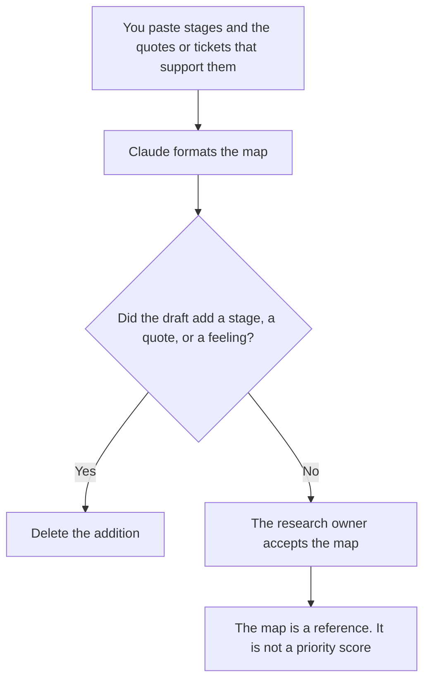

**A customer journey map written with AI is a table of stages you already observed, with the evidence you can point at for what the customer does, thinks, and needs at each one.** The model may format the grid and cluster notes you pasted. It may not invent a persona, a quote, or a pain. A stage with no evidence stays empty. An empty cell is more honest than a stock photo's feelings.

The person on the map, if you build one from interviews, is [how to create a user persona with AI](/blog/how-to-create-a-user-persona-with-ai-2026/). The questions before the call are [how to create a user interview guide with AI](/blog/how-to-create-a-user-interview-guide-with-ai-2026/). The notes after the call are [how to write a customer interview debrief with AI](/blog/how-to-write-a-customer-interview-debrief-with-ai-2026/).

Prices are US list prices excluding tax from directory pages checked October 16, 2026. Published October 24, 2026. We did not score journeys. A map is not a roadmap, and the model does not prioritize the backlog.

## The lines that have to be real

| Line | Who owns it | The model may |
|---|---|---|
| Stage | A step you named, in the customer's words or yours | List them in your order. It may not add "advocacy" to look complete |
| Do | An action you saw or a customer described | Shorten it. It may not invent a click |
| Evidence | The interview, ticket, or analytic you pasted | Cite only that source |
| Pain | A friction the evidence states | Copy it. It may not heighten the emotion |
| Gap | What you do not know | Leave the cell blank, or write Unknown |
| Owner | Who on your side watches this stage | Leave Missing if unnamed |

Five stages is not a law. If you only saw three, you have three. The model likes a neat arc from awareness to loyalty. Delete the arc if you did not observe it. A journey you hope for is a strategy doc. Label it as a hypothesis, in a separate column, so nobody treats it as a finding.

## Where the map lives

**The record.** [Notion AI](/tools/notion-ai/) Business is $20 a seat a month if the map and the interview notes live together. A quote on the map links to the debrief. A quote with no link does not ship.

**The draft.** [Claude](/tools/claude/) Pro is $20 a month, or $17 billed annually, when several debriefs should sit in a Project. The review is [Claude review](/blog/claude-review-2026/). Cluster only the notes you pasted. A cluster named by the model is a suggestion. You rename it or you reject it.

**The call.** [Granola](/tools/granola/) Business is $14 a user a month for the interview itself, without a bot. The transcript aid is not the map. The debrief article is the step between them.

**The picture, after the table.** [Figma](/tools/figma/) Starter is free. A Full seat on Professional is $16 a month billed annually, with 3,000 AI credits, on the October 16 card. Draw the map after the table is true. A pretty FigJam of invented pains is still invented. The design-system seat, if this map has to match components, is [best AI tools for design ops](/blog/best-ai-tools-for-design-ops-2026/).

A prompt that holds the line:

"Format a journey map from the stages and evidence I pasted. Do not add a stage. Do not invent a quote. If a cell has no evidence, write Unknown. Do not assign a priority. Do not create a persona name."

## What not to delegate

Do not ask the model what customers feel. Do not paste a persona from another product and ask it to adapt the feelings. Do not turn the map into a feature list. Features are a PRD: [how to write a PRD with AI](/blog/how-to-write-a-prd-with-ai-2026/). The account plan that follows a real customer, one logo at a time, is [how to write a customer success plan with AI](/blog/how-to-write-a-customer-success-plan-with-ai-2026/).

## FAQ

### Is the journey map the persona?

The persona is a composite you built from interviews, with the limits that article states. The journey map is the stages. You can have a map of stages with no named persona. You should not have a persona whose journey is unsupported by the same interviews.

### Can AI find the stages in a pile of tickets?

It can group tickets under stage names you already wrote. It should not name the stages from scratch and have you adopt them because the clusters look tidy. If a ticket fits none, the label is Untagged, and you decide whether the map is missing a stage.

### What if we have no interviews yet?

Then you do not have a journey map yet. You have a hypothesis. Label every cell Hypothesis. Run the interviews. Replace the cells with evidence, or leave them Unknown. Do not let a hypothesis pick up a date and become a finding.

### Can the map include a metric?

Only a metric you already collect, pasted with the source. A drop-off the model inferred from a story is not analytics. Leave the number out until the instrument exists.

## Last verified

October 16, 2026 for Notion AI, Claude, Granola, and Figma. Published October 24, 2026.

**Sources:** [Notion pricing](https://www.notion.com/pricing), [Claude pricing](https://claude.com/pricing), [Figma pricing](https://www.figma.com/pricing/), [Granola](https://www.granola.ai).

*Published by Andrew for [AI Tools Optimizer](https://aitoolsoptimizer.com).*

[Figma](/tools/figma/) is in the [design directory](/tools/category/design/). Directory pages may use affiliate links. A purchase through them may earn us a commission at no extra cost to you.
