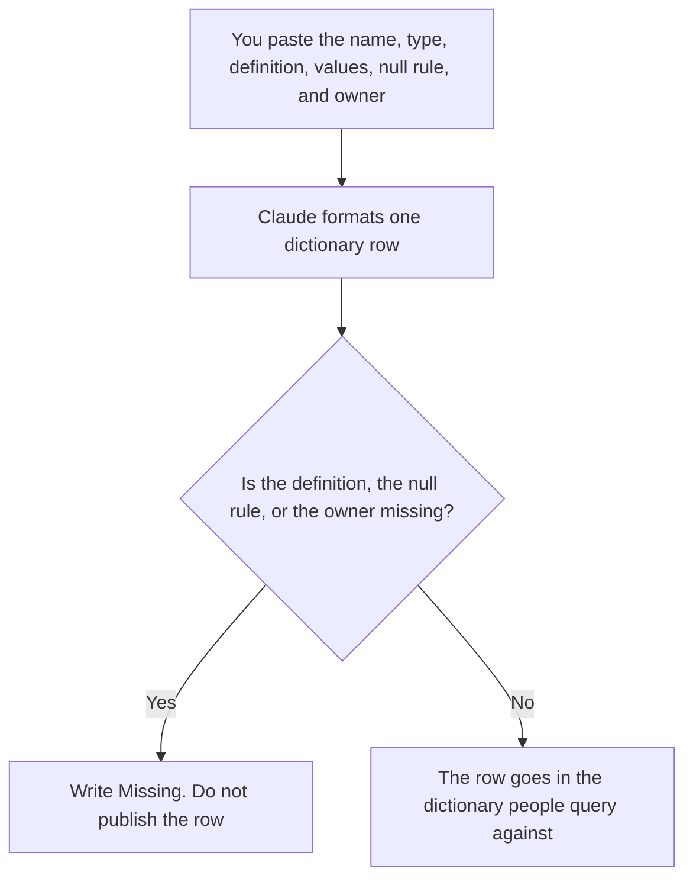

**A data dictionary entry written with AI is one field: the name, the type, the owner, the allowed values, the source, and what null means.** The model may format the row. It may not invent a business definition, a formula, or a sample of real customer values. The queries that will cite the field are [Gemini vs Claude for SQL drafts](/blog/gemini-vs-claude-for-sql-drafts-2026/). Fake rows for a test, which are a different artifact, are [how to create a test data plan with AI](/blog/how-to-create-a-test-data-plan-with-ai-2026/). Where a number came from, after the fact, is [what AI data lineage is](/blog/what-is-ai-data-lineage-2026/).

Prices are US list prices excluding tax from directory pages checked October 16, 2026. A live fetch of vendor pricing pages on October 24, 2026 returned HTTP 401, so this page stays on the directory record. Published October 24, 2026. We did not score definitions.

## What one entry contains

| Field | Who owns it | The model may |
|---|---|---|
| Name | The source system | Copy it. It may not rename the column to sound clearer |
| Type | The source system | Copy it. It may not coerce a string into a date |
| Definition | The business owner | Format words you pasted. It may not supply the meaning |
| Allowed values | You, or a profile you already ran | List them. It may not add a value it has not seen |
| Null | You | Say what a null means here. "Unknown" is allowed only if you wrote it |
| Owner | A person | Copy the name. If it is missing, stop |

A warehouse can hold a column for a year with three meanings. The entry is how you stop a fourth. If two teams disagree, the row says the disagreement and names who will resolve it. The model does not pick a winner because one phrasing was smoother.

Lineage tells you which jobs touched the column. The dictionary tells you what a value means. A lineage graph with no definition is a map of a word nobody shares. A definition with no owner will drift the next time a dashboard renames the metric.

## Where the entry is written

**The dictionary page.** [Notion AI](/tools/notion-ai/) Business is $20 a seat a month if that database is the dictionary. The invoice is [Notion AI pricing explained](/blog/notion-ai-pricing-explained-2026/). A wiki that is not this row is [Notion AI vs ChatGPT for wikis](/blog/notion-ai-vs-chatgpt-for-wikis-2026/).

**The long definition.** [Claude](/tools/claude/) Pro is $20 a month, or $17 billed annually, when the entry sits beside a metric spec. The review is [Claude review](/blog/claude-review-2026/).

**A profile of values you exported.** [Hex](/tools/hex/) Professional is $36 an editor a month if you already profile columns there. Paste the distinct values you computed. Do not ask the notebook's agent to infer the business meaning from a sample of production rows you should not have exported.

**A single row, from a paste.** [ChatGPT](/tools/chatgpt/) Plus is $20 a month. Discard an entry that adds an example using a real-looking email or a real-looking account id.

A prompt that holds the line:

"Format one dictionary entry from the name, type, definition, allowed values, null rule, and owner I pasted. Do not add a value. If the definition is missing, write Definition missing and stop."

## What not to delegate

Do not ask the model what the field "probably" means. Do not paste a production extract so it can guess. Do not publish two entries for one column under two friendly names. The SQL draft has to use the name the warehouse uses. The person who reads these rows every week is [best AI tools for product ops analysts](/blog/best-ai-tools-for-product-ops-analysts-2026/), when the field is a product event, and [best AI tools for data analysts](/blog/best-ai-tools-for-data-analysts-2026/) when it is the wider warehouse.

## FAQ

### How is a dictionary entry different from a test data plan?

The entry says what a real value means. The test plan says which fake rows you may load, and that they are fake. A test plan that invents an allowed value the dictionary does not list will create a third meaning. Write the entry first.

### Can the model fill allowed values from a CSV?

Only if you pasted the distinct values and you are allowed to paste them. A CSV of customers is the wrong input. A list of status codes you already aggregated is the right input. The model does not get to add "other" because lists usually have one.

### What if null means two things?

Say both, and name the job that produces each. If you cannot, the null rule is "overloaded" and the owner has a cleanup. The entry should not pretend null is simple.

### Who may change the definition?

The owner on the row. A helpful edit in a chat is a proposal. Dashboards that used the old meaning need a note when the meaning changes. That note is a person. The model can format it after the owner writes the change.

## Last verified

October 16, 2026 for Notion, Claude, Hex, and ChatGPT. Published October 24, 2026.

**Sources:** [Notion pricing](https://www.notion.com/pricing), [Claude pricing](https://claude.com/pricing), [Hex pricing](https://hex.tech/pricing), [ChatGPT pricing](https://chatgpt.com/pricing/).

*Published by Andrew for [AI Tools Optimizer](https://aitoolsoptimizer.com).*

[Notion AI](/tools/notion-ai/) is in the [productivity and notes directory](/tools/category/productivity-notes/). Directory pages may use affiliate links. A purchase through them may earn us a commission at no extra cost to you.
