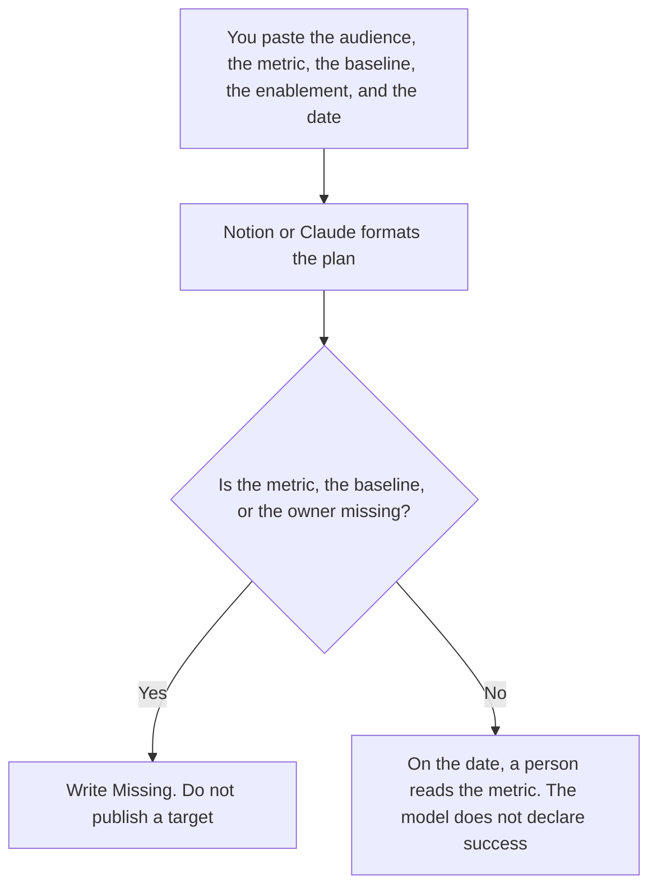

**A feature adoption plan written with AI names who should use the feature, which metric you already defined, what enablement you will actually do, and the date you will look.** The model may format those rows. It may not invent a target lift, a persona, or a launch date. The technical slice, flag by flag, is [how to create a feature flag rollout plan with AI](/blog/how-to-create-a-feature-flag-rollout-plan-with-ai-2026/). The public sentence after it ships is [how to write a changelog announcement with AI](/blog/how-to-write-a-changelog-announcement-with-ai-2026/). The email, if you send one, is [how to create a feature announce email with AI](/blog/how-to-create-a-feature-announce-email-with-ai-2026/).

Prices are US list prices excluding tax from directory pages checked October 16, 2026. A live fetch of vendor pricing pages on October 24, 2026 returned HTTP 401, so this page stays on the directory record. Published October 24, 2026. We did not score adoption.

## What belongs on the plan

| Row | Who owns it | The model may |
|---|---|---|
| The audience | The product owner | Copy the segment you named. It may not add a persona |
| The metric | The analyst who defined it | Copy the name and the grain. It may not set a target |
| The baseline | A number you already pulled | Paste it. An empty cell stays empty |
| The enablement | The person who will do it | List the doc, the tour, or the training you named |
| The date | You | Copy it. A "30-day check" needs a calendar date |

A plan that says "drive adoption" is a slogan. The metric has a name you can find in the warehouse or the product analytics tool: the share of the audience who completed the action, in the window you wrote. If that definition does not exist yet, write the dictionary entry first. That workflow is [how to create a data dictionary entry with AI](/blog/how-to-create-a-data-dictionary-entry-with-ai-2026/). The flag plan says who is exposed. This plan says whether the people who were exposed did the thing. They can disagree, and that disagreement is useful. Do not average them into one number the model prefers.

## Where the plan is written

**The page the team will open.** [Notion AI](/tools/notion-ai/) Business is $20 a seat a month if that is the system of record. Plus at $10 is not the full AI tier. The invoice is [Notion AI pricing explained](/blog/notion-ai-pricing-explained-2026/).

**The long draft.** [Claude](/tools/claude/) Pro is $20 a month, or $17 billed annually, when the plan sits beside the metric definition. The model may not propose a target percentage. The review is [Claude review](/blog/claude-review-2026/).

**The query that produces the baseline.** [Hex](/tools/hex/) Professional is $36 an editor a month if the notebook is where analysts already publish. You run the query. A generated chart without the definition next to it is not the baseline. Community is free and is a trial, on the directory card.

**A one-page version.** [ChatGPT](/tools/chatgpt/) Plus is $20 a month. Discard a plan that adds a webinar, a contest, and a target of "50% in two weeks" because launches "usually need energy."

A prompt that holds the line:

"Format an adoption plan from the audience, metric, baseline, enablement, and date I pasted. Do not invent a target. If the baseline is missing, write Baseline missing and stop."

## What not to delegate

Do not ask the model whether the feature is a success. Do not use a different definition in the plan and in the flag rollout. Do not announce a target externally that the plan left blank. The analyst who lives in these numbers is [best AI tools for product ops analysts](/blog/best-ai-tools-for-product-ops-analysts-2026/).

## FAQ

### How is this different from a flag rollout plan?

The flag plan is who is exposed, in what order, and how you turn it off. The adoption plan is what those people should do, how you will teach them, and which number you will read on a date. You can roll a flag to 100% and still have no adoption plan. You should not pretend the exposure percentage is the adoption metric.

### Can the model set the target?

No. A target is a decision by the owner, from a baseline you have. If the baseline cell is empty, the plan does not get a target. "Industry standard" is not a baseline.

### What counts as enablement?

The thing you will actually do: a doc you will update, a tour you will turn on, a training you have scheduled. A list of ten ideas is not enablement. One owner and one artifact is.

### Who signs it?

The product owner and the person who owns the metric. A model does not sign. A page with no date is a wish.

## Last verified

October 16, 2026 for Notion, Claude, Hex, and ChatGPT. Published October 24, 2026.

**Sources:** [Notion pricing](https://www.notion.com/pricing), [Claude pricing](https://claude.com/pricing), [Hex pricing](https://hex.tech/pricing), [ChatGPT pricing](https://chatgpt.com/pricing/).

*Published by Andrew for [AI Tools Optimizer](https://aitoolsoptimizer.com).*

[Notion AI](/tools/notion-ai/) is in the [productivity and notes directory](/tools/category/productivity-notes/). Directory pages may use affiliate links. A purchase through them may earn us a commission at no extra cost to you.
