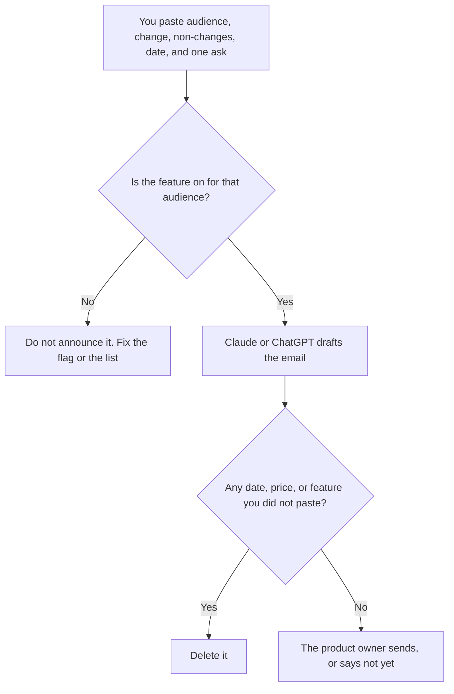

**A feature announcement email written with AI tells a reader who the change is for, what changed, and what to do next, using only the brief you paste.** The model may cut jargon. It may not invent a launch date, a price, a limit, or a customer quote. If the brief says the feature is behind a flag, the email says who has it. A blast that announces a feature the reader cannot open is a support ticket.

A recurring letter is a different file: [how to create a newsletter with AI](/blog/how-to-create-a-newsletter-with-ai-2026/). The page the email should match, when money is involved, is [how to write a pricing page with AI](/blog/how-to-write-a-pricing-page-with-ai-2026/). The check is [how to fact-check AI writing](/blog/how-to-fact-check-ai-writing-2026/). Whether the feature is actually on for this audience is [what AI feature flags are](/blog/what-is-ai-feature-flags-2026/).

Prices for the writing tools are US list prices excluding tax from directory pages checked October 16, 2026. Published October 24, 2026. We did not score open rates. This page does not write your launch.

## What the model may touch

| Block | Who owns the fact | The model may |
|---|---|---|
| Who receives it | You, including plan and region | Repeat the audience. It may not say "everyone" |
| What changed | The brief, in product's words | Shorten it. It may not add a capability |
| What did not change | You, especially price and limits | State the non-change. Silence reads as a new charge |
| The date | The date you pasted | Copy it. It may not write "available now" |
| The ask | One action: open the doc, join the webinar, reply | Keep one ask. It may not add a second offer |
| The voice | A sample you pasted, if you have one | Mimic it. It may not invent a slogan |

The brand sample, if you use one, is [how to create a brand voice with AI](/blog/how-to-create-a-brand-voice-with-ai-2026/). Voice does not outrank the brief. A clever subject line that implies a discount you did not approve is a defect.

## Where the sentences are drafted

**The draft.** [Claude](/tools/claude/) Pro is $20 a month, or $17 billed annually. Put the brief in a Project so the next announcement does not inherit last quarter's price. The review is [Claude review](/blog/claude-review-2026/).

**The team that already lives in chat.** [ChatGPT](/tools/chatgpt/) Plus is $20 a month. Business is $20 a user a month billed annually, minimum two, when the feature is unreleased. A personal free account is the wrong place for an embargoed launch. The ladder is [ChatGPT Go vs Plus vs Pro](/blog/chatgpt-go-vs-plus-vs-pro-2026/).

**The line edit.** [Grammarly](/tools/grammarly/) Pro is $12 a member a month billed annually, or $30 monthly. It will not know whether the feature is live. The invoice is [Grammarly pricing explained](/blog/grammarly-pricing-explained-2026/).

**The brief's home.** [Notion AI](/tools/notion-ai/) Business is $20 a seat a month. The sent email should match the brief, including the date. Plus at $10 is not the full AI tier. The invoice is [Notion AI pricing explained](/blog/notion-ai-pricing-explained-2026/).

A prompt that holds the line:

"Write a feature announcement email from this brief only. Name the audience, the change, what did not change, the date, and one action. If a price or a limit is not in the brief, do not mention it. Do not invent quotes, percentages, or 'available to all customers.' Keep it under 200 words. Give me a subject line that states the change."

The person who clicks send is [what human-in-the-loop AI is](/blog/what-is-human-in-the-loop-ai-2026/). A capability the build does not have is [what an AI hallucination is](/blog/what-is-ai-hallucination-2026/).

## The mail after the mail

If the announcement needs a live walkthrough, the deck is [Gamma vs Canva for webinars](/blog/gamma-vs-canva-for-webinars-2026/), and the script is [how to create a webinar script with AI](/blog/how-to-create-a-webinar-script-with-ai-2026/). The email and the deck use the same date. If support will get questions, give them the same brief. The escalation path for those questions is [how to create a support escalation matrix with AI](/blog/how-to-create-a-support-escalation-matrix-with-ai-2026/).

Do not attach a screenshot of a screen the reader cannot reach. Do not announce a price change inside a feature email unless finance put that price in the brief. Those are different decisions, and the model will happily merge them.

## FAQ

### Can AI choose the audience?

It can format a segment you name. It cannot decide that a feature is safe for every plan. The list comes from the flag and the billing system. A model that says "all users" has made a product decision.

### How many emails should one feature get?

The one you can keep true. A launch note and a follow-up are enough for most changes. A five-email sequence that restates an unreleased feature will train readers to ignore you. The newsletter workflow is for a cadence. This page is for a change.

### Should we mention competitors?

Not in this email. Competitive language belongs in the internal narrative, sourced: [how to write a competitive battle narrative with AI](/blog/how-to-write-a-competitive-battle-narrative-with-ai-2026/). The customer email describes your change.

### What if legal has not reviewed it?

Then it is not ready to send. The model can draft. Legal and the product owner approve claims, especially anything about security, uptime, or price. Put their names on the brief. An unapproved draft in a scheduling tool is how it sends itself.

## Last verified

October 16, 2026 for Claude, ChatGPT, Grammarly, and Notion AI. Published October 24, 2026.

**Sources:** [Claude pricing](https://claude.com/pricing), [ChatGPT pricing](https://chatgpt.com/pricing/), [Grammarly Pro cost](https://support.grammarly.com/hc/en-us/articles/115000090011-How-much-does-Grammarly-Pro-cost), [Notion pricing](https://www.notion.com/pricing).

*Published by Andrew for [AI Tools Optimizer](https://aitoolsoptimizer.com).*

[Claude](/tools/claude/) is in the [chatbots and assistants directory](/tools/category/chatbots-assistants/). Directory pages may use affiliate links. A purchase through them may earn us a commission at no extra cost to you.
