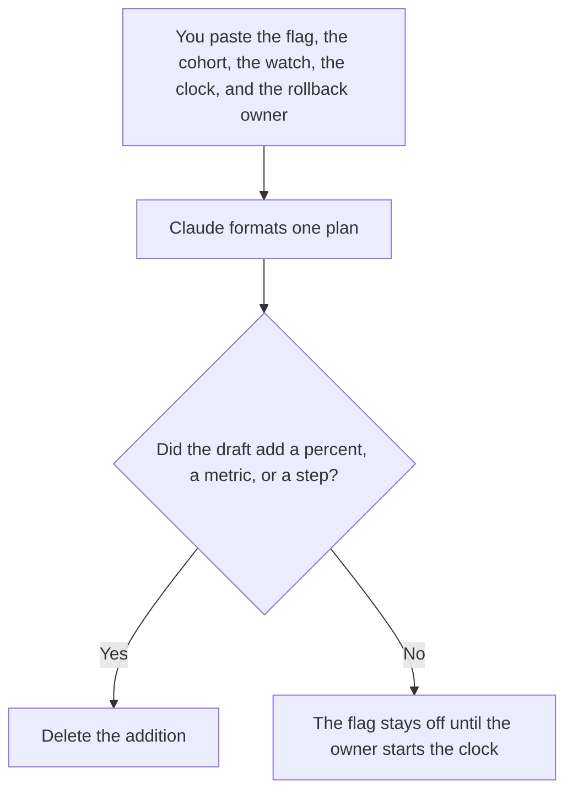

**A feature-flag rollout plan written with AI is a one-page record of the flag name, the cohort, the watch numbers, the clock, and the person who can turn the flag off.** The model may format notes you paste. It may not invent a percentage, a success metric, or a rollback step. The switch itself is [what AI feature flags are](/blog/what-is-ai-feature-flags-2026/). Who sees the new behavior first is [what an AI canary release is](/blog/what-is-ai-canary-releases-2026/). The version you place on the path is [what an AI canary deployment is](/blog/what-is-ai-canary-deployment-2026/).

The page you open when the watch numbers go bad is [what an AI runbook is](/blog/what-is-an-ai-runbook-2026/). Moving back to the fixed version later is [what AI rollforward is](/blog/what-is-ai-rollforward-2026/).

Prices are US list prices excluding tax from directory pages checked October 16, 2026. A live fetch of vendor pricing pages returned HTTP 401 on October 24, 2026, so this page stays on the directory record. Published October 24, 2026. We did not score rollout safety. The directory does not list a feature-flag vendor fee, so this page does not invent one.

## What fits on the plan

| Block | Who owns it | The model may |
|---|---|---|
| Flag | The name that exists in the system | Copy it. It may not rename it to sound clearer |
| Cohort | A percent, a tenant, or an internal list you wrote | Copy it. It may not "start at 5 percent" |
| Change | One version id | Refuse a plan that bundles three changes |
| Watch | Two or three counts, with the band you accept | List them. It may not add a vanity metric |
| Clock | A time box and the decision at the end | Copy it. It may not leave the plan open-ended |
| Rollback | The person and the control that returns the last version | Copy the steps you wrote. It may not invent a revert |

A plan with no rollback owner is a launch note. Do not start the clock. A plan that changes the prompt, the model, and the tool list under one flag is three plans. Split them so the off switch means one thing.

## Where the plan is written

**The draft.** [Claude](/tools/claude/) Pro is $20 a month, or $17 billed annually, when standing rollout notes live in a Project. Free can format one paste. The review is [Claude review](/blog/claude-review-2026/).

**The record.** [Notion AI](/tools/notion-ai/) Business is $20 a seat a month if this plan is the page the reviewer opens. The flag system remains the control. The page is not the flag.

**The code comment next to the flag.** [Cursor](/tools/cursor/) Plus is $8 a month, or $80 a year, when the plan's version id has to match the branch. You still compare the names yourself. The ladder is [Cursor pricing explained](/blog/cursor-pricing-explained-2026/).

**A short card.** [ChatGPT](/tools/chatgpt/) Plus at $20 a month can reuse the same headings. Discard a cohort it invented. The review is [ChatGPT review](/blog/chatgpt-review-2026/).

A prompt that holds the line:

"Format a feature-flag rollout plan from the flag name, cohort, version id, watch counts, clock, and rollback owner I pasted. Do not add a percentage or a metric. If rollback is missing, write Rollback missing and stop. Do not tell me to turn the flag on."

## What not to delegate

Do not ask the model whether it is safe to go to 100 percent. Do not let the plan and the flag config drift. The name on the page has to be the name in the system. Do not roll out a write you cannot undo and call the flag a safety control. The off switch stops new traffic. It does not unsend the email the new version already sent. That case belongs in the timeline workflow: [how to write an incident timeline with AI](/blog/how-to-write-an-incident-timeline-with-ai-2026/).

## FAQ

### How is this different from the canary glossary pages?

Those pages define the slice and the version on the path. This page is the document a person signs before the slice starts: names, numbers, clock, owner. You can understand a canary and still launch without a plan. The plan is the missing artifact.

### Can the model suggest watch metrics?

It can repeat metrics you already collect. It cannot invent an error budget. If you have no band for a count, the block says Band missing. A rollout without a band is a demo.

### What if the flag is for a prompt, not code?

The same blocks. The version id is the prompt version. The path is whatever serves that prompt. Prompt versioning is [what prompt versioning is](/blog/what-is-prompt-versioning-2026/). The plan does not get to skip the rollback owner because the change is "only words."

### Who is allowed to widen the slice?

The owner on the plan, after the clock, if the watch counts stayed inside the band. A channel poll is not a widening. Write the new cohort on the plan before you change the flag.

## Last verified

October 16, 2026 for Claude, Notion AI, Cursor, and ChatGPT. Published October 24, 2026. Live pricing fetches returned HTTP 401 that day.

**Sources:** [Claude pricing](https://claude.com/pricing), [Notion pricing](https://www.notion.com/pricing), [Cursor pricing](https://cursor.com/help/account-and-billing/pricing), [ChatGPT pricing](https://chatgpt.com/pricing/).

*Published by Andrew for [AI Tools Optimizer](https://aitoolsoptimizer.com).*

[Notion AI](/tools/notion-ai/) is in the [productivity and notes directory](/tools/category/productivity-notes/). Directory pages may use affiliate links. A purchase through them may earn us a commission at no extra cost to you.
