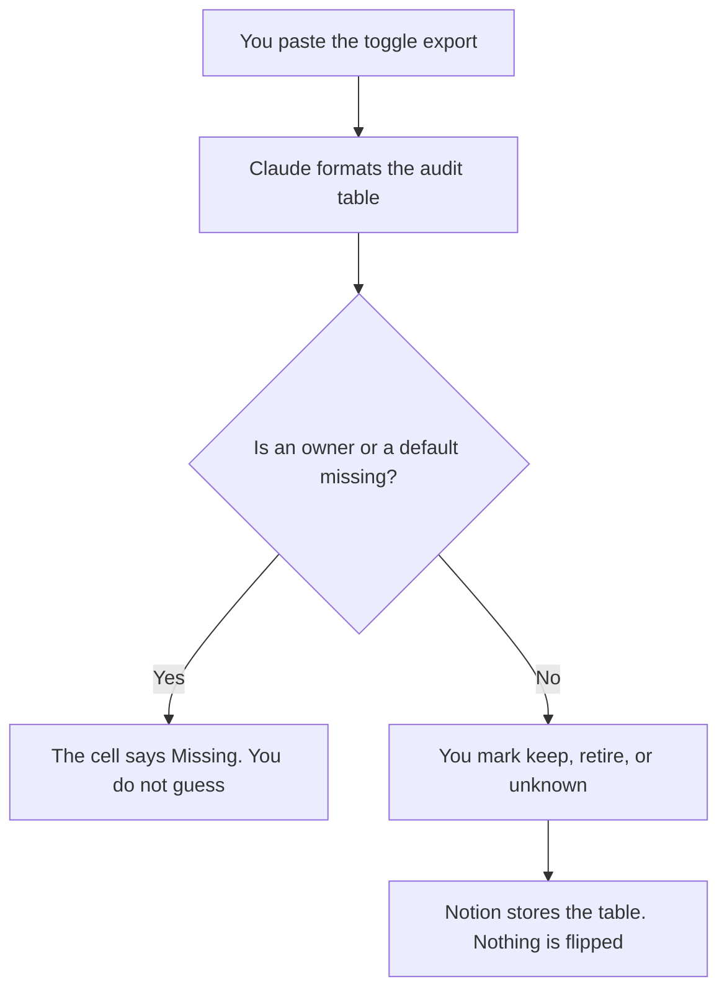

**A feature toggle audit written with AI is a table of toggles you already named: the owner, the default, the last change if you know it, and whether the toggle is still allowed to exist.** The model may format that table. It may not invent a toggle, flip one, or declare a toggle safe to delete because it "looks old." If a cell is empty, the cell says Missing.

What a flag is, before you audit a list of them, is [what AI feature flags are](/blog/what-is-ai-feature-flags-2026/). The note that retires one flag, after the audit says it should die, is [how to write a feature flag retirement note with AI](/blog/how-to-write-a-feature-flag-retirement-note-with-ai-2026/). The plan that turns one flag on for a slice of users is [how to create a feature flag rollout plan with AI](/blog/how-to-create-a-feature-flag-rollout-plan-with-ai-2026/).

Claude's prices are from claude.com/pricing on October 24, 2026. Cursor, Notion, and GitHub Copilot prices are from directory pages checked October 16, 2026. Published October 24, 2026. We did not score flag hygiene.

## What the audit contains

| Column | Who owns it | The model may |
|---|---|---|
| Toggle name, copied from the system | The person who exported the list | Not rename it to a friendlier name |
| Owner | You, or the export | Copy it. A blank stays Owner missing |
| Default, and who can change it | The export or the code you pasted | Not recommend a new default |
| Last change, if you have a date | You | Not infer a date from a filename |
| Keep, retire, or unknown | Only if you marked it | Not mark "retire" because the name contains test |

An audit that deletes rows "to keep the page short" has hidden toggles. Every name from the export stays, including ones you do not recognize. Unknown is a valid mark. It means a person still has to look. The people who own this inventory on a platform are [best AI tools for platform PMs](/blog/best-ai-tools-for-platform-pms-2026/). A single product's flag note is a narrower job.

## Where it is built

**The table, when the columns must match last quarter.** [Claude](/tools/claude/) Pro is $17 a month billed annually, $200 up front, or $20 monthly. Put the column list in the Project. The review is [Claude review](/blog/claude-review-2026/).

**The code that defines one toggle.** [Cursor](/tools/cursor/) Plus is $8 a month, or $80 a year, on the October 16 card. Read the diff if you go look. The audit does not authorize an edit. The ladder is [Cursor pricing explained](/blog/cursor-pricing-explained-2026/).

**The page the owners will update.** [Notion AI](/tools/notion-ai/) Business is $20 a seat a month. Plus at $10 is not the full AI tier. The chat is not the inventory.

**A search inside the repo.** [GitHub Copilot](/tools/github-copilot/) Pro is $10 a user a month. Business is $19 a user a month on that card. A suggestion is not a new row. The invoice is [GitHub Copilot pricing explained](/blog/github-copilot-pricing-explained-2026/).

A prompt that holds the line:

"Build a toggle audit from the export I pasted. One row per name. If owner, default, or date is absent, write Missing. Do not mark a row retire. Do not add a toggle that is not in the export."

## What not to delegate

Do not ask which toggles are safe to delete. Do not paste production values that include a customer id. Do not flip a default because the table looks tidy. The retirement note starts only after a person marks retire.

## FAQ

### How is this different from a retirement note?

The audit is the inventory and the marks. The retirement note is the message for one flag a person has decided to remove, with a date. You can finish an audit and retire nothing. You should not retire a flag that never appeared on the audit.

### How is this different from a rollout plan?

The rollout plan is how one flag turns on, for whom, and how you undo it. The audit asks whether the flag should still exist at all. A rollout attached to an unknown owner is a reason to stop, not a reason to expand the audience.

### Can the model read the flag service?

Only from an export or a file you pasted and checked. A model that "lists your flags" from memory is inventing a system. Paste the export. Count the rows. If the count does not match, the table is wrong.

### Who may mark a toggle retire?

The owner of that toggle, or the platform owner your policy names when the owner cell was missing and has since been filled. A model mark is not a decision. Unknown stays unknown until a person changes it.

## Last verified

October 24, 2026 for Claude. October 16, 2026 for Cursor, Notion, and GitHub Copilot. Published October 24, 2026.

**Sources:** [Claude pricing](https://claude.com/pricing), [Cursor pricing](https://cursor.com/help/account-and-billing/pricing), [Notion pricing](https://www.notion.com/pricing), [GitHub Copilot](https://github.com/features/copilot).

*Published by Andrew for [AI Tools Optimizer](https://aitoolsoptimizer.com).*

[Claude](/tools/claude/) is in the [chatbots and assistants directory](/tools/category/chatbots-assistants/). Directory pages may use affiliate links. A purchase through them may earn us a commission at no extra cost to you.
