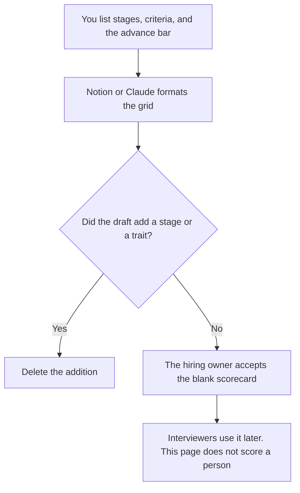

**A hiring pipeline scorecard written with AI is a table of stages you already use, the criteria you apply at each stage, and the bar for advancing.** The model may format the grid. It may not add a stage, a trait, or a score for a person. A candidate does not belong in this document. This page is the blank instrument. Filling it in for a person is a later, human step, and it is not a hire decision.

The rubric for one skill's levels is [how to write a hiring scorecard rubric with AI](/blog/how-to-write-a-hiring-scorecard-rubric-with-ai-2026/). The sheet for a single interview loop is [how to create interview scorecards with AI](/blog/how-to-create-interview-scorecards-with-ai-2026/). The role the pipeline is hiring for is [how to write a job description with AI](/blog/how-to-write-a-job-description-with-ai-2026/).

Prices are US list prices excluding tax. Notion, Claude, and Granola are from directory pages checked October 16, 2026. Reclaim's seat prices are from the pricing page fetched October 24, 2026. Published October 24, 2026. This is not HR or legal advice. We did not score any hiring process.

## The lines that have to be real

| Line | Who owns it | The model may |
|---|---|---|
| Stage | A step you already run, in your name for it | List them in your order. It may not insert a stage |
| Criteria | What that stage is allowed to judge | Copy your list. It may not add "culture fit" or another trait you did not write |
| Bar | What advance means, in your words | Format it. It may not raise the bar |
| Scorer | The role who records the stage | Leave Missing if unnamed |
| Evidence | The work sample or the question set you already use | Name it. It may not invent an exercise |
| Out of scope | What this stage must not decide | Keep it. A screen does not become a final hire |

"Culture fit," "polish," and "low risk" are the phrases to delete unless you have defined them as observable evidence. An undefined trait becomes a place to launder a preference. The model will offer those phrases because they sound like hiring. That is the edit.

## Where the grid lives

**The record.** [Notion AI](/tools/notion-ai/) Business is $20 a seat a month if the scorecard library lives in Notion. One page per role family. A copied scorecard from another role is wrong if the criteria changed. Say which role it covers.

**The draft.** [Claude](/tools/claude/) Pro is $20 a month, or $17 billed annually, when the job description and the old scorecard should sit in a Project. The model aligns names. It does not decide the bar. The review is [Claude review](/blog/claude-review-2026/).

**The calendar, separate from the score.** [Reclaim.ai](/tools/reclaim-ai/) Starter shows $10 per seat per month on the yearly toggle and $12 on the monthly toggle, as fetched October 24, 2026. Scheduling the loop is not scoring it. The invoice is [Reclaim.ai pricing explained](/blog/reclaim-ai-pricing-explained-2026/).

**The debrief notes.** [Granola](/tools/granola/) Business is $14 a user a month if the debrief should be captured without a bot. The note is evidence a person files against the criteria. It is not a score the model assigns. The ops shelf around this grid is [best AI tools for talent ops](/blog/best-ai-tools-for-talent-ops-2026/).

A prompt that holds the line:

"Format a pipeline scorecard from the stages, criteria, bars, and scorers I pasted. Do not add a stage. Do not add a personality trait. Do not include a candidate. If a scorer is missing, write Missing. Do not recommend hire or no hire."

## What not to delegate

Do not ask the model who to advance. Do not paste resumes into this workflow and ask for a ranking. Ranking people is a decision with a name on it, under your company's process. Do not let the scorecard contradict the job description. If they disagree, fix one of them on purpose.

The recruiter's sourcing shelf is a different job: [best AI tools for recruiters](/blog/best-ai-tools-for-recruiters-2026/). People ops, which owns the broader process, is [best AI tools for people ops](/blog/best-ai-tools-for-people-ops-2026/).

## FAQ

### Is this the interview scorecard?

The interview scorecard is one loop: the questions and the ratings for that conversation. The pipeline scorecard is the map of stages and what each stage is allowed to decide. Build the map first. Then build the sheet for a single interview.

### Can AI score the work sample?

It can lay the sample next to criteria you wrote, as a reading aid, only if your process allows that and a person assigns the mark. A generated number is not a score. Leave the mark blank until a person writes it.

### What belongs in Out of scope?

Anything that stage must not settle: pay, a final decision, a trait you are not assessing, a requirement that is not on the job description. Writing it down is how a screen stays a screen.

### Is this legal or HR advice?

No. It is a formatting workflow for stages you already run. What you may ask, what you must record, and who may decide are questions for your HR partner or counsel. The grid does not answer them.

## Last verified

October 16, 2026 for Notion AI, Claude, and Granola. October 24, 2026 for Reclaim's yearly and monthly Starter prices. Published October 24, 2026.

**Sources:** [Notion pricing](https://www.notion.com/pricing), [Claude pricing](https://claude.com/pricing), [Reclaim.ai pricing](https://reclaim.ai/pricing), [Granola](https://www.granola.ai).

*Published by Andrew for [AI Tools Optimizer](https://aitoolsoptimizer.com).*

[Notion AI](/tools/notion-ai/) is in the [productivity and notes directory](/tools/category/productivity-notes/). Directory pages may use affiliate links. A purchase through them may earn us a commission at no extra cost to you.
