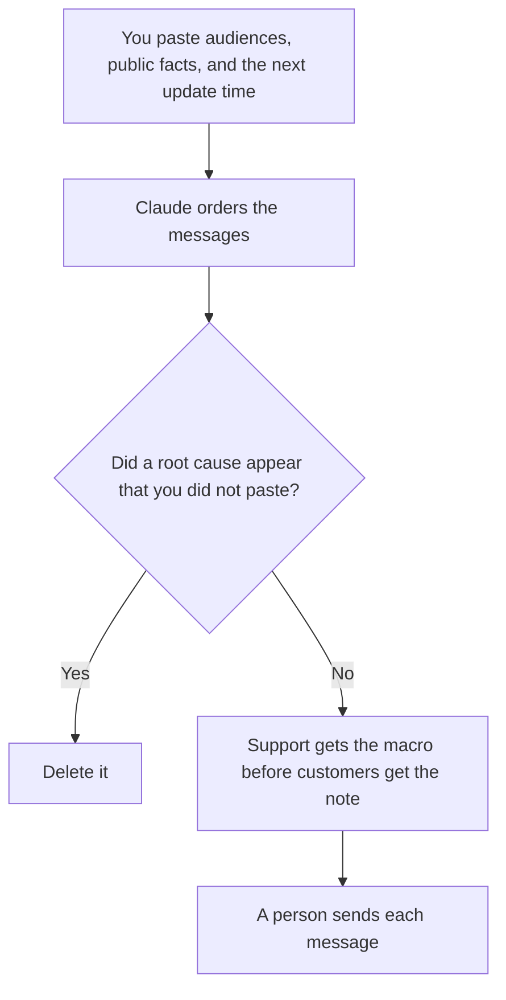

**A hotfix comms plan written with AI is the order of messages for a fix that cannot wait for a normal launch: who hears first, what fact each audience gets, and when you send the next update.** The model may lay out that order from a list you paste. It may not invent a cause, a customer impact count, or a promise that the bug is gone. A planned launch, with a date you chose, is [how to create a launch comms plan with AI](/blog/how-to-create-a-launch-comms-plan-with-ai-2026/). This page is the unplanned fix.

The way back if the hotfix misbehaves is [how to create a rollback plan with AI](/blog/how-to-create-a-rollback-plan-with-ai-2026/). The record of what happened, written after, is [how to write an incident timeline with AI](/blog/how-to-write-an-incident-timeline-with-ai-2026/). The public line is [how to write a status page update with AI](/blog/how-to-write-a-status-page-update-with-ai-2026/).

Prices are US list prices excluding tax from directory pages checked October 16, 2026. Published October 24, 2026. We did not score incidents.

## The order, written before you send

| Audience | What they need | The model may |
|---|---|---|
| The incident owner | The fact, the owner of the hotfix, the next check | Copy names you pasted |
| Support | The symptom, the workaround you approved, what not to tell customers yet | Format a macro. It may not add a workaround |
| Affected customers | The symptom, the status, the next update time | Use only facts you marked public |
| Everyone else | Often nothing, until you say so | Leave them off unless you listed them |
| The later note | A pointer to the timeline | Not a cause you have not confirmed |

Support should not learn the workaround from a customer who read it first. The plan names that sequence. If you do not have a workaround, the macro says so. A fluent workaround the model composed is how a second incident starts.

## Where the plan is written

**The draft, during the incident.** [Claude](/tools/claude/) Pro is $20 a month, or $17 billed annually, when you need a tight note from a paste. Keep the paste to facts the incident channel already has. The review is [Claude review](/blog/claude-review-2026/).

**The page on call will reuse.** [Notion AI](/tools/notion-ai/) Business is $20 a seat a month if the comms skeleton lives next to the runbook. Fill the skeleton. Do not ask it to decide severity.

**A short customer paragraph.** [ChatGPT](/tools/chatgpt/) Plus at $20 a month can shorten a public paragraph you marked as public. The review is [ChatGPT review](/blog/chatgpt-review-2026/).

**Tone on the public line.** [Grammarly](/tools/grammarly/) Pro is $12 per member per month billed annually, or $30 monthly. Tone is not accuracy. Read the facts after the edit.

A prompt that holds the line:

"Order messages for the audiences I listed, using only the public facts I marked. Do not add a root cause. Do not add a workaround. If the next update time is missing, write Update missing and stop."

## What not to delegate

Do not ask the model whether to hotfix. That is the incident owner, with the rollback plan in sight. Do not put a customer name in the internal macro and the public note by default. Do not send a "resolved" line until the check you named has passed. The roles for that hour are [what AI incident response is](/blog/what-is-ai-incident-response-2026/).

## FAQ

### How is this different from a launch comms plan?

A launch has a date, a narrative, and time to rehearse. A hotfix comms plan has a fact, an order, and a next update time. Using the launch template during an incident adds slides you do not have time to check.

### Can one note serve every audience?

Usually no. Support needs the workaround and the boundary. Customers need the symptom and the next update. Executives need the owner and the blast radius you already counted. The plan can share facts. It should not share one paragraph.

### What if we do not know the impact yet?

Say that. "We have not confirmed how many accounts are affected" is a fact. A guessed percentage is not. Update the number when you have it, on the clock you set.

### Who hits send?

A person named on the plan. The model drafts. The incident owner, or the comms owner they named, sends. A chat account should not be the sender.

## Last verified

October 16, 2026 for Claude, Notion AI, ChatGPT, and Grammarly. Published October 24, 2026.

**Sources:** [Claude pricing](https://claude.com/pricing), [Notion pricing](https://www.notion.com/pricing), [ChatGPT pricing](https://chatgpt.com/pricing/), [Grammarly pricing](https://www.grammarly.com/plans).

*Published by Andrew for [AI Tools Optimizer](https://aitoolsoptimizer.com).*

[Claude](/tools/claude/) is in the [chatbots and assistants directory](/tools/category/chatbots-assistants/). Directory pages may use affiliate links. A purchase through them may earn us a commission at no extra cost to you.
