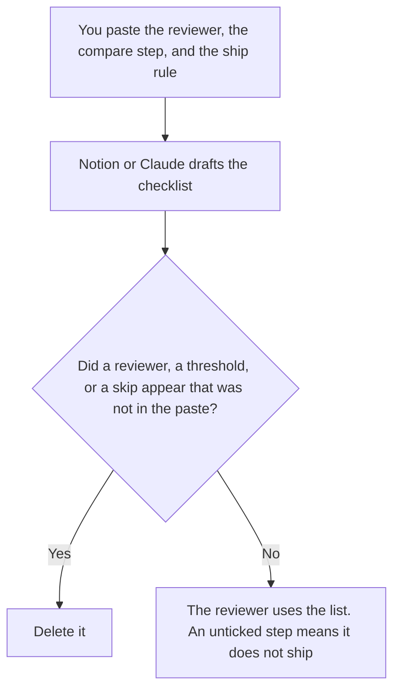

**A human-in-the-loop checklist written with AI is a list of steps a named person must finish before an output ships: who reads it, what they compare, and what they may not delegate.** The model may order steps you already run. It may not invent a reviewer, a sample size, or a rule that says the model may ship alone. The idea, before the checklist exists, is [what human-in-the-loop AI is](/blog/what-is-human-in-the-loop-ai-2026/). This page is the artifact: the boxes a person can tick.

A queue of failures a person still reads is [what an AI human review queue is](/blog/what-is-ai-human-review-queue-2026/). The pass that checks fields after the fact is [what AI output validation is](/blog/what-is-ai-output-validation-2026/). A scan for personal data before send is [what an AI output PII scan is](/blog/what-is-ai-output-pii-scan-2026/).

Notion and Grammarly prices are from directory pages checked October 16, 2026. Claude's prices are from claude.com/pricing on October 24, 2026. ChatGPT's Plus price is the October 24 plan-page figure recorded in [ChatGPT pricing explained](/blog/chatgpt-pricing-explained-2026/). Published October 24, 2026. We did not measure review time. A checklist is not a control until the named person uses it.

## What the checklist is allowed to contain

| Step | Who owns it | The model may |
|---|---|---|
| Reviewer | You | Copy the role or the name. It may not assign "the team" |
| What they compare | You | Copy the source: the paste, the schema, the price list |
| What blocks ship | You | Copy the rule. It may not add "if it looks fine" |
| What they may not delegate | You | Copy it. It may not shrink the list |
| Where the tick is recorded | You, or Record not named | Name the page. It may not say the chat log is the record |

A step that says "spot-check a few" has added a sample size you did not write. If you did not say how many, the step says Count not set, and the reviewer does not invent a percentage. A step that says the model may send when confidence is high has added a skip. Confidence is not a box on this list unless a person wrote a number and a source for it. This page does not supply that number.

The checklist sits in front of send. It does not replace a format gate or a schema lock. Those are systems. This is the person. Link [what an AI output format gate is](/blog/what-is-ai-output-format-gate-2026/) when the container is the thing being checked. The person still ticks the box that says they looked.

## Where it is drafted

**The list people open.** [Notion AI](/tools/notion-ai/) Business is $20 a seat a month. One checklist per output type, the reviewer, and the record. Plus at $10 is not the full AI tier. The invoice is [Notion AI pricing explained](/blog/notion-ai-pricing-explained-2026/).

**The draft.** [Claude](/tools/claude/) Pro is $17 a month billed annually, $200 up front, or $20 monthly. The Project holds the ship rule so a later edit does not soften it into a suggestion. The review is [Claude review](/blog/claude-review-2026/). The ladder is [Claude pricing explained](/blog/claude-pricing-explained-2026/).

**One checklist from a short paste.** [ChatGPT](/tools/chatgpt/) Plus is $20 a month. Discard a version that adds a reviewer. The ladder is [ChatGPT pricing explained](/blog/chatgpt-pricing-explained-2026/).

**A clarity pass that must not drop a step.** [Grammarly](/tools/grammarly/) Pro is $12 a member a month billed annually, or $30 monthly, on the October 16 card. Compare the "may not delegate" lines before and after. The invoice is [Grammarly pricing explained](/blog/grammarly-pricing-explained-2026/).

A prompt that holds the line:

"Draft the checklist from the reviewer, the compare step, and the ship rule I pasted. If the reviewer is missing, write Reviewer not named. If the count is missing, write Count not set. Do not add a step that lets the model ship alone."

## What not to delegate

Do not ask which steps are "enough review." Do not tick a box because the draft looked clean. Do not store the tick only in the chat. The reviewer named on the list is the person who ships. An empty box means it stays held.

## FAQ

### How is this different from the human-in-the-loop explainer?

That page is the idea: a person still decides before an output ships. This page is the checklist you can hand that person, with a named reviewer and a compare step. The explainer does not name your reviewer. The checklist does, because you pasted the name. Use that page for the definition. Use this page for the boxes.

### How is this different from a human review queue?

The queue is where failed or held outputs wait. The checklist is what the reviewer does with one item, including items that never failed a gate. A queue can exist with no written compare step. A checklist can exist for a send that did not pass through a queue. Write both when both are true.

### How is this different from output validation?

Validation is a check on fields or values, often in the system. The checklist is the person comparing the output to a source you named. A validator can pass and the reviewer can still stop the send. A reviewer can tick a box and the validator can still reject the file. They are different steps.

### Who may ship?

The reviewer named on the checklist. Reviewer not named means nobody has authority from this list. Count not set means you do not pretend a sample was reviewed. A model may draft the list. It may not tick it.

## Last verified

October 24, 2026 for Claude and for ChatGPT's plan page, via the posts cited above. October 16, 2026 for Notion and Grammarly. Published October 24, 2026.

**Sources:** [Notion pricing](https://www.notion.com/pricing), [Claude pricing](https://claude.com/pricing), [ChatGPT and Codex pricing](https://learn.chatgpt.com/docs/pricing), [Grammarly pricing](https://www.grammarly.com/plans).

*Published by Andrew for [AI Tools Optimizer](https://aitoolsoptimizer.com).*

[Notion AI](/tools/notion-ai/) is in the [productivity and notes directory](/tools/category/productivity-notes/). Directory pages may use affiliate links. A purchase through them may earn us a commission at no extra cost to you.
