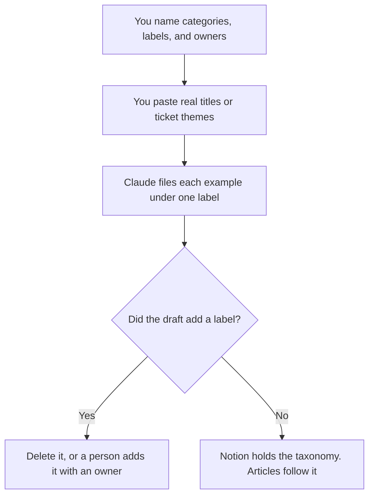

**A knowledge base taxonomy written with AI is a short list of categories and labels a person will maintain, formatted so every article has one home.** The model may group examples you pasted under labels you already named. It may not invent a category, a synonym that becomes a second label, or an article. The taxonomy is not the help center. It is the shelf the help center uses. A bot comes after the shelf is real.

The pages a person reads are [how to create FAQ pages with AI](/blog/how-to-create-faq-pages-with-ai-2026/). The center those pages live in is [how to build a help center with AI](/blog/how-to-build-a-help-center-with-ai-2026/). The bot that should quote them is [how to build a knowledge-base chatbot](/blog/how-to-build-a-knowledge-base-chatbot-2026/). The person who keeps the shelf honest is [best AI tools for knowledge managers](/blog/best-ai-tools-for-knowledge-managers-2026/).

Prices are US list prices excluding tax from directory pages checked October 16, 2026. Published October 24, 2026. We did not score findability. A label the model likes and nobody owns will rot.

## The lines that have to be real

| Line | Who owns it | The model may |
|---|---|---|
| Top categories | The list you will put in the navigation | Order it. It may not add a category |
| Labels | The tags you will keep under those categories | File your examples under them |
| One home | The rule: an article has one primary category | Flag a collision. It may not create "General" |
| Owner | The person who may add a label | Copy the name. A label with no owner does not ship |
| Examples | Real article titles or ticket themes you pasted | Place them. It may not draft the article |
| Rejected labels | The words you tried and refused | Keep them in a do-not-use list |

How old an article may be before the bot should stop trusting it is [what retrieval freshness is](/blog/what-is-retrieval-freshness-2026/). A taxonomy does not make a stale article fresh. It makes the stale article easier to find and replace.

## Where the shelf is written

**The record.** [Notion AI](/tools/notion-ai/) Business is $20 a seat a month when the taxonomy is a table: category, label, definition, owner, example. A label the model added in a chat does not enter the table until the owner accepts it. The internal cousin of this shelf is [how to build an internal wiki with AI](/blog/how-to-build-an-internal-wiki-with-ai-2026/).

**The filing pass.** [Claude](/tools/claude/) Pro is $20 a month, or $17 billed annually, when the allowed labels sit in a Project and you paste this month's titles. The review is [Claude review](/blog/claude-review-2026/).

**A second grouping.** [ChatGPT](/tools/chatgpt/) Plus at $20 a month can propose which existing label fits a messy title. Discard a new label that appears because the title was awkward. Rename the title, or leave it Unfiled. The review is [ChatGPT review](/blog/chatgpt-review-2026/).

**The bot, later.** [Chatbase](/tools/chatbase/) Hobby is $32 a month billed yearly, or $40 monthly, with 700 message credits. Point it at articles that already use the taxonomy. A bot trained on an unlabeled dump will answer from whichever page was uploaded last. Build the shelf first.

A prompt that holds the line:

"File each title under one label from the list I pasted. If none fits, write Unfiled. Do not create a label. Do not rename my labels. Do not draft an article. If two labels seem to fit, write Collision and name both."

## What not to delegate

Do not ask the model for a "complete" taxonomy of your product. Completeness is how you get twelve categories you will not maintain. Start from the navigation you are willing to show a customer, and from ticket themes you actually see. Do not merge the internal wiki's labels with the help center's labels unless a person decides they are the same shelf. Two shelves with the same words and different meanings is the failure mode.

## FAQ

### How many categories should we have?

As many as you named and will staff. This page does not recommend a number. A category with no owner and no example does not belong on the list the model is allowed to use.

### Can AI write the articles too?

Not in this workflow. The taxonomy is the shelf. Article drafts are the FAQ and help-center workflows, and each draft still needs a person who knows the policy. A label without an article is an empty shelf, which is honest. An article under a label you do not use is clutter.

### What do we do with Unfiled?

A person reads Unfiled on a schedule you set. They either add a label, with an owner, or they retitle the article so it fits. Leaving Unfiled for a model to "clean up" is how a new synonym appears every week.

### Is this the same as a support escalation matrix?

No. The matrix says who handles which severity. The taxonomy says where an article lives. They can share words like Billing. They are different tables, with different owners. Link them. Do not merge them.

## Last verified

October 16, 2026 for Notion AI, Claude, ChatGPT, and Chatbase. Published October 24, 2026.

**Sources:** [Notion pricing](https://www.notion.com/pricing), [Claude pricing](https://claude.com/pricing), [ChatGPT pricing](https://chatgpt.com/pricing/), [Chatbase pricing](https://www.chatbase.co/pricing).

*Published by Andrew for [AI Tools Optimizer](https://aitoolsoptimizer.com).*

[Notion AI](/tools/notion-ai/) is in the [productivity and notes directory](/tools/category/productivity-notes/). Directory pages may use affiliate links. A purchase through them may earn us a commission at no extra cost to you.
