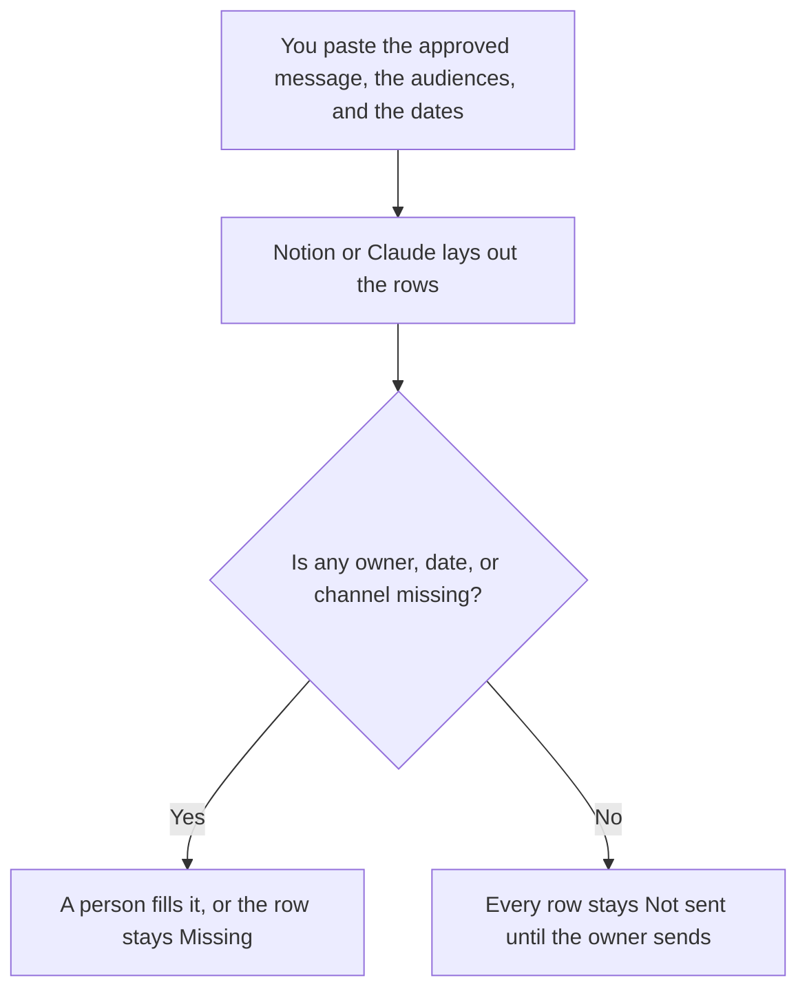

**A launch comms plan written with AI is a table of audiences, the channel each one will hear on, the message you already approved, the date, and the owner.** The model may lay the rows out and spot a missing owner. It may not invent an audience, a date, or a promise. The task list for the whole launch, including work that is not a message, is [how to create a product launch checklist with AI](/blog/how-to-create-a-product-launch-checklist-with-ai-2026/). The single email about one feature is [how to create a feature announce email with AI](/blog/how-to-create-a-feature-announce-email-with-ai-2026/). This page is who hears which version of the news, and when.

The positioning those messages should match is [how to write a product one-pager with AI](/blog/how-to-write-a-product-one-pager-with-ai-2026/). The strategy note before the tasks is [how to write a go-to-market brief with AI](/blog/how-to-write-a-go-to-market-brief-with-ai-2026/).

Prices are US list prices excluding tax from directory pages checked October 16, 2026. Published October 24, 2026. We did not score launches. A channel with no sender is a wish.

## The rows that have to be real

| Row | Who owns it | The model may |
|---|---|---|
| Audience | A group you named: customers on the plan, prospects, employees, partners | Copy it. It may not add "the public" |
| Channel | The place you will actually send: email, in-app, changelog, a call | Copy it. It may not add a social network you do not run |
| Message | The approved sentence, or "not written" | Paste it. It may not improve the claim |
| Date | A date you chose, or Date missing | Copy it. It may not pick a launch day |
| Owner | A person who can send or cancel | Copy the name. It may not assign a department |
| Status | Not sent, until that person sends | Leave Not sent. It may not check the box |

Employees and customers should not receive the same paragraph unless you decided that on purpose. A partner may be allowed to say less than a sales rep. The kit for what a partner may say is a different page: [how to write a partner enablement kit with AI](/blog/how-to-write-a-partner-enablement-kit-with-ai-2026/). If that decision is not made, the partner row says Not approved, and they are not on the send list.

## Where the plan is written

**The table.** [Notion AI](/tools/notion-ai/) Business is $20 a seat a month if the plan is a database the launch team will update. The status field starts as Not sent. The model does not flip it. The seat article is [Notion AI pricing explained](/blog/notion-ai-pricing-explained-2026/).

**The draft of a missing message.** [Claude](/tools/claude/) Pro is $20 a month, or $17 billed annually, when you paste the approved claim and ask for a version for one audience. A version that adds a metric is discarded. The review is [Claude review](/blog/claude-review-2026/).

**A second formatting.** [ChatGPT](/tools/chatgpt/) Plus at $20 a month can turn a messy thread into the columns. Discard an audience it added to make the plan "feel complete."

**The internal readout.** [Gamma](/tools/gamma/) Plus is $9 a seat a month if someone asked for slides of the plan. The slides quote the table. They do not become the plan. The invoice is [Gamma pricing explained](/blog/gamma-pricing-explained-2026/).

A prompt that holds the line:

"Format a launch comms plan from the audiences, channels, message, dates, and owners I pasted. Status is Not sent on every row. If a date or owner is missing, write Missing. Do not add an audience or a channel. Do not rewrite the approved message."

## What not to delegate

Do not ask the model when to launch. Do not let a full-looking table replace a message that still says Not written. Do not send the customer row before the changelog exists. The record of what shipped is [how to write a changelog with AI](/blog/how-to-write-a-changelog-with-ai-2026/). A comms plan that announces a feature the changelog does not list is how support learns about a launch from a customer.

## FAQ

### Is this the launch checklist?

The checklist is every task: legal, support, billing, the email, the flag. This page is only the messages. Use both. Do not collapse them into one list a model invented, with phantom owners.

### Can one message serve every audience?

Only if you wrote that down. The default on this page is one row per audience, because employees, customers, and partners do not need the same sentence. If you decide they do, one row can name all three, and a person signs that decision. The model does not merge rows to save space.

### What if the date moves?

The owner changes the date in the table. The model does not "update the plan" from a rumor in a thread. Every artifact that quoted the old date is stale until a person checks it. Status stays Not sent.

### Do we need a slide?

Only if a meeting requires one. The table is the plan. A deck that adds a narrative the table does not contain is a second plan. Gamma can format. It should not invent a channel.

## Last verified

October 16, 2026 for Notion AI, Claude, ChatGPT, and Gamma. Published October 24, 2026.

**Sources:** [Notion pricing](https://www.notion.com/pricing), [Claude pricing](https://claude.com/pricing), [ChatGPT pricing](https://chatgpt.com/pricing/), [Gamma pricing](https://gamma.app/pricing).

*Published by Andrew for [AI Tools Optimizer](https://aitoolsoptimizer.com).*

[Notion AI](/tools/notion-ai/) is in the [productivity and notes directory](/tools/category/productivity-notes/). Directory pages may use affiliate links. A purchase through them may earn us a commission at no extra cost to you.
