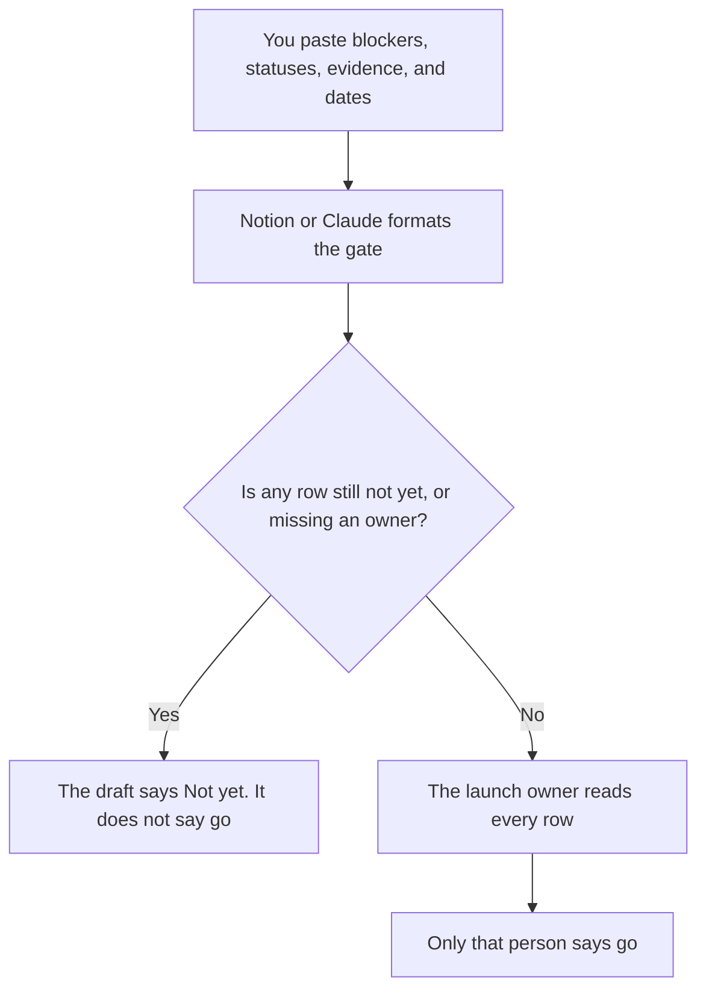

**A launch readiness checklist written with AI is the go or not-yet list: each blocker, the owner, the date, and the evidence a person already attached.** The model may format that list. It may not mark a row done, invent a legal review, or decide that support is ready. The longer task list for the launch itself is [how to create a product launch checklist with AI](/blog/how-to-create-a-product-launch-checklist-with-ai-2026/). This page is the gate at the end of that list.

The customer notice, if the launch changes something they already use, is [how to write a customer migration notice with AI](/blog/how-to-write-a-customer-migration-notice-with-ai-2026/). The people who will answer the tickets are [how to create a support swarm plan with AI](/blog/how-to-create-a-support-swarm-plan-with-ai-2026/).

Claude's prices are from claude.com/pricing on October 24, 2026. Notion, ChatGPT, and ClickUp prices are from directory pages checked October 16. chatgpt.com/pricing returned HTTP 403 on October 24. Published October 24, 2026. We did not score launches.

## What the gate contains

| Row | Who owns the status | The model may |
|---|---|---|
| The blocker, in words you used | The workstream owner | Copy it. It may not split one blocker into three |
| Ready or not yet | That owner | Copy the word they used. It may not change "not yet" to "on track" |
| Evidence | A link or a sentence you pasted | Paste it. It may not say the evidence was reviewed |
| The date | You | Copy it. It may not pick a closer launch date |
| The rollback owner | You | Copy the name. If it is blank, write Owner missing |

A task checklist can be long and still leave the gate red. Readiness is the short list of rows that would stop the launch. If support staffing is one of those rows, the swarm plan has to be linked, not described as "support will handle it." If customers must move, the migration notice has to be linked, with its send date.

## Where it is kept

**The page the launch owner opens.** [Notion AI](/tools/notion-ai/) Business is $20 a seat a month. Plus at $10 is not the full AI tier. The page is the record. The chat is not. The invoice is [Notion AI pricing explained](/blog/notion-ai-pricing-explained-2026/).

**The draft, when the rows must match the last launch.** [Claude](/tools/claude/) Pro is $17 a month billed annually, $200 up front, or $20 monthly. Put last launch's row names in the Project so this gate uses the same words. The review is [Claude review](/blog/claude-review-2026/).

**One gate, from a paste.** [ChatGPT](/tools/chatgpt/) Plus is $20 a month on the October 16 card. Free can format a single list. Discard a version that adds a "risks and opportunities" essay. The review is [ChatGPT review](/blog/chatgpt-review-2026/).

**The tracker, if the work already lives there.** [ClickUp Brain](/tools/clickup-brain/) Brain² starts at $9 a user a month on the October 16 card, on top of a ClickUp plan. The status in ClickUp wins if it disagrees with the prose. The invoice is [ClickUp Brain pricing explained](/blog/clickup-brain-pricing-explained-2026/).

A prompt that holds the line:

"Format a launch readiness gate from the rows I pasted. Keep each status. If a status is not yet, the summary is Not yet. Do not add a blocker. Do not say go."

## What not to delegate

Do not ask the model whether you are ready. Do not check a box because the sentence sounds finished. Do not include a customer name. The train that carries the change, if this is a release cut, is [how to write a release train note with AI](/blog/how-to-write-a-release-train-note-with-ai-2026/).

## FAQ

### How is this different from a product launch checklist?

The product launch checklist is the task list with owners and dates. This gate is the short set of blockers that must be ready or explicitly accepted. A finished task list can still fail the gate. Link the task list. Do not paste it again as if copying tasks made them done.

### Can the model add standard blockers?

Only if you paste the standard list and a person still marks each row. A template that adds "security review" you did not schedule creates a false red, or worse, a false green when someone deletes it without looking. Start from your rows.

### What if one row is accepted risk?

The owner writes Accepted, the reason, and their name. The model may not turn Accepted into Ready. The summary can say Go only after the launch owner says so, including the accepted rows.

### Who may say go?

The launch owner named on the page. A model summary is not the call. A green table with a blank rollback owner is Not yet.

## Last verified

October 24, 2026 for Claude. October 16, 2026 for Notion, ChatGPT, and ClickUp. Published October 24, 2026.

**Sources:** [Notion pricing](https://www.notion.com/pricing), [Claude pricing](https://claude.com/pricing), [ChatGPT pricing](https://chatgpt.com/pricing/), [ClickUp Brain](https://clickup.com/brain).

*Published by Andrew for [AI Tools Optimizer](https://aitoolsoptimizer.com).*

[Notion AI](/tools/notion-ai/) is in the [productivity and notes directory](/tools/category/productivity-notes/). Directory pages may use affiliate links. A purchase through them may earn us a commission at no extra cost to you.
