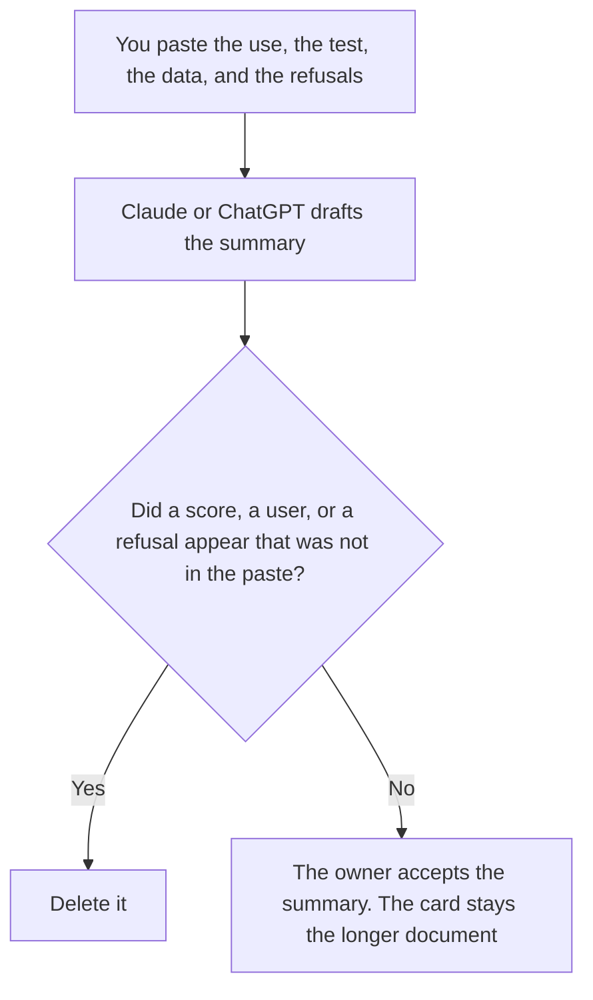

**A model card summary written with AI is a short draft that restates the intended use, the test you already ran, the data that test used, and the uses you already refuse.** The model may order those fields. It may not invent a benchmark, a user, or a refusal. The document those fields belong to is [what a model card is](/blog/what-is-model-cards-2026/). This page is the summary: a page a buyer can read without opening the card's tables. If the summary adds a number the card does not contain, the summary is a brochure.

The repeatable check the card should point at is [what AI eval testing is](/blog/what-is-ai-eval-testing-2026/). The line that counts as a pass, if you wrote one, is [what an AI eval pass threshold is](/blog/what-is-ai-eval-pass-threshold-2026/). A sentence the card does not support is [what an AI hallucination is](/blog/what-is-ai-hallucination-2026/).

Claude's prices are the October 24, 2026 read of claude.com/pricing recorded in [Claude pricing explained](/blog/claude-pricing-explained-2026/). Notion and Grammarly prices are from directory pages checked October 16, 2026. ChatGPT's Plus price is the October 24 plan-page figure recorded in [ChatGPT pricing explained](/blog/chatgpt-pricing-explained-2026/). A live fetch of Grammarly's plans URL returned HTTP 401 on October 24, as the Business pricing article records. Published October 24, 2026. We did not score a model. This page does not publish a benchmark.

## What the summary is allowed to say

| Field | Who owns it | The model may |
|---|---|---|
| Intended use | You | Copy the sentence. It may not widen the use |
| The test you ran | You, or Test not recorded | Name it. It may not invent a score |
| The data that test used | You, or Data not recorded | Copy the description. It may not add a population |
| Uses you refuse | You | Copy the list. It may not drop a refusal to sound friendlier |
| The owner | You | Copy the name. It may not assign a lab |

A sentence that says the model is "state of the art" has added a claim. If the test is missing, the line says Test not recorded. If you refuse a use, the summary keeps the refusal even when it makes the paragraph longer. Put proposals in a note labeled Not on the card.

The summary points at the card. It does not replace the tables. A summary that contains every row will go stale the first time a row changes, and it will hide a missing test inside a smooth paragraph. Link the row. Do not paste a leaderboard you did not run.

## Where it is drafted

**The draft.** [Claude](/tools/claude/) Pro is $17 a month billed annually, $200 up front, or $20 monthly. Keep the refusal list in a Project so a later edit does not shorten it. The review is [Claude review](/blog/claude-review-2026/).

**The page next to the card.** [Notion AI](/tools/notion-ai/) Business is $20 a seat a month. Link the owner, the date, and the card. Plus at $10 is not the full AI tier. The invoice is [Notion AI pricing explained](/blog/notion-ai-pricing-explained-2026/).

**One summary from a paste.** [ChatGPT](/tools/chatgpt/) Plus is $20 a month. Discard a version that adds a percentage. The ladder is [ChatGPT pricing explained](/blog/chatgpt-pricing-explained-2026/).

**A clarity pass that must not touch a number.** [Grammarly](/tools/grammarly/) Pro is $12 a member a month billed annually, or $30 monthly, on the October 16 card. Compare every figure and every refusal before and after. The invoice is [Grammarly pricing explained](/blog/grammarly-pricing-explained-2026/).

A prompt that holds the line:

"Draft the summary from the intended use, the test, the data, and the refusals I pasted. If a test is missing, write Test not recorded. Do not add a score. Do not drop a refusal."

## What not to delegate

Do not ask for a benchmark "readers expect." Do not paste a vendor's card and adopt its numbers as yours. Do not publish the summary because it sounds complete. The owner named on the card accepts the summary. Test not recorded stays not recorded.

## FAQ

### How is a summary different from a model card?

The card is the document: intended use, the tests, the data, and the uses you will not support, including the detail a buyer may need. The summary is the short page that restates fields you already filled. It does not add a result, and it does not hide a blank. Use the explainer for what a card is. Use this page for the draft of the short version.

### How is this different from an eval pass threshold?

The threshold is the line a named metric must meet. The summary may mention that line only if you pasted it. It may not choose the line, and it may not say the model passed. A card can point at a threshold that still says Threshold not set.

### Can the summary name a model we did not test?

Only as a model you refuse, or as a comparison you already wrote with a source. A sentence that borrows another lab's number is a number you did not run. Leave it out. Not on the card stays off the summary.

### Who may publish the summary?

The owner of the card. A smooth paragraph is not a test. A refusal you pasted stays in the summary. A score you did not paste stays out.

## Last verified

October 24, 2026 for Claude and for ChatGPT's plan page, via the posts cited above. October 16, 2026 for Notion and Grammarly. Published October 24, 2026. Grammarly's plans URL returned HTTP 401 on October 24. No benchmark is published in this article.

**Sources:** [Claude pricing](https://claude.com/pricing), [Notion pricing](https://www.notion.com/pricing), [ChatGPT and Codex pricing](https://learn.chatgpt.com/docs/pricing), [Grammarly pricing](https://www.grammarly.com/plans).

*Published by Andrew for [AI Tools Optimizer](https://aitoolsoptimizer.com).*

[Claude](/tools/claude/) is in the [chatbots and assistants directory](/tools/category/chatbots-assistants/). Directory pages may use affiliate links. A purchase through them may earn us a commission at no extra cost to you.
