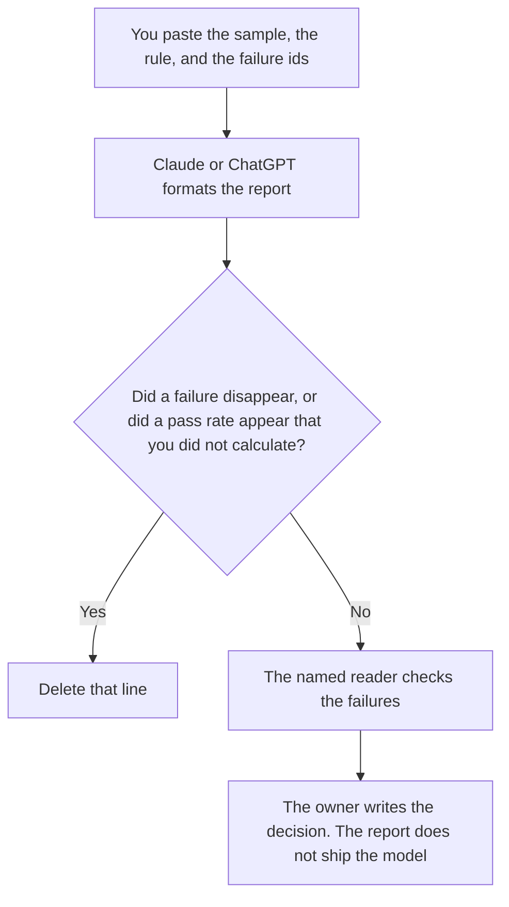

**A model eval report written with AI states the sample you already chose, the pass rule you already wrote, the failures you already logged, and the person who read them.** The model may format that report. It may not invent a pass rate, drop a failure, or declare the model ready to ship. How many cases you owe is [what an AI eval sample size is](/blog/what-is-ai-eval-sample-size-2026/). The suite those cases belong to is [what an AI eval regression suite is](/blog/what-is-ai-eval-regression-suite-2026/). The queue for the cases a person still has to read is [what an AI human review queue is](/blog/what-is-ai-human-review-queue-2026/).

Claude's prices are from claude.com/pricing on October 24, 2026. Notion and Cursor prices are from directory pages checked October 16, 2026. ChatGPT Plus is $20 a month on learn.chatgpt.com/docs/pricing on October 24, 2026. Published October 24, 2026. We did not score models.

## What the report contains

| Section | Who owns it | The model may |
|---|---|---|
| The sample size and how you drew it | The eval owner | Copy both. It may not round the sample up |
| The pass rule | You, in words a stranger can apply | Copy it. It may not soften "must" into "should" |
| Each failure, with the case id | The person who logged it | List every id in the paste. It may not merge two |
| Who read the failures | You | Copy the name. A blank stays Reader missing |
| The decision | The owner, after they read | Format the words the owner already chose |

A confidence label on an answer is a different object. If you are reporting one, the definition has to be in the paste. The label's limits are [what an AI output confidence score is](/blog/what-is-ai-output-confidence-score-2026/). A report that says "high confidence, so we ship" has skipped the decision. The decision is a sentence the owner writes.

## Where it is written

**The draft, when every report uses the same headings.** [Claude](/tools/claude/) Pro is $17 a month billed annually, $200 up front, or $20 monthly. Put the headings in the Project. The review is [Claude review](/blog/claude-review-2026/).

**The page the team will reopen.** [Notion AI](/tools/notion-ai/) Business is $20 a seat a month if that is the eval log. Plus at $10 is not the full AI tier on the October 16 card. The invoice is [Notion AI pricing explained](/blog/notion-ai-pricing-explained-2026/).

**One report from a short table.** [ChatGPT](/tools/chatgpt/) Plus is $20 a month. Discard a version that adds a percentage you did not paste. The review is [ChatGPT review](/blog/chatgpt-review-2026/).

**The prompt under test, if it lives in a repo.** [Cursor](/tools/cursor/) Plus is $8 a month, or $80 a year, on the October 16 card. The report names the prompt version. The editor does not change that version while you are writing the report. The ladder is [Cursor pricing explained](/blog/cursor-pricing-explained-2026/).

A prompt that holds the line:

"Write the eval report from the sample size, the pass rule, the failure ids, and the reader I pasted. If a field is missing, write Missing. Do not compute a pass rate. Do not recommend that we ship."

## What not to delegate

Do not ask the model which failures "do not matter." Do not average two runs that used different samples. Do not let the report change the prompt it is judging. A prompt change is a separate request: [how to write a prompt change request with AI](/blog/how-to-write-a-prompt-change-request-with-ai-2026/).

## FAQ

### How is this different from the sample-size explainer?

That page is how you choose the number of cases before you trust a result. This page is the report after you have a number, a rule, and a list of failures. The report copies the number. It does not pick a new one.

### Can the model calculate the pass rate if I paste the counts?

Only when you paste the counts and you ask for the arithmetic in the open, and you check it. If either count is missing, the line says Missing. A rate with a blank denominator is a fiction.

### What if a failure was a bad test?

The owner says so, in the report, with the case id. The model does not reclassify it. A bad test is still a row until a person strikes it and says why.

### Who may say the model is ready?

The eval owner, in the decision line, after the named reader has seen the failures. A tidy report is not a release. The go-live list, if this model is part of a launch, is a different document.

## Last verified

October 24, 2026 for Claude and for ChatGPT Plus. October 16, 2026 for Notion and Cursor. Published October 24, 2026.

**Sources:** [Claude pricing](https://claude.com/pricing), [Notion pricing](https://www.notion.com/pricing), [ChatGPT and Codex pricing](https://learn.chatgpt.com/docs/pricing), [Cursor pricing](https://cursor.com/help/account-and-billing/pricing).

*Published by Andrew for [AI Tools Optimizer](https://aitoolsoptimizer.com).*

[Claude](/tools/claude/) is in the [chatbots and assistants directory](/tools/category/chatbots-assistants/). Directory pages may use affiliate links. A purchase through them may earn us a commission at no extra cost to you.
