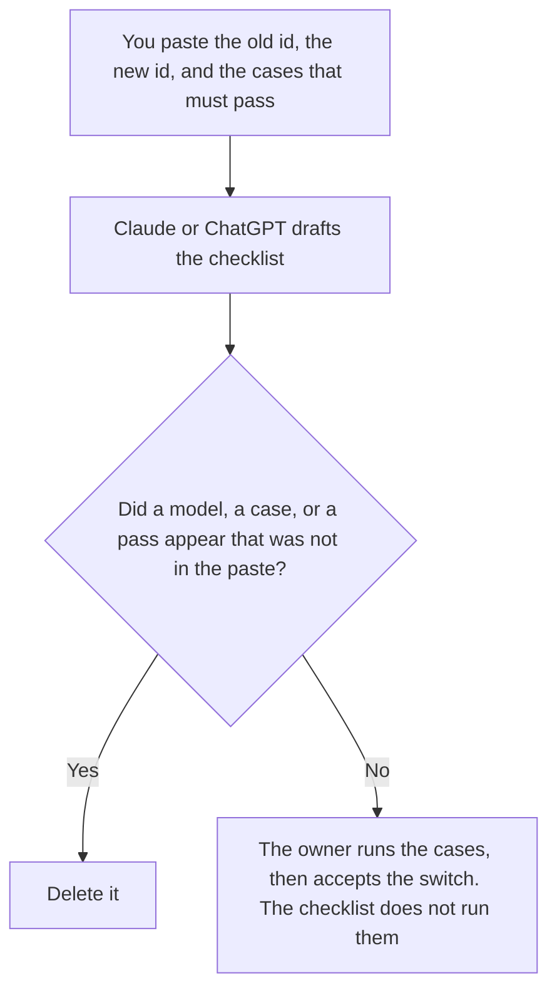

**A model switch checklist written with AI is a draft that names the model you are leaving, the model a person already chose, the cases that must still pass, and who accepts the switch.** The model may order those lines. It may not pick the new model, drop a case, or declare the switch done. The row that sends a task to a model id is [what an AI model routing rule is](/blog/what-is-ai-model-routing-rule-2026/). The backup if the new model cannot run is [what an AI model fallback matrix is](/blog/what-is-ai-model-fallback-matrix-2026/).

The component that reads the rule is [what an AI model router is](/blog/what-is-ai-model-router-2026/). A checklist is not a router. It is the list you finish before you change the row.

Claude's prices are from claude.com/pricing on October 24, 2026. Notion and Cursor prices are from directory pages checked October 16, 2026. ChatGPT's Plus price is from learn.chatgpt.com/docs/pricing on October 24. Published October 24, 2026. We did not score models.

## What the checklist is allowed to say

| Line | Who owns it | The model may |
|---|---|---|
| The model id you are leaving | You | Copy the id. It may not guess a nickname |
| The model id you are moving to | You | Copy the id. If you have not chosen, write Model not chosen |
| The cases that must pass | You | Copy the list. It may not delete a case to shorten the page |
| The owner and the date | You | Copy them. It may not mark the switch accepted |

A checklist that says the new model is "equivalent" has made a claim you did not paste. If a case has not been run, the line says Not run. It does not say pass. The text check on a prompt, before any model runs, is [what an AI prompt unit test is](/blog/what-is-ai-prompt-unit-test-2026/). That check does not replace these cases.

## Where it is drafted

**The draft.** [Claude](/tools/claude/) Pro is $17 a month billed annually, $200 up front, or $20 monthly. Keep the case names in a Project so a later edit does not drop one. The review is [Claude review](/blog/claude-review-2026/).

**The file the next switch will copy.** [Notion AI](/tools/notion-ai/) Business is $20 a seat a month. One checklist per switch, with the date. The invoice is [Notion AI pricing explained](/blog/notion-ai-pricing-explained-2026/).

**The diff, if the router reads a file.** [Cursor](/tools/cursor/) Plus is $8 a month, or $80 a year. You review the diff that changes the model id. The checklist is not the diff. The ladder is [Cursor pricing explained](/blog/cursor-pricing-explained-2026/).

**One draft from a short paste.** [ChatGPT](/tools/chatgpt/) Plus is $20 a month. Discard a version that recommends a model. The ladder is [ChatGPT pricing explained](/blog/chatgpt-pricing-explained-2026/).

A prompt that holds the line:

"Draft the model switch checklist from the old model id, the new model id, and the cases I pasted. If the new id is missing, write Model not chosen. Do not mark a case passed. Do not add a case. Do not recommend a model."

## What not to delegate

Do not ask which model is better. Do not drop a case because the new model failed it. Do not change the routing rule in the same hour you draft the checklist. The owner accepts the checklist after the cases have results a person recorded. A formatted list is not a switch.

## FAQ

### How is this different from a routing rule?

The rule is what production reads: condition, model id, fallback. The checklist is how you decide to edit that rule. You can draft a checklist while the old rule is still the one that runs. You should not edit the rule because the checklist looks finished.

### How is this different from a fallback matrix?

The matrix says what may run when the first model cannot. A switch is a planned change of the first model. The matrix still needs a row after the switch. Do not leave the old id as the only fallback by accident, and do not delete the fallback to "simplify" the checklist.

### How is this different from a prompt unit test?

A prompt unit test checks the prompt text before a model runs. This checklist names the cases the new model must still pass. You can pass the text check and fail every case on the new model. Keep both. Do not let one green box cover the other.

### Who may accept the switch?

The owner on the checklist, after each required case says pass or has a written exception that owner accepts. A model that says the answers look close has not accepted the switch. An unrun case stays Not run.

## Last verified

October 24, 2026 for Claude and for ChatGPT's plan page. October 16, 2026 for Notion and Cursor. Published October 24, 2026.

**Sources:** [Claude pricing](https://claude.com/pricing), [Notion pricing](https://www.notion.com/pricing), [Cursor pricing](https://cursor.com/help/account-and-billing/pricing), [ChatGPT and Codex pricing](https://learn.chatgpt.com/docs/pricing).

*Published by Andrew for [AI Tools Optimizer](https://aitoolsoptimizer.com).*

[Claude](/tools/claude/) is in the [chatbots and assistants directory](/tools/category/chatbots-assistants/). Directory pages may use affiliate links. A purchase through them may earn us a commission at no extra cost to you.
