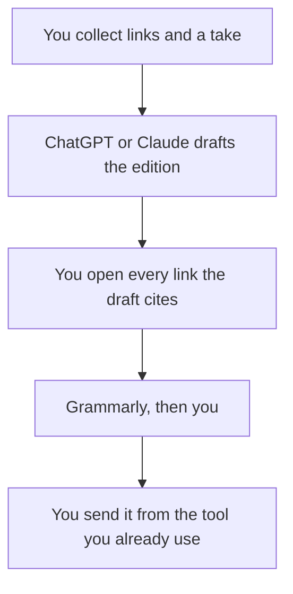

**A newsletter created with AI is one edition drafted from links you opened and notes you wrote, in a structure you reuse, sent by you.** The model can assemble the sections. It cannot decide the take, invent a quote from a link it did not see, or send the mail. The calendar that decides which edition exists is [how to build an AI content calendar](/blog/how-to-build-an-ai-content-calendar-2026/). A single post, which is a different length, is [how to write a blog post with Claude](/blog/how-to-write-a-blog-post-with-claude-2026/).

The voice rules, if you need them on paper first, are [how to create a brand voice with AI](/blog/how-to-create-a-brand-voice-with-ai-2026/). The claim check is [how to fact-check AI writing](/blog/how-to-fact-check-ai-writing-2026/).

Prices are US list prices excluding tax from directory pages checked October 16, 2026. Published October 24, 2026. We did not score open rates.

## What the model may touch

| Section | Who owns it | The model may |
|---|---|---|
| The take | You, in two or three sentences | Tighten it. It may not flip your position |
| Links | URLs you opened | Format them. It may not add a source |
| A summary of a link | The page, pasted or closely noted | Compress what you pasted. It may not review a URL from memory |
| The ask | The product or event you are allowed to mention | One line. It may not add an offer |
| Subject line | You, from the take | Offer options. You pick |

A summary of an article the model did not see is [a hallucination](/blog/what-is-ai-hallucination-2026/) your readers will forward. Paste the passage or skip the item.

## Where the edition is drafted

**A repeating format and images in one seat.** [ChatGPT](/tools/chatgpt/) Plus is $20 and includes custom GPTs and image generation. A custom GPT can hold the section list. Go at $8 is enough for a short edition and may include ads. The ladder is [ChatGPT Go vs Plus vs Pro](/blog/chatgpt-go-vs-plus-vs-pro-2026/). The writing comparison, if the edition is really an essay, is [ChatGPT vs Claude for writing](/blog/chatgpt-vs-claude-for-writing-2026/).

**A long source pack.** [Claude](/tools/claude/) Pro is $20 a month, or $17 billed annually. Put the style sheet in a Project. The container is [Claude Projects vs ChatGPT Projects](/blog/claude-projects-vs-chatgpt-projects-2026/). The brainstorm that should happen before the edition, not inside the send, is [ChatGPT vs Claude for brainstorming](/blog/chatgpt-vs-claude-for-brainstorming-2026/).

**The archive.** [Notion AI](/tools/notion-ai/) Business is $20 a seat if the back issues live in Notion. Plus at $10 is not the full AI tier. The archive is the record of what you sent. The chat is not. The card is [Notion AI pricing explained](/blog/notion-ai-pricing-explained-2026/).

**The line edit.** [Grammarly](/tools/grammarly/) Free covers grammar. Pro is $12 a member a month billed annually, or $30 monthly. Avoid the $30 toggle if you will still be sending next quarter. The card is [Grammarly pricing explained](/blog/grammarly-pricing-explained-2026/).

**A brand system, only if you will maintain it.** [Jasper](/tools/jasper/) Pro is $59 a seat a month billed yearly, with two Brand Voices. A solo newsletter does not need that seat. The invoice is [Jasper pricing explained](/blog/jasper-pricing-explained-2026/).

A prompt that holds the line:

"Here is our section list and the notes for this edition, including pasted passages. Draft the edition in under 600 words. Use only these notes. Do not add links, statistics, or quotes. If a note is thin, write one sentence and stop. End with the ask I provided, or omit the ask."

You send it. The person on the button is [what human-in-the-loop AI is](/blog/what-is-human-in-the-loop-ai-2026/). An internal announcement is a different list: [best AI tools for internal comms](/blog/best-ai-tools-for-internal-comms-2026/).

## A cadence that stays honest

One edition a week you can check beats a generated daily. The content calendar holds the dates. The newsletter workflow holds the words. Social posts cut from a published edition are [how to create social posts from a blog with AI](/blog/how-to-create-social-posts-from-a-blog-with-ai-2026/). Cut from the sent edition, not from the unreviewed draft.

If a link is an AI-search claim about your own brand, that is a measurement product, not a sentence the model may invent. Surfer and Semrush price that work separately: [Surfer SEO pricing explained](/blog/surfer-seo-pricing-explained-2026/).

## FAQ

### Can AI send the newsletter?

It can draft. You send, from the email tool you already trust, after you click every link. An auto-send will eventually recommend a product you do not sell or a number you did not check.

### Do I need Jasper or a SEO suite?

Not for the edition itself. Plus or Claude Pro covers the draft. Add Jasper when more than one brand voice is a system you will maintain. Add Surfer or Frase when the edition is actually an SEO article. Most newsletters are not.

### How many links belong in one edition?

As many as you opened. Three checked links beat twelve generated ones. If you cannot say why a link is there, cut it.

### What about a paid sponsorship?

Write the sponsor line yourself from the insertion order. The model may place it in the template. It may not invent a claim about the sponsor's product.

## Last verified

October 16, 2026 for ChatGPT, Claude, Notion, Grammarly, and Jasper prices named above. Published October 24, 2026.

**Sources:** [ChatGPT pricing](https://chatgpt.com/pricing), [Claude pricing](https://claude.com/pricing), [Jasper pricing](https://www.jasper.ai/pricing).

*Published by Andrew for [AI Tools Optimizer](https://aitoolsoptimizer.com).*

[ChatGPT](/tools/chatgpt/) is in the [chatbots and assistants directory](/tools/category/chatbots-assistants/). Directory pages may use affiliate links. A purchase through them may earn us a commission at no extra cost to you.
