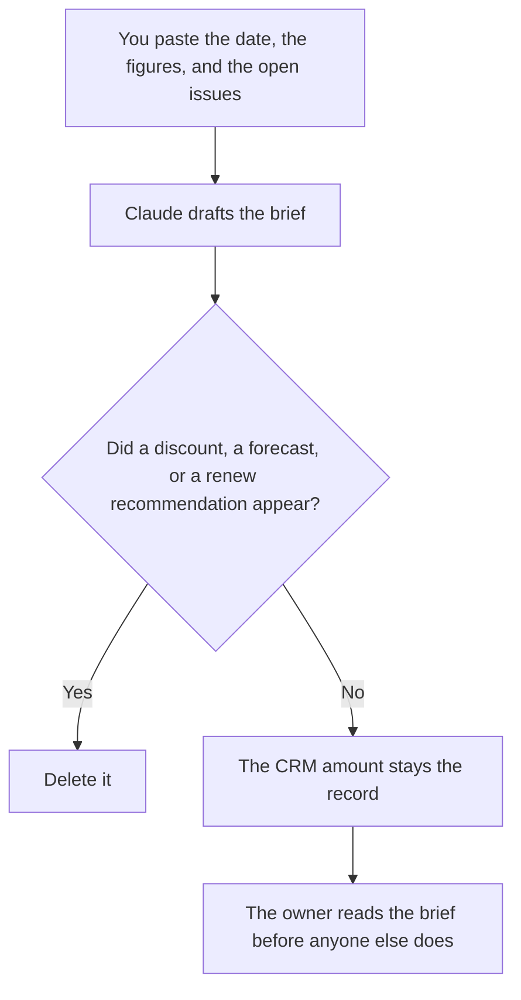

**A partner renewal brief written with AI states the partner, the end date, the commercial figures a person pasted, the open issues already on the record, and the decision that is still open.** The model may format that brief. It may not invent a revenue number, a discount, a risk score, or a recommendation to renew. If a figure is missing, the line says Figure missing.

The note you send when a partner issue is already on fire is [how to write a partner escalation note with AI](/blog/how-to-write-a-partner-escalation-note-with-ai-2026/). The operating stack around the record is [best AI tools for partner ops](/blog/best-ai-tools-for-partner-ops-2026/). A public page you cite before you repeat a partner's claim is [Perplexity vs Gemini for vendor diligence](/blog/perplexity-vs-gemini-for-vendor-diligence-2026/).

Claude's prices are from claude.com/pricing on October 24, 2026. Notion, HubSpot, and Perplexity prices are from directory pages checked October 16, 2026. HubSpot's Starter figure was labeled limited-time. Published October 24, 2026. We did not score partnerships. This page is not legal or financial advice.

## What the brief may contain

| Block | Who owns it | The model may |
|---|---|---|
| Partner name and the contract end date | The record | Copy them. It may not move the date closer "so you have time" |
| The figures you will discuss | Finance or the contract, pasted by you | Copy the numbers and the units. It may not convert currency |
| Open issues already written down | The owner | List them. It may not add a new grievance |
| A decision | Only if a person already made one | Otherwise write Decision open |
| A public claim about the partner | A page you opened | Cite the URL and the date. A snippet is not the page |

A brief that says the partner is "strategic" has added a judgment. Leave the adjective out unless a person typed it and is willing to own it. A brief that converts a euro figure to dollars has done math this page does not allow. Paste the figure in the currency on the contract.

## Where it is assembled

**The brief, when the headings match last quarter.** [Claude](/tools/claude/) Pro is $17 a month billed annually, $200 up front, or $20 monthly. The review is [Claude review](/blog/claude-review-2026/).

**The page the owner will mark up.** [Notion AI](/tools/notion-ai/) Business is $20 a seat a month. Plus at $10 is not the full AI tier on the October 16 card. The invoice is [Notion AI pricing explained](/blog/notion-ai-pricing-explained-2026/).

**The partner row.** [HubSpot](/tools/hubspot/) free tools are $0. Starter was $7 or $10 a seat on a limited-time offer that day. The record wins. Do not paste a generated amount back into the deal. The invoice is [HubSpot pricing explained](/blog/hubspot-pricing-explained-2026/).

**A public page.** [Perplexity](/tools/perplexity/) Pro is $17 a month billed annually. Open the link. Write the date. The invoice is [Perplexity pricing explained](/blog/perplexity-pricing-explained-2026/).

A prompt that holds the line:

"Draft a partner renewal brief from the name, end date, figures, and open issues I pasted. If a figure is missing, write Figure missing. Leave the decision as Decision open unless I pasted one. Do not recommend a discount or a renewal."

## What not to delegate

Do not ask whether the partner is worth keeping. Do not paste a compensation plan or a private email thread so the brief "has color." Do not send the brief to the partner. It is an internal page until the owner says otherwise.

## FAQ

### How is this different from an escalation note?

The escalation is one problem that needs a person now. The renewal brief is the packet before a renewal date: what the contract says, what is open, what is not decided. You can escalate an issue and still have a calm brief. Do not merge them into one dramatic page.

### Can the model pull the contract?

Only from text you pasted or a clause you already checked. A model that "remembers" last year's terms is using a stale thread. Paste the date and the figures from the file in front of you.

### What if the CRM and the contract disagree?

Stop. Name both figures and both sources. Do not ask the model to reconcile them. A person picks the record, or corrects one of the systems, before the brief says a single number.

### Who may decide to renew?

The owner named on the brief, under whatever approval your company already requires. A clear packet is not a yes. Decision open means the meeting has not happened.

## Last verified

October 24, 2026 for Claude. October 16, 2026 for Notion, HubSpot, and Perplexity. Published October 24, 2026.

**Sources:** [Claude pricing](https://claude.com/pricing), [Notion pricing](https://www.notion.com/pricing), [HubSpot pricing](https://www.hubspot.com/pricing), [Perplexity pricing](https://www.perplexity.ai/pro).

*Published by Andrew for [AI Tools Optimizer](https://aitoolsoptimizer.com).*

[Claude](/tools/claude/) is in the [chatbots and assistants directory](/tools/category/chatbots-assistants/). Directory pages may use affiliate links. A purchase through them may earn us a commission at no extra cost to you.
