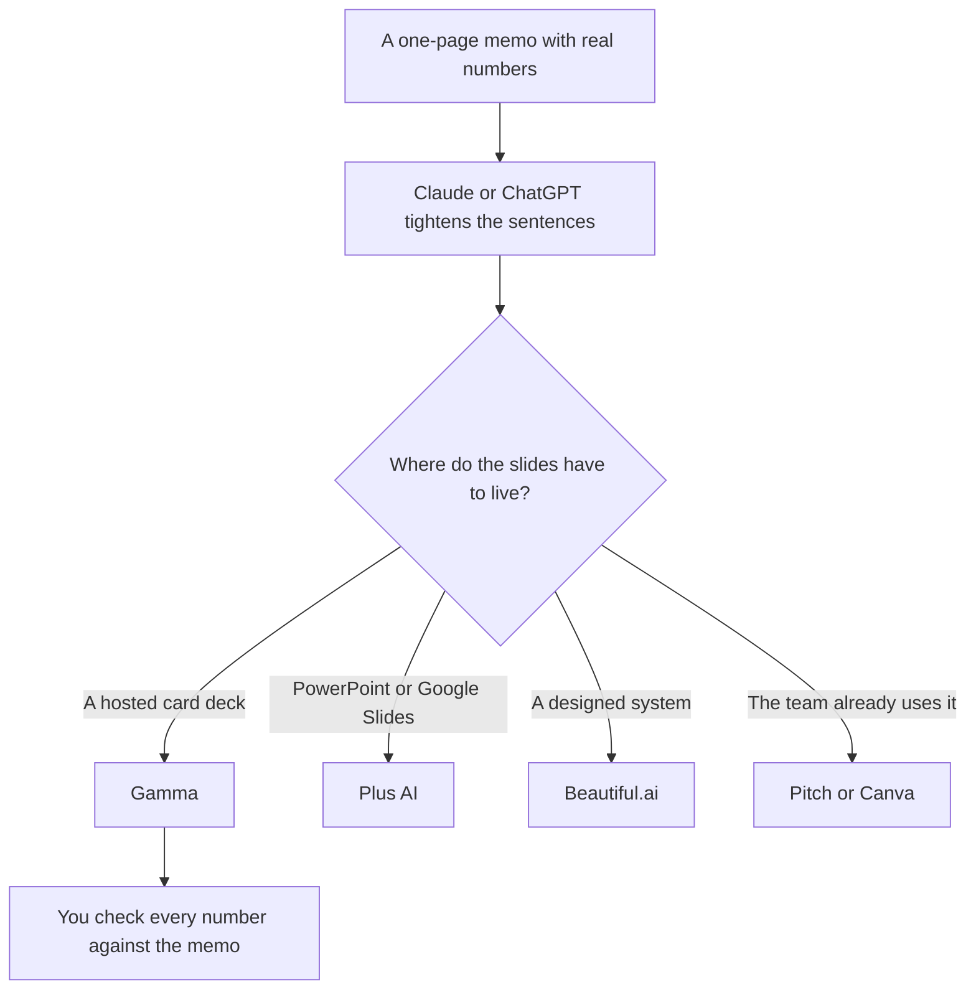

**A pitch deck made with AI is a slide pass over a memo you already believe: problem, what you do, the proof, the ask.** The model can turn that memo into cards. It cannot know your revenue, your runway, or the round. If a number is not in the memo, it does not go on a slide. Investors will ask, and "the tool wrote it" is not an answer.

Pick the slide tool after the narrative is stable. Switching from Gamma to [Beautiful.ai](/tools/beautiful-ai/) will not repair a missing proof point. The format choice is [Gamma vs Beautiful.ai vs Plus AI](/blog/gamma-vs-beautiful-ai-vs-plus-ai-2026/). The shelf is [best AI presentation makers](/blog/best-ai-presentation-makers/). The credit math is [Gamma pricing explained](/blog/gamma-pricing-explained-2026/).

Prices are US list prices excluding tax from directory pages checked October 16, 2026. Published October 24, 2026. We did not score decks or fundraising outcomes.

## The memo, in this order

| Slide | You must paste | The model may |
|---|---|---|
| Problem | One customer fact you can say out loud | Shorten it |
| What you do | One sentence a customer would recognize | Not add a feature you do not ship |
| Proof | A metric from your sheet, with the date | Format it. It may not round it |
| Market | A source you link, or omit the slide | Not invent a TAM |
| Ask | The round, the amount, and the use, from you | Lay it out |
| Team | Real names and real roles | Not import a bio from the web |

A market slide without a source is the usual failure. Delete it. A smaller deck is better than a precise-looking fiction. That failure mode is [what an AI hallucination is](/blog/what-is-ai-hallucination-2026/). The check is [how to fact-check AI writing](/blog/how-to-fact-check-ai-writing-2026/).

## Which seat drafts, and which seat designs

**The narrative.** [Claude](/tools/claude/) Pro is $20 a month, or $17 billed annually. Put the memo and one deck outline you liked in a Project. Ask for speaker notes that only use the memo, plus a list of claims with no source. [ChatGPT](/tools/chatgpt/) Plus at $20 is the same job if that is already the writing seat. The writing split is [ChatGPT vs Claude for writing](/blog/chatgpt-vs-claude-for-writing-2026/). The project containers are [Claude Projects vs ChatGPT Projects](/blog/claude-projects-vs-chatgpt-projects-2026/).

**Gamma, when the deliverable is a card deck.** Plus is $9 a seat a month, or $108 a year, with 1,000 credits. Pro at $18 adds the API and 4,000 credits. Paste the memo. Edit the outline before you generate cards. Regenerating to discover the story spends the month. The alternatives, if the format is wrong, are [Gamma alternatives](/blog/gamma-alternatives-2026/).

**[Plus AI](/tools/plus-ai/), when the file has to be PowerPoint or Google Slides.** Basic is $10 per user per month billed annually for 1,500 credits. The trial is seven days. Use it because of the file, not because the model is a different storyteller.

**Beautiful.ai, when you want a designed system and you will use the trial.** Pro is $14.50 a month billed annually, or $45 monthly. There is no free plan. The invoice is [Beautiful.ai pricing explained](/blog/beautiful-ai-pricing-explained-2026/). Fourteen days is the evaluation.

**Pitch or Canva, when the team already lives there.** [Pitch](/tools/pitch/) Free covers up to five members, with 100 one-time AI credits. Plus is $10 a seat yearly. [Canva](/tools/canva/) Pro is $18 a month or $180 a year. Generate from the memo inside the tool you will still be using next month. Rebuilding a brand kit to chase a generator is the expensive version of this workflow.

A prompt for the narrative pass:

"Memo is below. Draft 10 slide titles and one sentence each. Every number must appear in the memo. If a slide needs a number the memo does not have, title it 'cut this slide.' Do not estimate a market size."

## The pass investors actually notice

Read the deck once for design and once for numbers. On the number pass, cover the slide and say the figure from memory, then uncover it. If you cannot, the figure is not yours yet. Take it off.

Speaker notes can be longer than the slide. The slide should survive a room where you do not read them. Ask the model to cut slide text under a word count you set. Then put the explanation in the notes, still sourced from the memo.

A product spec is not a pitch. If you are still deciding what to build, stop and write [a product spec](/blog/how-to-draft-a-product-spec-with-ai-2026/). The deck can wait until the non-goals exist.

## FAQ

### Can I generate a deck from a one-line idea?

You can generate a story. Label it a brainstorm. Do not send it. The version you send starts from a memo with figures you can defend. Gamma Free can hold that brainstorm while a non-refreshing credit balance lasts. It should not be the file you email.

### How many slides?

Ten is a constraint, not a rule. Ask for the slides the memo supports. A model asked for fifteen will invent five. Cut the market and the team bios before you cut the proof.

### Which tool should a pre-seed founder buy?

The one that outputs the file the conversation needs. Gamma Plus at $9 if a link is fine. Plus AI Basic at $10 annual if an investor asked for PowerPoint. Claude or ChatGPT for the memo either way. Do not buy Ultra at $90 to make a ten-card deck.

### Can the model write the financials?

It can format a table you paste. It should not build the model. Your sheet is the source. If the sheet is the hard part, the tools for that grid are [best AI for Excel and Google Sheets](/blog/best-ai-for-excel-and-google-sheets-2026/). Bring the total back into the memo before it touches a slide.

## Last verified

October 16, 2026 for Gamma, Claude, ChatGPT, Plus AI, Beautiful.ai, Pitch, and Canva prices. Published October 24, 2026.

**Sources:** [Gamma pricing](https://gamma.app/pricing), [Claude pricing](https://claude.com/pricing), [Plus AI pricing](https://plusai.com/pricing/).

*Published by Andrew for [AI Tools Optimizer](https://aitoolsoptimizer.com).*

[Gamma](/tools/gamma/) is in the [presentations directory](/tools/category/presentations/). Directory pages may use affiliate links. A purchase through them may earn us a commission at no extra cost to you.
