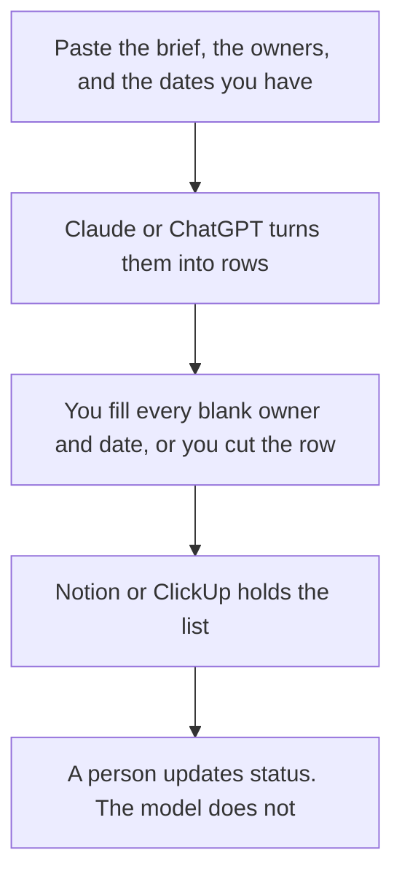

**A product launch checklist written with AI is a list of tasks, each with an owner and a date, taken from the plan you paste.** The model can spot a missing owner. It cannot mark a task done, invent a legal review, or decide that support is ready. A checkbox without a person's name is a wish. If a task is not in your notes, it stays off the list until someone adds it on purpose.

The strategy note that should exist before the list is [how to write a go-to-market brief with AI](/blog/how-to-write-a-go-to-market-brief-with-ai-2026/). The customer-facing "what changed" after you ship is [how to write release notes with AI](/blog/how-to-write-release-notes-with-ai-2026/). The product-marketing shelf is [best AI tools for product marketing](/blog/best-ai-tools-for-product-marketing-2026/).

Prices are US list prices excluding tax from directory pages checked October 16, 2026. Published October 24, 2026. We did not score launch outcomes.

## What a row has to contain

| Row | Required | The model may | The model may not |
|---|---|---|---|
| Task | A verb and an artifact: "publish the help article" | Split a vague line into two tasks if you ask | Add a webinar nobody staffed |
| Owner | A name or a role you named | Leave it blank and flag it | Assign a person who is not in the paste |
| Date | A date you chose, or "date missing" | Sort the list | Pick a ship date |
| Status | Not started, in progress, or done, from you | Repeat the status you typed | Check the box because the draft exists |
| Dependency | Only a blocker you named | Put it in a column | Assume legal, security, or billing signed off |
| Channel | The place the artifact ships | Match it to the task | Promise a press hit |

A checklist that says "all teams aligned" is [a hallucination](/blog/what-is-ai-hallucination-2026/) with checkboxes. The check on any customer-facing sentence is [how to fact-check AI writing](/blog/how-to-fact-check-ai-writing-2026/).

## Where the list lives

**The page people will tick.** [Notion AI](/tools/notion-ai/) Business is $20 a seat a month and includes Notion Agent. Free includes a trial of Notion AI. The checklist is a database with an owner property, not a chat bullet list. The invoice is [Notion AI pricing explained](/blog/notion-ai-pricing-explained-2026/).

**The first draft of the rows.** [Claude](/tools/claude/) Pro is $20 a month, or $17 billed annually, when the brief is long. [ChatGPT](/tools/chatgpt/) Plus at $20 is the other seat. Business is $20 a user a month billed annually, minimum two, when the brief is confidential. The container is [Claude Projects vs ChatGPT Projects](/blog/claude-projects-vs-chatgpt-projects-2026/).

**The list, if the work already lives in ClickUp.** [ClickUp Brain](/tools/clickup-brain/) starts at $9 a user a month for Brain², on top of a ClickUp plan. ClickUp Unlimited is $7 a user a month billed yearly on the card, and Business is $12 billed yearly. Brain can see tasks you already track. It still cannot close a task you did not finish. The comparison with a notes tool is [Notion AI vs ClickUp Brain](/blog/notion-ai-vs-clickup-brain-2026/).

**A readout for the launch meeting, after the rows are true.** [Gamma](/tools/gamma/) Plus is $9 a seat a month. Do not generate the deck from an empty checklist. The invoice is [Gamma pricing explained](/blog/gamma-pricing-explained-2026/).

A prompt that holds the line:

"Turn this brief into a launch checklist. Columns: task, artifact, owner, date, status, dependency. Use only owners and dates I pasted. If an owner or a date is missing, write Missing. Do not add tasks I did not mention. Do not mark anything done."

The person who owns the date is [what human-in-the-loop AI is](/blog/what-is-human-in-the-loop-ai-2026/).

## Rows teams forget, and still must type themselves

Support macros and the help article are tasks only if someone owns them. The macro workflow is [how to write a support macro library with AI](/blog/how-to-write-a-support-macro-library-with-ai-2026/). A status page draft is a task only if you will have an incident owner. Pricing pages, legal copy, and billing changes stay Missing until that owner accepts the row. The model is good at reminding you the row is empty. It is bad at volunteering a name.

The record of who accepted the list is [what a system of record for AI is](/blog/what-is-a-system-of-record-for-ai-2026/).

## FAQ

### How long should the checklist be?

Long enough that every customer-facing artifact has an owner, and short enough that you will update it. Forty rows nobody opens is a document, not a checklist. Cut tasks that have no artifact.

### Can AI pull tasks from the roadmap?

Only from a roadmap you paste or a workspace your admin has connected. A generated roadmap item is not a commitment. If the source of truth is a tracker, link the row. Do not retype a date the tracker can change tomorrow without saying which system wins.

### Should the ship date be on the list?

Yes, as a date a person set. If the date moves, a person moves it. Ask the model to list which rows break when the date moves. Do not ask it to pick a new date.

### Is a checklist a go-to-market brief?

No. The brief says who the launch is for and what you will claim. The checklist says who does the work by when. Write the brief first. The list without a claim still ships a product. The claim without an owner does not.

## Last verified

October 16, 2026 for Notion, Claude, ChatGPT, ClickUp Brain, and Gamma. Published October 24, 2026.

**Sources:** [Notion pricing](https://www.notion.com/pricing), [Claude pricing](https://claude.com/pricing), [ClickUp Brain pricing](https://clickup.com/brain/pricing).

*Published by Andrew for [AI Tools Optimizer](https://aitoolsoptimizer.com).*

[Notion AI](/tools/notion-ai/) is in the [productivity and notes directory](/tools/category/productivity-notes/). Directory pages may use affiliate links. A purchase through them may earn us a commission at no extra cost to you.
