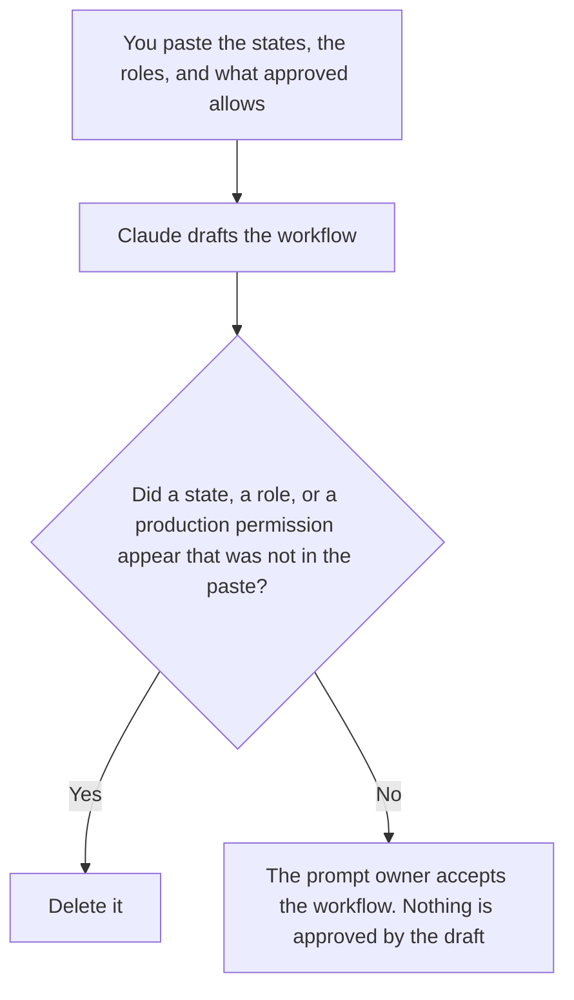

**A prompt approval workflow created with AI is a draft of the states a person already named: who may move a prompt from draft to review, and who may mark it approved before it runs.** The model may order the states. It may not approve a prompt, skip a state, or name an approver. The rules for how a prompt should be written are [how to create a prompt style guide with AI](/blog/how-to-create-a-prompt-style-guide-with-ai-2026/). A person's read of what changed is [what an AI prompt diff review is](/blog/what-is-ai-prompt-diff-review-2026/). The id on the wording is [what prompt versioning is](/blog/what-is-prompt-versioning-2026/).

The checklist a reviewer can follow is [how to create a prompt review checklist with AI](/blog/how-to-create-a-prompt-review-checklist-with-ai-2026/). The checklist is not the workflow. The workflow says which state the checklist belongs to.

Claude's prices are the October 24, 2026 read of claude.com/pricing recorded in [Claude pricing explained](/blog/claude-pricing-explained-2026/). Notion, Cursor, and Grammarly prices are from directory pages checked October 16, 2026. Published October 24, 2026. We did not score prompts. A diagram is not an approval.

## What the workflow is allowed to say

| Field | Who owns it | The model may |
|---|---|---|
| States | You | Copy the names you pasted. It may not add Approved as a default |
| Who may move a state | You | Copy the role. It may not substitute a model |
| What "approved" allows | You | Copy it. It may not widen it from draft use to production |
| Version | You | Copy the id. It may not mark the latest draft as current |
| Expiry | You, or the words Expiry not set | Copy it. It may not pick a quarter |

A workflow that ends in "the model may ship if the diff looks small" has added a permission. Approved means the person you named has marked that version. A review state without a person is not a review. If the approver is missing, the line says Approver not set. The prompt stays in draft.

The style guide can be required reading in the review state. The workflow does not contain the style rules. Link them. Do not paste a rewritten style guide into the state diagram.

## Where it is drafted

**The draft.** [Claude](/tools/claude/) Pro is $17 a month billed annually, $200 up front, or $20 monthly. Keep the state names in a Project so a later edit does not rename Approved to Ready. The review is [Claude review](/blog/claude-review-2026/).

**The file the company keeps.** [Notion AI](/tools/notion-ai/) Business is $20 a seat a month. One database of prompt versions, with the state and the approver as properties a person edits. The invoice is [Notion AI pricing explained](/blog/notion-ai-pricing-explained-2026/).

**The diff, if the workflow is a checklist in a repo.** [Cursor](/tools/cursor/) Plus is $8 a month, or $80 a year. You review the diff. Merging the file does not approve the prompt. The ladder is [Cursor pricing explained](/blog/cursor-pricing-explained-2026/).

**A clarity pass that must not rename a state.** [Grammarly](/tools/grammarly/) Pro is $12 a member a month billed annually, or $30 monthly. Compare the state names before and after. The invoice is [Grammarly pricing explained](/blog/grammarly-pricing-explained-2026/).

A prompt that holds the line:

"Draft the approval workflow from the states, the roles, and what approved allows, as I pasted them. If the approver is missing, write Approver not set. Do not mark any prompt approved. Do not add a state."

## What not to delegate

Do not ask the model which prompts are "safe to skip review." Do not treat a green diff as approval. Do not let a scheduled job move the state. The prompt owner, or the approver they named, moves the state. Draft stays draft until that person says otherwise.

## FAQ

### How is this different from a prompt style guide?

The style guide is how the prompt should be written: voice, required lines, forbidden lines. The workflow is who may change the state of a version. A prompt can match the style guide and still be in draft. A prompt can be approved and still violate the guide if the approver did not check. Keep both. Do not merge them into one file that auto-approves a match.

### How is this different from a diff review?

The diff review is a person reading what changed between two versions. The workflow says that reading happens in the review state, and that a different person may be the one who marks approved. You can review a diff and leave the state on In review. The workflow does not perform the read.

### How is this different from versioning?

Versioning is the id on the wording. The workflow says which version is allowed to run. A new version starts in draft even if the text is a copy. The old approved version stays the one that runs until a person moves the new id. Do not let a draft replace the id that production calls.

### Who may mark a prompt approved?

The approver named for that state. The model that drafted the workflow is not the approver. The person who opened the pull request is not the approver unless the workflow says they are. Approver not set means nobody marks it approved.

## Last verified

October 24, 2026 for Claude, via the pricing article. October 16, 2026 for Notion, Cursor, and Grammarly. Published October 24, 2026.

**Sources:** [Claude pricing](https://claude.com/pricing), [Notion pricing](https://www.notion.com/pricing), [Cursor pricing](https://cursor.com/help/account-and-billing/pricing), [Grammarly pricing](https://www.grammarly.com/plans).

*Published by Andrew for [AI Tools Optimizer](https://aitoolsoptimizer.com).*

[Notion AI](/tools/notion-ai/) is in the [notes directory](/tools/category/productivity-notes/). Directory pages may use affiliate links. A purchase through them may earn us a commission at no extra cost to you.
