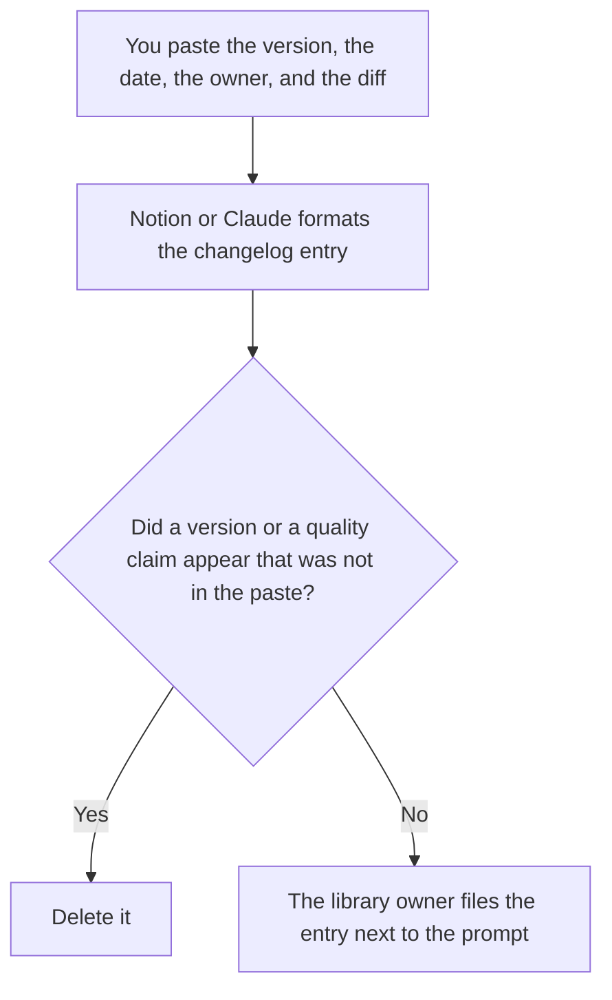

**A prompt library changelog written with AI is a list of prompt versions: the id, the date, the owner, and the change a person already described.** The model may format that list. It may not decide a prompt got better, invent a version, or hide a change that tightened a rule. The line-level change is [what an AI prompt diff is](/blog/what-is-ai-prompt-diff-2026/). The request that asks for the change before it lands is [how to write a prompt change request with AI](/blog/how-to-write-a-prompt-change-request-with-ai-2026/).

A probe you run after the change is [what an AI prompt canary is](/blog/what-is-ai-prompt-canary-2026/). The cases you run before you ship it are [what an AI eval regression suite is](/blog/what-is-ai-eval-regression-suite-2026/).

Notion, ChatGPT, and Cursor prices are from directory pages checked October 16, 2026. Claude's prices are from claude.com/pricing on October 24, 2026. chatgpt.com/pricing returned HTTP 403 that day. Published October 24, 2026. We did not score prompts.

## What the changelog records

| Row | Who owns it | The model may |
|---|---|---|
| Prompt id and version | You, from the library | Copy them. It may not renumber |
| Date and owner | The change record | Copy both. If the owner is blank, write Owner not set |
| What changed | A description you wrote, or a diff you pasted | Summarize that paste. It may not add a motive |
| What you did not measure | You | Keep the line. It may not say the new prompt is better |

A changelog that says "improved clarity" without quoting the line has editorialized. Quote the line or point at the diff. If the change was a rollback, say rollback. Do not call it an iteration.

The entry is not the approval. The change request is the approval, when you use one. The changelog is the record after the change exists.

## Where it is kept

**The library page.** [Notion AI](/tools/notion-ai/) Business is $20 a seat a month. The changelog sits on the same page as the prompt, or one link away. Plus at $10 is not the full AI tier. The invoice is [Notion AI pricing explained](/blog/notion-ai-pricing-explained-2026/).

**A set of entries that must use the same fields.** [Claude](/tools/claude/) Pro is $17 a month billed annually, $200 up front, or $20 monthly. Put the field list in a Project. The review is [Claude review](/blog/claude-review-2026/).

**One entry from a short diff.** [ChatGPT](/tools/chatgpt/) Plus is $20 a month on the October 16 card. Paste the diff. Discard a summary that adds a benefit. The review is [ChatGPT review](/blog/chatgpt-review-2026/).

**The file in the repo.** [Cursor](/tools/cursor/) Plus is $8 a month, or $80 a year. If the prompt lives in git, the changelog can point at the commit you already made. The model does not make the commit. The ladder is [Cursor pricing explained](/blog/cursor-pricing-explained-2026/).

A prompt that holds the line:

"Write a changelog entry from the prompt id, the version, the date, the owner, and the diff I pasted. Do not add a version. Do not say the new prompt is better. If the owner is missing, write Owner not set."

## What not to delegate

Do not ask which prompt version won. Do not rewrite history when a version looks embarrassing. Do not drop a rollback from the log. The library owner files the entry. A chat is not the library.

## FAQ

### How is this different from a prompt diff?

The diff is the line change. The changelog is the record that the change happened, with an owner and a date. You can have a diff and no changelog, and then nobody knows which version production is on. Point at the diff. Do not replace it with an adjective.

### How is this different from a change request?

The request is the ask, before the change. The changelog is after. If the request was rejected, there is no changelog row for a version that does not exist. A request number can sit on the row. The request is not the row.

### Can one entry cover several prompts?

Only if you paste each id. An entry that says "updated the library" is not a changelog. It is a mood. One id per row is easier to audit. A batch row must list the ids.

### Who may edit a past entry?

The library owner, with a new row that says the old row was corrected. Silent edits make the log useless. The date of the correction is a date. It is not a rewrite of the original date.

## Last verified

October 16, 2026 for Notion, ChatGPT, and Cursor. October 24, 2026 for Claude. Published October 24, 2026.

**Sources:** [Notion pricing](https://www.notion.com/pricing), [Claude pricing](https://claude.com/pricing), [ChatGPT pricing](https://chatgpt.com/pricing/), [Cursor pricing](https://cursor.com/help/account-and-billing/pricing).

*Published by Andrew for [AI Tools Optimizer](https://aitoolsoptimizer.com).*

[Notion AI](/tools/notion-ai/) is in the [productivity and notes directory](/tools/category/productivity-notes/). Directory pages may use affiliate links. A purchase through them may earn us a commission at no extra cost to you.
