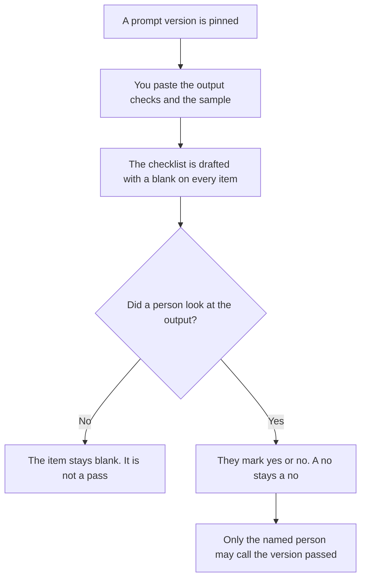

**A prompt QA checklist written with AI is the list of checks a person already requires on the output of a frozen prompt version before that version is called passed.** The model may turn those checks into a list with a yes, a no, or a blank. It may not add a check, mark a blank as yes, or call the version passed. The checks on the prompt itself, before it may run, are [how to create a prompt review checklist with AI](/blog/how-to-create-a-prompt-review-checklist-with-ai-2026/). This page is the output. A prompt can be allowed to run and still fail QA.

The id the caller must send is [what an AI prompt version pin is](/blog/what-is-ai-prompt-version-pin-2026/). Re-running prompts after an edit is [what prompt regression testing is](/blog/what-is-prompt-regression-testing-2026/). The line a metric must meet is [what an AI eval pass threshold is](/blog/what-is-ai-eval-pass-threshold-2026/).

Claude's prices are from claude.com/pricing on October 24, 2026. Notion and Cursor prices are from the October 16 directory and the October 24 Cursor help page, as the pricing articles record them. ChatGPT's Plus price is from learn.chatgpt.com/docs/pricing on October 24. Published October 24, 2026. We did not score prompts. A completed-looking list is not a pass.

## What the checklist is allowed to contain

| Item | Who owns it | The model may |
|---|---|---|
| The prompt version id | You | Copy it. It may not write latest |
| The output check | You | Copy it. It may not add a check |
| Yes, no, or blank | The reviewer, after they look | Leave a blank blank. It may not fill yes |
| The sample you used | You, or Sample not set | Name it. It may not invent an input |
| Who may call it passed | You | Copy the name. It may not pass the version |

A check that says "the tone feels on brand" has added a test you did not write. If the sample is missing, the line says Sample not set, and nobody marks the output yes. The review checklist can be done, and this list can still be blank. They are not the same gate. One automated lint rule is [what an AI prompt lint rule is](/blog/what-is-ai-prompt-lint-rule-2026/). Lint is not QA of the answer.

The note of what changed in the wording is [how to create a prompt library changelog with AI](/blog/how-to-create-a-prompt-library-changelog-with-ai-2026/). The changelog does not check the output. QA does, against the sample you named.

## Where it is drafted

**The draft.** [Claude](/tools/claude/) Pro is $17 a month billed annually, $200 up front, or $20 monthly. Keep the checks in a Project so a later edit does not add one. The review is [Claude review](/blog/claude-review-2026/).

**The page the reviewer completes.** [Notion AI](/tools/notion-ai/) Business is $20 a seat a month. The row stores the version id, the sample, and the blanks. Plus at $10 is not the full AI tier. The invoice is [Notion AI pricing explained](/blog/notion-ai-pricing-explained-2026/).

**One list from a paste.** [ChatGPT](/tools/chatgpt/) Plus is $20 a month. Discard a version that marks the items yes. The ladder is [ChatGPT pricing explained](/blog/chatgpt-pricing-explained-2026/).

**The diff, if the checks live next to the prompt.** [Cursor](/tools/cursor/) Plus is $8 a month, or $80 a year, on the October 24 help page. You review a diff that changes a check or the version id. The individual ladder is [Cursor pricing explained](/blog/cursor-pricing-explained-2026/).

A prompt that holds the line:

"Draft the QA checklist from the version id, the output checks, and the sample I pasted. Leave every result blank. If a check is missing, write Check not set. Do not mark anything passed. Do not add a check."

## What not to delegate

Do not ask which checks a release "should" include. Do not let the model grade its own output. Do not call a version passed because the review checklist was already yes. The named reviewer looks at the sample. A blank stays a blank.

## FAQ

### How is this different from a prompt review checklist?

The review checklist is what a reviewer requires on the prompt before that version may run: the wording, the owner, the items you already listed. This checklist is what you require on the output of a version that is already pinned. A prompt can pass review and fail QA. Use the review page for the wording. Use this page for the answer.

### How is this different from a pass threshold?

The threshold is the number, or the named outcome, a metric must meet. A QA item can point at that threshold if you pasted it. The checklist does not choose the number, and a yes on a different item does not move the line. A blank sample means you have not applied the threshold at all.

### How is this different from prompt regression testing?

Regression testing is re-running prompts after an edit. The checklist is the list of output checks for one frozen version, against a sample you named. A regression run can feed the checklist. It does not replace a check you forgot to write, and it does not mark the box.

### Who may call the version passed?

The person named on the list. Check not set stays not set. A model that says the output "looks right" is not a yes. The version id on the list has to match the pin. Latest is not an id.

## Last verified

October 24, 2026 for Claude, for ChatGPT's plan page, and for Cursor's help page. October 16, 2026 for Notion. Published October 24, 2026. No prompt was marked passed in this article.

**Sources:** [Claude pricing](https://claude.com/pricing), [Notion pricing](https://www.notion.com/pricing), [ChatGPT and Codex pricing](https://learn.chatgpt.com/docs/pricing), [Cursor pricing](https://cursor.com/help/account-and-billing/pricing).

*Published by Andrew for [AI Tools Optimizer](https://aitoolsoptimizer.com).*

[Claude](/tools/claude/) is in the [chatbots and assistants directory](/tools/category/chatbots-assistants/). Directory pages may use affiliate links. A purchase through them may earn us a commission at no extra cost to you.
