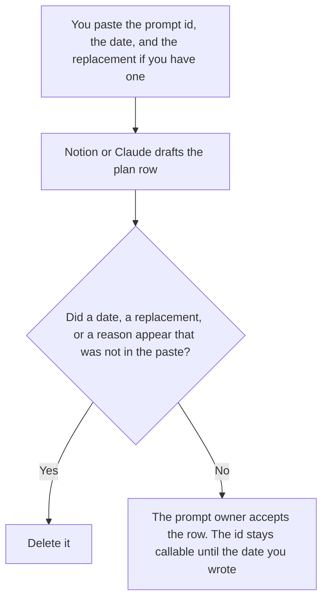

**A prompt retirement plan written with AI is a list of prompt ids a person already marked for retirement, with the date, the replacement id if they named one, and who may still call the old id until that date.** The model may format the list. It may not decide a prompt is obsolete, invent a replacement, or hide an id that is still in production. The line-level change, while the prompt is still live, is [what an AI prompt diff is](/blog/what-is-ai-prompt-diff-2026/). The log of versions that remain in the library is [how to create a prompt library changelog with AI](/blog/how-to-create-a-prompt-library-changelog-with-ai-2026/).

The request that asks for a change before it lands is [how to write a prompt change request with AI](/blog/how-to-write-a-prompt-change-request-with-ai-2026/). The place the ids live is [what an AI prompt registry is](/blog/what-is-ai-prompt-registry-2026/).

Notion, ChatGPT, and Cursor prices are from the dates below. Claude's prices are from claude.com/pricing on October 24, 2026. chatgpt.com/pricing returned HTTP 403 that day, so the Plus figure stays on the plan page recorded in [ChatGPT pricing explained](/blog/chatgpt-pricing-explained-2026/). Published October 24, 2026. We did not score prompts. A retirement date is not a quality score.

## What the plan is allowed to say

| Field | Who owns it | The model may |
|---|---|---|
| Prompt id | You | Copy it. It may not merge two ids |
| Retirement date | You | Copy it. It may not pick "end of quarter" |
| Replacement id | You, or Replacement not named | Copy it. It may not invent a successor |
| Who may call the old id until the date | You, or Caller not named | Copy the name. It may not leave the id open to everyone |
| What happens on the date | You: calls stop, or the gate rejects the id | It may not keep the id "for emergencies" unless you wrote that |

A row that says the prompt is "low quality" has added a judgment. If you did not write a reason, the cell says Reason not recorded. The plan can retire an id with no quality story. A replacement that was not named stays as Replacement not named. Callers do not get to guess which prompt replaces it.

A support macro that is going away is [how to write a support macro retirement note with AI](/blog/how-to-write-a-support-macro-retirement-note-with-ai-2026/). A feature flag that is going away is [how to write a feature flag retirement note with AI](/blog/how-to-write-a-feature-flag-retirement-note-with-ai-2026/). Those are different ids. Do not put a macro id in the prompt plan because the names look alike.

## Where it is drafted

**The register.** [Notion AI](/tools/notion-ai/) Business is $20 a seat a month on the October 16 card. One row per id, the date, the replacement, and the owner. Plus at $10 is not the full AI tier. The invoice is [Notion AI pricing explained](/blog/notion-ai-pricing-explained-2026/).

**The draft of the notice.** [Claude](/tools/claude/) Pro is $17 a month billed annually, $200 up front, or $20 monthly. The Project holds the id so a later edit does not swap it. The review is [Claude review](/blog/claude-review-2026/). The ladder is [Claude pricing explained](/blog/claude-pricing-explained-2026/).

**One row from a paste.** [ChatGPT](/tools/chatgpt/) Plus is $20 a month. Discard a version that adds a replacement. The ladder is [ChatGPT pricing explained](/blog/chatgpt-pricing-explained-2026/).

**The diff, if the id is rejected in code on that date.** [Cursor](/tools/cursor/) Plus is $8 a month, or $80 a year, on the October 24 help page recorded in [Cursor Business pricing explained](/blog/cursor-business-pricing-explained-2026/). You review the diff that rejects the id. The plan does not merge itself.

A prompt that holds the line:

"Draft the retirement row from the prompt id, the date, and the replacement id I pasted. If the replacement is missing, write Replacement not named. If the date is missing, write Date not set. Do not decide the prompt is obsolete. Do not pick a date."

## What not to delegate

Do not ask which prompts are "safe to delete." Do not retire an id because a newer prompt sounds better on one example. Do not leave the old id callable with no date and no named caller. The prompt owner accepts the row. A formatted table is not a retirement.

## FAQ

### How is this different from a prompt library changelog?

The changelog lists versions that changed: the id, the date, the line that moved. The retirement plan lists ids that will stop, the date they stop, and the replacement if you named one. A changelog entry can exist for a prompt that stays in production. A retirement row is the plan to take an id out. Link them. Do not treat a version bump as a retirement.

### How is this different from a prompt change request?

The change request asks to edit a live prompt before the edit lands. The retirement plan asks to stop calling an id on a date. You can change a prompt without retiring it. You can retire a prompt without describing a line-level diff. Use the request for an edit. Use this page for a stop date.

### How is this different from a macro or flag retirement note?

Those notes retire a support macro or a feature flag. This plan retires a prompt id in the registry. The same person might own all three. The ids are different, and the callers are different. A macro note does not stop a prompt. A prompt row does not unpublish a macro.

### Who may retire a prompt?

The owner named on the row. Date not set means the id is not retired. Replacement not named means callers do not switch until a person names the next id. A model suggestion is not a date.

## Last verified

October 24, 2026 for Claude, for ChatGPT's plan page, and for Cursor's help page, via the posts cited above. October 16, 2026 for Notion. Published October 24, 2026.

**Sources:** [Notion pricing](https://www.notion.com/pricing), [Claude pricing](https://claude.com/pricing), [ChatGPT and Codex pricing](https://learn.chatgpt.com/docs/pricing), [Cursor pricing](https://cursor.com/help/account-and-billing/pricing).

*Published by Andrew for [AI Tools Optimizer](https://aitoolsoptimizer.com).*

[Notion AI](/tools/notion-ai/) is in the [productivity and notes directory](/tools/category/productivity-notes/). Directory pages may use affiliate links. A purchase through them may earn us a commission at no extra cost to you.
