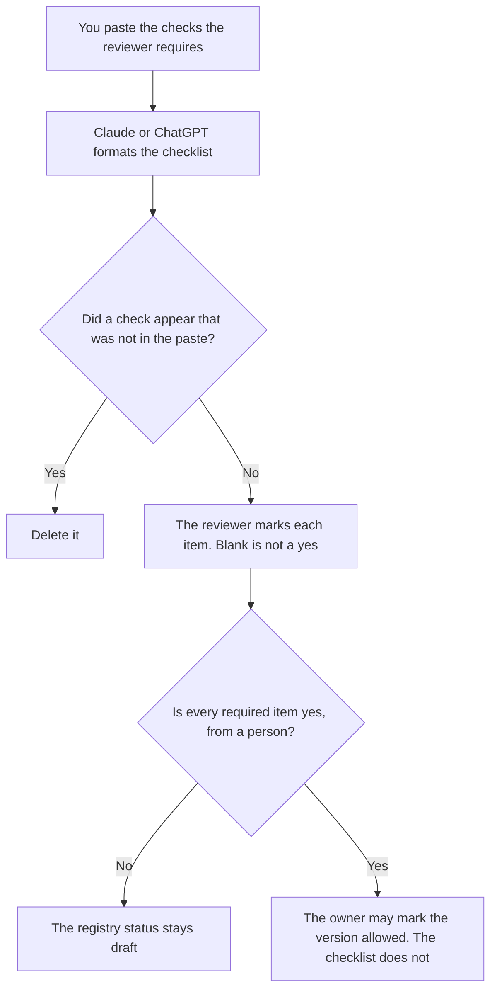

**A prompt review checklist written with AI is the list of checks a reviewer already requires before a prompt version may be marked allowed.** The model may turn those checks into a list with a yes, a no, or a blank. It may not add a check, soften a no, or mark the prompt allowed. One automated rule, which is a different object, is [what an AI prompt lint rule is](/blog/what-is-ai-prompt-lint-rule-2026/). The note of what changed is [how to create a prompt library changelog with AI](/blog/how-to-create-a-prompt-library-changelog-with-ai-2026/).

The small live trial after the checklist passes is [what an AI prompt canary is](/blog/what-is-ai-prompt-canary-2026/). The permission row is [what an AI prompt registry is](/blog/what-is-ai-prompt-registry-2026/). The checklist is not the registry. It is what the reviewer completes before the row changes.

Claude's prices are from claude.com/pricing on October 24, 2026. Notion and Cursor prices are from directory pages checked October 16, 2026. ChatGPT's Plus price is from learn.chatgpt.com/docs/pricing on October 24. Published October 24, 2026. We did not score prompts.

## What the checklist contains

| Check | Who defines it | The model may |
|---|---|---|
| Owner and version are filled in | You | Copy the line. If either is blank, the item stays no |
| The data the prompt must not see | You | Copy the ban. It may not narrow it |
| The eval set the reviewer named | You | Name it. It may not invent a passing score |
| The environment the prompt may run in | You | Copy it. It may not add production |

A checklist the model completes by itself is a story about the prompt. The reviewer marks the items. A polished prompt with a blank owner fails the owner item. There is no partial credit the model can award.

## Where it is kept

**The checks.** [Claude](/tools/claude/) Pro is $17 a month billed annually, $200 up front, or $20 monthly. Keep the required items in a Project so a later draft does not drop the data ban. The review is [Claude review](/blog/claude-review-2026/).

**The page the reviewer opens.** [Notion AI](/tools/notion-ai/) Business is $20 a seat a month. One checklist per version. The invoice is [Notion AI pricing explained](/blog/notion-ai-pricing-explained-2026/).

**One list from a short paste.** [ChatGPT](/tools/chatgpt/) Plus is $20 a month. Discard a version that adds "check for brand voice" if you did not require it. The ladder is [ChatGPT pricing explained](/blog/chatgpt-pricing-explained-2026/).

**A test that encodes one item, if the check is mechanical.** [Cursor](/tools/cursor/) Plus is $8 a month, or $80 a year. You review the diff. The checklist does not merge it. The ladder is [Cursor pricing explained](/blog/cursor-pricing-explained-2026/).

A prompt that holds the line:

"Format the review checklist from the checks I pasted. If a check has no result, write Not reviewed. Do not add a check. Do not mark the prompt allowed."

## What not to delegate

Do not ask whether the prompt is good. Do not let the model check the box for "no customer data" because the text looks abstract. The reviewer looks. Do not skip the checklist because a canary is scheduled. The canary is allowed only after the owner says so.

## FAQ

### How is this different from a lint rule?

A lint rule is one check a program can run, such as a banned phrase. The checklist is the set of items a person must mark, including items a program cannot see, such as whether the owner is the right person. A green lint run does not complete the checklist.

### How is this different from a changelog?

The changelog says what the text used to say. The checklist says whether this version met the checks. A long changelog can attach to a version that is still draft. Passing the checklist is not the same as describing the diff.

### How is this different from a canary?

The canary is a small live trial of a version you already allowed. The checklist is the review before that permission. Running a canary does not backfill a blank item.

### Who may mark an item yes?

The reviewer named on the checklist. A model that writes yes has not reviewed it. Change that cell back to Not reviewed.

## Last verified

October 24, 2026 for Claude and for ChatGPT's plan page. October 16, 2026 for Notion and Cursor. Published October 24, 2026.

**Sources:** [Claude pricing](https://claude.com/pricing), [Notion pricing](https://www.notion.com/pricing), [ChatGPT and Codex pricing](https://learn.chatgpt.com/docs/pricing), [Cursor pricing](https://cursor.com/help/account-and-billing/pricing).

*Published by Andrew for [AI Tools Optimizer](https://aitoolsoptimizer.com).*

[Claude](/tools/claude/) is in the [chatbots and assistants directory](/tools/category/chatbots-assistants/). Directory pages may use affiliate links. A purchase through them may earn us a commission at no extra cost to you.
