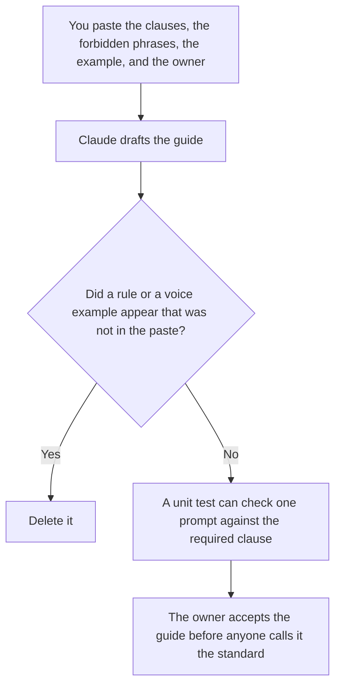

**A prompt style guide created with AI is a draft of rules a person already wrote for prompts: a required clause, a forbidden phrase, a voice example they pasted, and an owner.** The model may order the rules in plain language. It may not invent a voice, a banned word, or a second owner. A style guide for prose the company publishes is [how to create a style guide with AI](/blog/how-to-create-a-style-guide-with-ai-2026/). The check that a prompt file follows a rule is [what an AI prompt unit test is](/blog/what-is-ai-prompt-unit-test-2026/).

Who accepts a change between two prompt versions is [what an AI prompt diff review is](/blog/what-is-ai-prompt-diff-review-2026/). The guide is the rules. The review is one change. The list of prompts that may run is [what an AI prompt registry is](/blog/what-is-ai-prompt-registry-2026/).

Claude's prices are the October 24, 2026 read of claude.com/pricing recorded in [Claude pricing explained](/blog/claude-pricing-explained-2026/). Notion, Grammarly, and Cursor prices are from directory pages checked October 16, 2026. Published October 24, 2026. We did not score prompts.

## What the guide is allowed to contain

| Rule | Who writes it | The model may |
|---|---|---|
| Required clause | You | Copy it. It may not soften the words |
| Forbidden phrase | You | Copy it. It may not add a synonym "so it is complete" |
| Voice example | You, pasted | Quote it. It may not write a new example and label it yours |
| Where it applies | You: which prompts, which team | Copy the scope. It may not say "all prompts" |
| Owner | A person | Copy the name. It may not assign a team alias |

A brand style guide tells a writer how a blog post sounds. A prompt style guide tells a prompt author which lines must be in the prompt file. They can share an owner. They are not the same document. Do not paste the brand guide and ask for "the prompt version."

A unit test fails a file that lacks the clause. It does not write the clause. If the guide has no required clause yet, the test has nothing to enforce. Write the rule first.

## Where it is drafted

**The draft.** [Claude](/tools/claude/) Pro is $17 a month billed annually, $200 up front, or $20 monthly. The Project holds the current rules so a later chat does not add a ban. The review is [Claude review](/blog/claude-review-2026/).

**The file the company keeps.** [Notion AI](/tools/notion-ai/) Business is $20 a seat a month. One page, the owner, the date. The invoice is [Notion AI pricing explained](/blog/notion-ai-pricing-explained-2026/).

**A clarity pass that must not touch a forbidden phrase.** [Grammarly](/tools/grammarly/) Pro is $12 a member a month billed annually, or $30 monthly. Reject a suggestion that rewrites the required clause. The invoice is [Grammarly pricing explained](/blog/grammarly-pricing-explained-2026/).

**The diff, if the guide lives next to the prompts.** [Cursor](/tools/cursor/) Plus is $8 a month, or $80 a year. You review the diff. The ladder is [Cursor pricing explained](/blog/cursor-pricing-explained-2026/).

A prompt that holds the line:

"Draft the prompt style guide from the required clauses, the forbidden phrases, the example, and the owner I pasted. If the owner is missing, write Owner not set. Do not add a rule. Do not invent an example."

## What not to delegate

Do not ask the model what a "good" prompt voice is. Do not mine old prompts for rules you have not accepted. Do not mark the guide adopted because the headings look official. The owner accepts it. A unit test can enforce a clause after that. It does not adopt the guide.

## FAQ

### How is this different from a writing style guide?

The writing guide covers published prose: words you will ship to a reader. The prompt guide covers the instructions you send a model. A friendly blog voice can be the wrong line inside a prompt that must refuse an invented date. Keep both documents. Link them if the owner is the same person. Do not merge the rules.

### How is this different from a prompt unit test?

The guide says what the rules are. The unit test checks one file for a clause you already listed. A guide with no test is a document people can ignore. A test with no guide is a check nobody agreed to. Write the guide, then point the test at a clause in it.

### How is this different from a diff review?

The review accepts one change between two versions. The guide is the standing rule that change should follow. A review can pass a diff that breaks the guide if the reviewer does not have the guide open. Put the guide's version id on the review row.

### Who may add a forbidden phrase?

The owner. A reviewer can propose one. They do not edit the guide in the same pull request as the prompt, unless the row says they may. A new phrase needs a date. Old prompts do not become retroactively wrong until you say which version of the guide applies.

## Last verified

October 24, 2026 for Claude, via the pricing article. October 16, 2026 for Notion, Grammarly, and Cursor. Published October 24, 2026.

**Sources:** [Claude pricing](https://claude.com/pricing), [Notion pricing](https://www.notion.com/pricing), [Grammarly pricing](https://www.grammarly.com/plans), [Cursor pricing](https://cursor.com/help/account-and-billing/pricing).

*Published by Andrew for [AI Tools Optimizer](https://aitoolsoptimizer.com).*

[Notion AI](/tools/notion-ai/) is in the [notes directory](/tools/category/productivity-notes/). Directory pages may use affiliate links. A purchase through them may earn us a commission at no extra cost to you.
