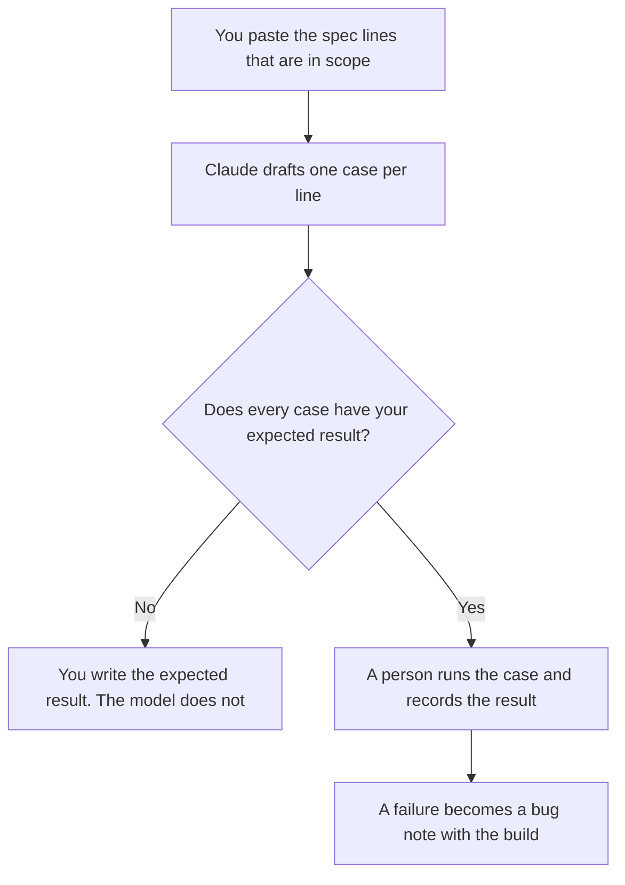

**A QA test plan written with AI is a scope, a list of cases drawn from a spec you have, and the environment you named.** The model may turn acceptance lines into case titles and a table. It may not invent a requirement, a pass result, or a browser you do not ship. A case with no expected result stays incomplete until a person writes it.

The spec those cases should trace to is [how to draft a product spec with AI](/blog/how-to-draft-a-product-spec-with-ai-2026/). The bug note after a case fails is [how to write a bug triage note with AI](/blog/how-to-write-a-bug-triage-note-with-ai-2026/). Writing the test in the repo, then running it, is [Cursor vs GitHub Copilot for tests](/blog/cursor-vs-github-copilot-for-tests-2026/). A green check you did not earn is [what an AI hallucination is](/blog/what-is-ai-hallucination-2026/).

Prices are US list prices excluding tax from directory pages checked October 16, 2026. Published October 24, 2026. We did not score defect detection. This page does not replace your release bar.

## What the plan has to contain

| Section | You provide | The model may |
|---|---|---|
| Scope | What is in this release, in your words | Repeat it. It may not pull in the next release |
| Out of scope | What you will not test | Copy it. It may not shrink the list |
| Environment | Browsers, accounts, flags, data you named | Format it. It may not add a device |
| Cases | One case per acceptance line you paste | Title and steps from that line. It may not add a scenario |
| Expected result | The outcome you wrote | Copy it. It may not write "works correctly" |
| Result | Empty until someone runs it | Leave it blank. It may not write Pass |

"Test the happy path" is not a plan. A case names the setup, the action, and the result you expect. The model is useful when the spec is long and the cases would otherwise be a paraphrase nobody traces.

## Where the plan is written

**The draft from the spec.** [Claude](/tools/claude/) Pro is $20 a month, or $17 billed annually. Put the spec in a Project. Ask for cases only from the lines you mark in scope. Free can do a short spec. The review is [Claude review](/blog/claude-review-2026/).

**The test in the repo.** [Cursor](/tools/cursor/) Plus is $8 a month, or $80 a year. [GitHub Copilot](/tools/github-copilot/) Pro is $10 a user a month. Either can draft a test file. You run it. A test that the model says will pass, and that you did not run, is not a result. The invoices are [Cursor pricing explained](/blog/cursor-pricing-explained-2026/) and [GitHub Copilot pricing explained](/blog/github-copilot-pricing-explained-2026/). The QA shelf is [best AI tools for QA engineers](/blog/best-ai-tools-for-qa-engineers-2026/).

**The page the release uses.** [Notion AI](/tools/notion-ai/) Business is $20 a seat a month if the plan lives next to the spec. The result column stays empty in the template. People fill it after the run. The page is the record: [what a system of record for AI is](/blog/what-is-a-system-of-record-for-ai-2026/).

A prompt that holds the line:

"From these in-scope spec lines, draft one test case each. Columns: id, setup, action, expected result, result. Copy the expected result only if I wrote one. Otherwise write Missing. Leave result blank. Do not add cases. Do not mark anything passed."

The scored cousin, when the "spec" is a model prompt rather than a product, is [what AI eval testing is](/blog/what-is-ai-eval-testing-2026/). Do not mix a product test plan with an eval harness. They fail differently.

## What not to delegate

Do not ask the model to decide the release is ready. Do not let it delete out-of-scope items because the plan looks long. Do not paste production customer data into a case for "realism" if your policy forbids it. Use the fixture you named.

The addendum when the spec changes mid-test is [how to write a product spec addendum with AI](/blog/how-to-write-a-product-spec-addendum-with-ai-2026/). Update the cases from the addendum. Do not keep testing the old lines and call it coverage.

## FAQ

### Can AI write the test cases and run them?

It can draft cases and draft code. You run the code and you record the result. A plan that arrives pre-filled with Pass is a document to reject.

### How many cases are enough?

One for each in-scope acceptance line you are willing to stand behind, plus the failures you already know matter. A model that triples the list with edge cases you did not ask for has expanded the release. Add an edge case only when you mean to test it.

### Should the plan include automation?

Say so if that is the decision. The plan can name which cases are automated and which are manual. The model does not get to mark a manual case automated because a tool exists. The editor choice is the Cursor and Copilot comparison linked above.

### Do we need Copilot and Cursor and Claude?

No. Claude or ChatGPT can draft the plan. One editor can draft the test. Paying for three tools to produce one plan is three meters. Pick the editor your repo already uses.

## Last verified

October 16, 2026 for Claude, Cursor, GitHub Copilot, and Notion AI. Published October 24, 2026.

**Sources:** [Claude pricing](https://claude.com/pricing), [Cursor pricing](https://cursor.com/pricing), [GitHub Copilot plans](https://github.com/features/copilot/plans).

*Published by Andrew for [AI Tools Optimizer](https://aitoolsoptimizer.com).*

[Cursor](/tools/cursor/) is in the [coding directory](/tools/category/coding/). Directory pages may use affiliate links. A purchase through them may earn us a commission at no extra cost to you.
